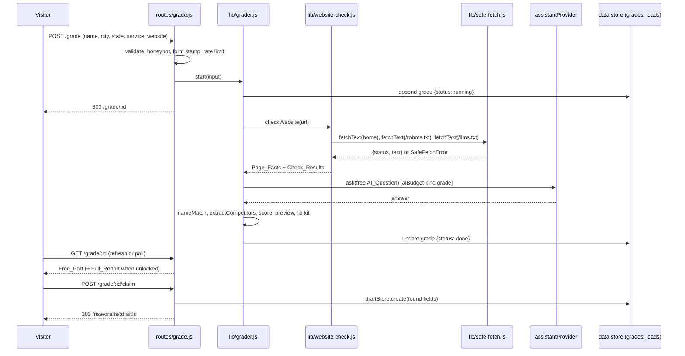

# Design Document: AI Visibility Grader

## Overview

The Grader is a public page, `/grade`, that checks one local business in about two minutes and ends with the fix on screen: the business's free First Answer Pages listing, already filled in from what the scan found. It is built on top of the finished `super-pages` spec and changes none of its behavior.

A Grade has three parts:

1. **Website checks**: fetch the home page, `/robots.txt` and `/llms.txt` safely, read them with built-ins, and score 12 Checks.
2. **AI answers**: ask the existing Assistant_Provider (Claude with web search in production, the mock in tests) "best <service> in <city>", find out whether the business is named, and pull out the competitors that were named instead.
3. **The fix**: a Free_Page_Preview that claims into the existing draft review flow, and a Fix_Kit of copy-and-paste changes for the business's own website.

### Design decisions at a glance

| Question | Decision |
|---|---|
| Where the work runs | In-process, after the redirect. `POST /grade` stores the Grade and starts `runGrade(id)` without awaiting it; the scan page polls. One Render instance, so no job queue. |
| No-JS scan screen | `<meta http-equiv="refresh" content="3">` while `running`. The optional script polls `status.json` once a second and swaps in the report. |
| HTTP client for business websites | `node:http` / `node:https` `request()` with a custom `lookup` function, not global `fetch`. The `lookup` hook checks every resolved address before the socket opens, so the connection can only go to a checked address (no DNS-rebinding gap). Redirects are followed by hand. |
| HTML reading | Hand-written. Elements and comments are removed by `indexOf` scanning (an unclosed tag cuts to the end), because lazy patterns go quadratic on unclosed tags. Attribute and text patterns run only on short, bounded pieces. No parser dependency. |
| AI provider | The existing `ctx.assistantProvider.ask({ prompt, category, businessName })`. No new provider in v1. |
| AI spending | `aiBudget.consume({ kind: 'grade' })`, a new kind with its own daily limit, inside the existing total cap. |
| Lead gate | `GRADER_LEAD_GATE=on` (default). `off` for contest judges and demos. Unlock is a signed cookie per Grade. |
| Secrets | New `GRADER_SECRET` (render.yaml `generateValue: true`) signs the form-start stamp and unlock cookies. If unset, a random per-process key is used and a warning is printed once; unlocks then reset on restart. |
| Storage | Two new collections, `grades` and `leads`, added to the data store allow-list. Same JSON-file writer and retention job as `drafts` and `quotes`. |
| Indexing | Every `/grade` page sends `X-Robots-Tag: noindex, nofollow`; sitemap, llms.txt, MCP and IndexNow never see Grades. One later change, not built until the owner confirms (Requirement 22, "Feature D"): the plain start form and the About page are open to search engines and listed in the sitemap; reports and everything else stay as described here. |
| Dollar figures | None. Every number on the report is measured. |

### Findings from reading the existing code

- `server/lib/assistant.js`: providers expose `ask({ prompt, category, businessName })` and resolve to `{ answer, provider, model, webSearch }`; the Anthropic adapter uses the server-side `web_search` tool with `max_uses: 3`; the OpenAI adapter has no web search. The mock is deterministic.
- `server/lib/seance.js`: `normalizeForMatch` (lowercase, punctuation to spaces, collapse spaces) and `detectNamed(name, answer)` (substring). `runSeance` needs a saved listing, so the Grader calls the provider directly and reuses only `normalizeForMatch`.
- `server/lib/ai-budget.js`: `consume({ kind })` with kinds `photo` and `seance`; photo has its own share; the Seance keeps a quarter of the total.
- `server/lib/rate-limiter.js`: `RULES` table and `consume(key, rule)` returning `{ allowed, retryAfterSeconds }`.
- `server/data.js`: `COLLECTIONS = new Set(['drafts', 'quotes', 'seance', 'pending'])`; `pruneExpired({ quotes, drafts })`.
- `server/lib/drafts.js`: `createDraftStore({ store }).create({ fields, missingFields, provider })` returns `{ status: 201, draft }`. The review page is `/rise/drafts/:id`.
- `server/lib/listing-fields.js`: `normalizePhone`, `normalizeState`, `tidyCity`, `mapCategory`, `validateFields`.
- `server/lib/admin-auth.js`: signed admin cookie with `createHmac`; `requireAdmin` middleware.
- `data/categories.json` has no roofers or HVAC; the Grader's service is free text and maps to a category only when a draft is created (falling back to `other`).

## Architecture



### File layout

| File | Role |
|---|---|
| `server/lib/ip-guard.js` | `isPublicAddress(ip)`: the range list from Requirement 3.2. |
| `server/lib/safe-fetch.js` | `createSafeFetcher({ request, lookup, clock, timeoutMs, maxBytes, maxRedirects, userAgent })` → `fetchText(url)`. |
| `server/lib/page-facts.js` | `readPageFacts(html)` → Page_Facts (also `reviewLinks`, `jsonLd.business.areaServed` and `hasReviewData`); `serviceAreaPattern(city)`. |
| `server/lib/robots.js` | `parseRobots(text)`, `mayFetchRoot(groups, agent)`. |
| `server/lib/grade-checks.js` | `CHECKS` table and `runWebsiteChecks(facts, robots, llms, input)`. |
| `server/lib/name-match.js` | `shortName(name)`, `isNamed(answer, { name, website })`, `extractCompetitors(answer, business)`. |
| `server/lib/grade-score.js` | `scoreGrade(results)`. |
| `server/lib/fix-kit.js` | `suggestedTitle`, `suggestedSummary`, `jsonLdBlock`, `llmsDraft`, `robotsLines`. |
| `server/lib/grader.js` | `createGrader(ctx)`: `start`, `run`, `recheck`, `unlock`, `claim`, `findReusableAi`. |
| `server/lib/grade-html.js` | Form, scan, report, about, admin pages. |
| `server/routes/grade.js` | Public routes. |
| `server/routes/admin.js` | Adds `/admin/grades` and `/admin/leads`. |
| `public/js/grade.js` | Optional: poll `status.json`, copy buttons. |
| `test/fixtures/grade/*.html` | Three saved home pages with personal details replaced. |

### Routes

| Method and path | Purpose | Limits |
|---|---|---|
| `GET /grade` | Form | none |
| `POST /grade` | Validate, start, 303 to report | `grade` 5/hour, `grade-day` 6/day per client (each check can use 3 AI calls and the whole site shares 60 a day; lowered from 20 in review) |
| `GET /grade/about` | What the Grader reads and why | none |
| `GET /grade/:id` | Scan screen or report | none |
| `GET /grade/:id/status.json` | `{ status, steps, done }` for the script | none |
| `POST /grade/:id/unlock` | Lead_Form | `grade-unlock` 5/hour per client |
| `POST /grade/:id/claim` | Create or reuse the Draft | `rise` rule (existing) |
| `POST /grade/:id/recheck` | Website checks again | 1 per 2 minutes per Grade, 10/hour per client |
| `GET /admin/grades`, `GET /admin/leads`, `POST /admin/grades/:id/delete` | Admin | `requireAdmin` |

`/grade/about` is registered before `/grade/:id`. Grade_Ids are 22-character base64url strings; any other `:id` gets 404 without a store read.

## Components and Interfaces

### ip-guard.js

`isPublicAddress(ip: string): boolean`. Uses `net.isIP`. IPv4 is parsed to a 32-bit number; IPv6 is expanded to eight 16-bit groups (handling `::` and an embedded dotted IPv4 tail). Refused ranges:

- IPv4: `0.0.0.0/8`, `10.0.0.0/8`, `100.64.0.0/10`, `127.0.0.0/8`, `169.254.0.0/16`, `172.16.0.0/12`, `192.0.0.0/24`, `192.0.2.0/24`, `192.88.99.0/24`, `192.168.0.0/16`, `198.18.0.0/15`, `198.51.100.0/24`, `203.0.113.0/24`, `224.0.0.0/4`, `240.0.0.0/4` (includes `255.255.255.255`).
- IPv6: a native IPv6 address is public only inside `2000::/3`, minus `2001::/23`, `2001:db8::/32`, `2002::/16` and `3fff::/20`. `::ffff:0:0/96`, `::/96` and `64:ff9b::/96` are judged by their embedded IPv4. Everything else is refused, including site-local `fec0::/10`, unique-local, link-local, multicast, any string containing `%`, and any string the expander cannot parse.

Anything `net.isIP` rejects is not public.

### safe-fetch.js

```js
createSafeFetcher({
  request = { http: http.request, https: https.request },
  lookup = dns.lookup,
  timeoutMs = 10000, maxBytes = 2 * 1024 * 1024, maxRedirects = 5,
  userAgent,
}) => ({ fetchText(url, { accept }) })
```

`fetchText` resolves to `{ status, finalUrl, contentType, text, truncated }` or rejects with `SafeFetchError` whose `code` is one of `bad_url`, `blocked_address`, `timeout`, `too_large`, `too_many_redirects`, `connect_failed`.

1. Parse with `new URL()`. Refuse unless protocol is `http:` or `https:`, `username` and `password` are empty, and the port is empty, `80` or `443`.
2. Read the host from `url.hostname` (never the raw input: WHATWG URL already turns decimal, hex and octal IPv4 into dotted form) and strip `[` and `]`. If `net.isIP` is true for the result, refuse unless `isPublicAddress`.
3. Otherwise resolve the host in `fetchText` with `lookup(host, { all: true })` and refuse with `blocked_address` when the list is empty or any address is not public. Then call `request[protocol](url, { method: 'GET', headers, agent: false, lookup: pinnedLookup, signal })`. `pinnedLookup` never resolves again: it answers `cb(null, [{ address, family }, …])` with the checked list when `opts.all` is set (Node 22 does this by default), and `cb(null, address, family)` otherwise. The socket can only open to a checked address, and TLS still verifies the certificate against the host name.
4. Headers: `User-Agent` (Requirement 3.7), `Accept`, `Accept-Encoding: gzip, deflate, br`. Nothing else.
5. On status 301, 302, 303, 307 or 308 with a `Location`, resolve it against the current URL and repeat from step 1, up to 5 times.
6. Pipe the body through `zlib.createGunzip`, `createInflate` or `createBrotliDecompress` per `Content-Encoding`, count decompressed bytes, and destroy the stream past `maxBytes` (result `truncated: true`, error `too_large` for the home page).
7. One `setTimeout` per fetch covers connect, redirects and body; on expiry the request is destroyed with `timeout`.
8. Decode as UTF-8 (or the `charset` in `Content-Type` when Node supports it through `TextDecoder`, else UTF-8).

The transport and lookup are injectable; tests pass fakes and never open sockets.

### page-facts.js

`readPageFacts(html: string) => PageFacts`

1. Truncate to 2 MiB. Remove `<!-- ... -->` comments.
2. Collect `<script type="application/ld+json">…</script>` bodies (type match case-insensitive, attribute order free) before removing other scripts.
3. Count `<script` tags, then remove `script`, `style`, `noscript`, `template`, `svg` elements by `indexOf` scanning for the open and close tags (no lazy regular expressions).
4. `title`: first `<title>` text. Meta tags: scan every `<meta …>` tag, read its attributes with one attribute pattern (`name`, `property`, `content`, `charset`), and keep `description`, `og:title`, `og:image`, `viewport`.
5. `h1s`: text of each `<h1>…</h1>` with inner tags stripped.
6. Images: every `` tag; missing alt means no `alt` attribute or an empty or whitespace value.
7. `telLinks`: `<a` tags whose `href` starts with `tel:` (case-insensitive, after trimming).
8. `ctaLabels`: inner text of `<a>` and `<button>` elements and `value` of `<input type=submit|button>`, each trimmed and capped at 60 characters.
9. `text`: replace remaining tags with spaces, decode entities (named: `amp lt gt quot apos nbsp ndash mdash rsquo lsquo ldquo rdquo hellip copy reg`; numeric decimal and hex), collapse whitespace.
10. `jsonLd`: for each block, `JSON.parse` in a try; on success, collect `@type` values from the top object, from each item of a top-level array, and from `@graph`; find the first business-typed node (type list below) and read `name`, `telephone`, `address` (string or `PostalAddress`), `openingHours` / `openingHoursSpecification`, `url`. On failure, record `{ unreadable: true }`.
11. `scriptBuilt`: `text.length < 200 && scriptCount > 0`.

Business types: `LocalBusiness`, `Restaurant`, `FoodEstablishment`, `CafeOrCoffeeShop`, `BarOrPub`, `Bakery`, `HomeAndConstructionBusiness`, `RoofingContractor`, `HVACBusiness`, `Plumber`, `Electrician`, `GeneralContractor`, `HousePainter`, `Locksmith`, `MovingCompany`, `AutomotiveBusiness`, `AutoRepair`, `HealthAndBeautyBusiness`, `HairSalon`, `BeautySalon`, `DaySpa`, `LegalService`, `Attorney`, `ProfessionalService`, `FinancialService`, `InsuranceAgency`, `RealEstateAgent`, `Dentist`, `MedicalBusiness`, `Store`, `CleaningService` (non-standard but common), `Organization` only when it also carries `telephone` and `address`.

Patterns used by Checks (all case-insensitive):

- Hours: a day word (`mon|tue|wed|thu|fri|sat|sun` and full names) within 40 characters of a time (`\d{1,2}(:\d{2})?\s?(am|pm|a\.m\.|p\.m\.)`), or a time range (`<time> (-|–|to) <time>`), or `24/7`, `open 24 hours`.
- Street address: `\b\d{1,6}\s+(?:[A-Za-z0-9.'-]+\s){0,4}(St|Street|Ave|Avenue|Rd|Road|Blvd|Boulevard|Dr|Drive|Ln|Lane|Way|Ct|Court|Pkwy|Parkway|Pike|Hwy|Highway|Cir|Circle|Pl|Place|Ter|Terrace)\b`.
- Call to action (whole words): `call`, `book`, `schedule`, `quote`, `estimate`, `order`, `reserve`, `reservation`, `appointment`, `get started`.
- City and service in the title: the normalized title contains the normalized city, and at least one service word of 4 or more letters (or its singular, by dropping a trailing `s`).

### robots.js

`parseRobots(text) => Group[]` where `Group = { agents: string[], rules: { allow: boolean, path: string }[] }`. Lines split on `\r?\n`, `#` comments removed, `field: value` split at the first colon, field compared case-insensitively. A `User-agent` line after rules starts a new group; consecutive `User-agent` lines share a group.

`mayFetchRoot(groups, agent)`: pick the group whose agents include `agent` (case-insensitive exact token), else the group with `*`, else allow. Among that group's rules whose path is a prefix of `/` (`/` itself, `/*`, or empty `Disallow`, which allows), the longest path wins; on a tie `Allow` wins; an empty `Disallow:` value means allow all.

### name-match.js

- `shortName(name)`: normalize with `normalizeForMatch`, drop a leading `the`, drop trailing legal words (`llc`, `l l c`, `inc`, `incorporated`, `co`, `company`, `corp`, `corporation`, `ltd`, `pllc`, `pc`, `lp`), trimmed. Returned only when it has at least 2 words or 6 characters; else `null`.
- `registeredDomain(website)`: host without `www.`, cut to the last two labels (three when the second-to-last is a known two-letter public suffix such as `co.uk`, from a short fixed list).
- `isNamed(answer, { name, website })`: true when the normalized answer contains the normalized name, the short name, or the registered domain (matched on the raw lowercased answer, since normalizing would split the dot).
- `extractCompetitors(answer, business)`: read lines matching `^\s*(\d+[.)]|[-*•])\s+` and every `**…**` span; for each, strip markdown, take the text before the first separator (` - `, ` – `, ` — `, `:`, `(`, ` | `), trim, keep names of 2 to 60 characters that start with a letter or digit, drop ones `isNamed` matches to the business, de-duplicate on normalized form, keep the first 5.

### grade-checks.js

```js
CHECKS = [
  { id: 'ai-bots-allowed',    group: 'ai_readable',     points: 8 },
  { id: 'business-labeled',   group: 'ai_readable',     points: 8 },
  { id: 'info-sheet',         group: 'ai_readable',     points: 4 },
  { id: 'title-city-service', group: 'search_basics',   points: 7 },
  { id: 'one-headline',       group: 'search_basics',   points: 4 },
  { id: 'summary',            group: 'search_basics',   points: 4 },
  { id: 'image-descriptions', group: 'search_basics',   points: 3 },
  { id: 'share-picture',      group: 'search_basics',   points: 2 },
  { id: 'tap-to-call',        group: 'customer_basics', points: 4 },   // was 5; see "Owner-approved features"
  { id: 'hours-shown',        group: 'customer_basics', points: 3 },   // was 4
  { id: 'address-shown',      group: 'customer_basics', points: 3 },   // unchanged; worded as a service-area Check when noStorefront
  { id: 'call-button',        group: 'customer_basics', points: 2 },   // was 3
  { id: 'reviews-visible',    group: 'customer_basics', points: 3 },   // new
  { id: 'ai-named',           group: 'ai_answers',      points: 30 },
  { id: 'google-profile',     group: 'google_profile',  points: 15 },
]
```

Group totals: ai_answers 30, ai_readable 20, search_basics 20, customer_basics 15, google_profile 15 = 100. Each entry also has `label` (plain name), `passText`, `failText` (detail), and `fix` (at most 160 characters). Example fixes:

- `ai-bots-allowed`: "Your website tells some AI assistants to stay out. Add the lines in your fix kit to robots.txt so they can read it."
- `business-labeled`: "Add the business label block from your fix kit to your home page so AI can read your name and phone."
- `title-city-service`: "Change your page title to the one in your fix kit so it says what you do and where."
- `tap-to-call`: "Make your phone number a tap-to-call link so people on phones can call you in one tap."

Text-based Checks (`title-city-service` excepted, since the title is not page text) are `not_checked` when `scriptBuilt` is true.

### grade-score.js

`scoreGrade(results) => { score, earned, available, failed, counted, byGroup }`. `ai-named` contributes `earnedPoints` from Requirement 8.1 (it carries `earned` on its result); every other `pass` contributes its full points and `fail` contributes 0. `score = available >= 40 ? Math.round(100 * earned / available) : null`. `failed` counts `fail` results; `counted` counts `pass` plus `fail`.

### fix-kit.js

- `suggestedTitle({ name, service, city, state })`: try `name | Service in City, ST`; if over 60, try `name | Service in City`; then drop whole words from the end of the service; then `name | City`; finally the name cut at a word boundary to 60.
- `suggestedSummary(...)`: "<Name>: <service> in <City>, <ST>. Call <phone> today." with the phone part only when found, followed by "Serving <City> and nearby areas." when it fits, cut at a word boundary to 160.
- `jsonLdBlock(found)`: `{ "@context": "https://schema.org", "@type": "LocalBusiness", name, telephone?, url?, address?, openingHours?, areaServed: city }`, `JSON.stringify(…, null, 2)` with `<` replaced by `\u003c`, wrapped in `<script type="application/ld+json">`.
- `llmsDraft(found)`: Markdown: `# <Name>`, a one-line summary, then `- Service:`, `- Area:`, `- Phone:`, `- Website:`, `- Hours:` lines for found fields.
- `robotsLines(blockedAgents)`: one `User-agent: <agent>` plus `Allow: /` group per blocked agent.

### grader.js

`createGrader({ store, assistantProvider, aiBudget, safeFetcher, notifier, clock, newId, config })`:

- `start(input)`: normalize input, create the Grade (`running`, steps `[]`), look for a reusable AI result (Requirement 14.3), then `queueMicrotask(() => run(id))` and return the id. Running promises are kept in a `Map` so a second `run` for the same id is ignored.
- `run(id)`: website steps (with a 30 s overall budget through `AbortSignal.timeout`), then the free AI_Question (skipped when reused), then preview and fix kit, then `done`. Each step appends `{ name, state, ms }` to `steps` through `store.collection('grades').update`.
- `askAi(grade, prompt)`: `aiBudget.consume({ kind: 'grade' })` first; refused means `not_checked` ("AI check limit reached for today"). Then `assistantProvider.ask({ prompt, category: mapped category or '', businessName: input.name })` with a 120 s `Promise.race` timeout. Stores `{ prompt, provider, model, webSearch, answer (cut to 4,000 code points), named, competitors, ms, at }`.
- `unlock(id, lead)`: store the Lead, run the two extra questions in the background, recompute the Score.
- `claim(id)`: build fields from the found facts, call `draftStore.create`, store `draftId`.
- `recheck(id)`: re-run website steps only; keep `previousScore`.
- `isStale(grade, now)`: `running` and older than 4 minutes.

### Unlock cookie and form stamp

- Form stamp: hidden field `t = <ms>.<hmac(secret, 'form:' + ms)>`. Accepted when the HMAC matches, the age is at least 3 s and at most 2 hours.
- Unlock cookie: name `g_<id>`, value `hmac(secret, 'unlock:' + id)`, `HttpOnly`, `SameSite=Lax`, `Secure` in production, `Path=/grade/<id>`, `Max-Age` 90 days. Checked with `timingSafeEqual`.

### AI_Budget change

`consume({ kind })` gains `'grade'`. New state `grade` counted per Chicago day like `photo`. Rules: blocked when `total >= cap`, or when `kind === 'grade'` and `grade >= gradeCap`, or when `kind` is `photo` or `grade` and `photo + grade >= cap - ceil(cap / 4)`. `gradeCap = GRADE_AI_CALLS_PER_DAY` (default 60, at least 0). The persisted file gains a `grade` count; files without it load as 0.

### Notifier change

Today a notifier is `{ name, notify({ quote, listing }) }`. Each implementation gains `notifyLead({ business, score, reportUrl, lead })`. Only the Resend email to the admin includes the visitor's name, phone and email; the mock and console notifiers never print them:

- mock: records the call in memory;
- console: prints one line with the business name, score and link;
- none: does nothing;
- Resend: emails `ADMIN_EMAIL` only (never a business owner) with the subject "New grader lead: <business>" and the report link; and the visitor's name, phone and email, so the admin can follow up right away.

`notifyLead` never throws, matching `notify`.

### Retention change

`pruneExpired` gains `grades` and `leads` options; both drop records whose `createdAt` is more than 90 days old. Records with a missing or invalid `createdAt` are kept, matching the quotes rule.

## Implementation notes from the code review

These were checked against the code and on Node 22, and they are part of the design.

- **Assistant call.** The real interface is `ask({ prompt, signal, category, businessName, consumeExtra })`, and the result may include `sources`. Pass `signal: AbortSignal.timeout(120000)` and `consumeExtra: () => aiBudget.consume({ kind: 'grade' }).allowed === true`, so a continued call is counted. Like the Seance, do not consume budget for the mock. In production with the mock in use, record `ai-named` as `not_checked` ("AI check isn't connected") and show no demo answer.
- **Background work.** Every background promise (`run`, the extra questions, recheck) ends in a `.catch` that logs the Grade_Id only. Node 22 exits on an unhandled rejection.
- **Budget file.** Write `grade` to the budget file only when it is above 0, so existing files and tests stay byte-identical.
- **Retention.** `pruneExpired` gains `grades` and `leads` options that default to false, and returns their counts only when asked. The startup call becomes `pruneExpired({ grades: true, leads: true })`, and `grader.start()` calls `pruneExpired({ quotes: false, drafts: false, grades: true, leads: true })`. Pruning runs at startup and on new records; there is no timer.
- **Grade ids.** A new `newGradeId` dependency (default `randomBytes(16).toString('base64url')`); `ctx.newId` is not used for Grades. New `createApp` deps: `safeFetcher`, `newGradeId`.
- **Layout.** `layout()` gains an optional `head` string that defaults to empty and leaves existing output byte-identical. The scan page's refresh tag goes inside `<noscript>` in the head, so pages with JavaScript poll instead of reloading.
- **Recheck.** A recheck never sets `status: 'running'`; it uses a separate `recheckRunning` flag, so `isStale` cannot fail an old Grade. Rate rules: `grade-recheck` (10 per hour per client) and `grade-recheck-grade` (1 per 2 minutes per Grade). `grade` and `grade-day` are consumed together with `consumeAll`.
- **Claim.** The draft review page shows the owner's email, so a Draft is reused only when the same browser holds a signed `gc_<id>` cookie set at claim time; any other visitor gets a new Draft. Fields go through `validateFields(fields, categories)` as `/rise/manual` does; hours are `{ monday: '…' }` style or left out; `website` is not a listing field and is dropped; the Draft's provider is `'grader'`, added to the admin page's provider labels.
- **Name matching.** Match on normalized text padded with spaces, so "ace plumbing" does not match "space plumbing". `shortName` returns null when every remaining word is a service, city, state or generic word (for example "roofing"). The domain is matched in normalized form ("billragan com"). `isNamed` also returns the business's `position` in the extracted list when it has one.
- **Fix kit.** The summary has no minimum length. The title may hard-cut a single word longer than 60, and lengths count code points.
- **Smaller points.** Store `extraAiStartedAt` before the extra questions start, so repeated views cannot start them twice. Call `notifyLead` only when it exists, inside try/catch with a timeout. Serve `status.json` for running Grades from memory. Add grader leads (kept 90 days) to `/privacy`. Robots groups naming the same agent are merged. Text-based Checks are `one-headline`, `hours-shown`, `address-shown`, `call-button` and `reviews-visible`. The wording ban test uses `/\bYP\b/`, since a plain substring check matches `<!DOCTYPE`.

## Owner-approved features (Nov 18)

Requirements 18 to 22. The features are for every small business, not one client: a business that goes to its customers (A), a business whose reviews live only inside Google (B), a listing that links to the business's own site (C) and, once the owner confirms, search engines finding the main pages (D). Nothing here changes a Grade made without the new checkbox, except that the report gains one Check (`reviews-visible`).

### Feature A: No storefront (Requirement 18)

**Form and input.** `grade-html.js` `gradeFormPage` gains one checkbox after the website field: `<input type="checkbox" id="g-nostorefront" name="noStorefront" value="1">` with the label "We go to our customers (no storefront)" and, in the hint style, "Check this box if you go to your customers and don't show a street address." `routes/grade.js` normalizes `noStorefront` to `true` only when the value is exactly `'1'` (or `'on'`); the normalized input gets `noStorefront: true` only then, and no key otherwise. A 422 re-render keeps the box as typed; the failed page's "Start again" form carries it as a hidden field. The reuse `key` (Requirement 14.3) is unchanged: the AI answers do not depend on the box. The value is never logged (logs hold only the Grade_Id, step names, counts and timings).

**The check.** `address-shown` keeps its id, group and points. `CHECKS` entries may carry `serviceArea: { label, passText, failText, fix }`. `checkById(id, input)` (input optional) returns the entry with that variant merged in when `input.noStorefront` is true; every place that shows a label, detail or fix (report rows, "Fix these first", full report) passes the Grade's input. Variant text:

- label: "Service area on your home page"
- passText: "Your home page says what area you serve."
- failText: "We found no service area on your home page."
- fix: a function of the Grade's input, `fix(input)`: `Add a line to your home page that names the area you serve, like "Serving <city> and nearby areas".` with `<city>` the Grade's own city (stored as typed, escaped when shown) or "your city" when it is empty. WHEN the sentence is longer than 160 code points, the example is dropped and the fix is `Add a line to your home page that names the area you serve.`; words are never cut. `checkById(id, input)` calls it, so the variant's `fix` is a string in the merged entry.

`runWebsiteChecks({ facts, robots, llms, input })` already receives `input`; with `input.noStorefront` it judges `address-shown` with `SERVICE_AREA_PATTERN.test(facts.text)` or `Boolean(facts.jsonLd.business?.areaServed)`, and otherwise as today (`STREET_PATTERN`). It stays a text-based Check (`not_checked` when `scriptBuilt`, "No website given" and "We couldn't reach your website." as today).

`serviceAreaPattern(city)` is exported from `page-facts.js` and built per Grade. It is matched against `normalizeForMatch(facts.text)` (punctuation gone, lower case), so the city is normalized the same way (`normalizeForMatch(city)`: "St. Louis" becomes "st louis") and then escaped character by character for use in a regular expression (`s.replace(/[.*+?^${}()|[\]\\]/g, '\\$&')`). An empty or all-punctuation city after normalizing has no city alternative at all (never an empty alternative, which would match everywhere). Building and running it never throws. It matches any of:

- `service areas?`;
- `areas? we serve`;
- `we serve`, `we proudly serve` or `serving`, followed within 80 characters (`[^\n]{0,80}`) by the city name or one of `area`, `areas`, `county`, `counties`, `surrounding`, `nearby`, `communities`;
- the city name followed by `and (the )?(surrounding|nearby|neighboring) (areas?|communities|towns|cities|counties)`.

"We serve breakfast all day" and a bare "serving biscuits" do not match. Unticked Grades never use this pattern (the restaurant fixture contains "serving" and must keep its result). Only bounded windows are used (no open-ended or lazy matching), and a 1 MB page is read in well under the 200 ms limit.

**Business label reading.** `readPageFacts` adds `areaServed` (text) to the first business node: a string, an object with `name`, or an array of those, joined with ", ", cut to 120 characters; empty string when absent. The key is added to the node object only; existing assertions on `name`, `telephone` and `address` are unaffected.

**Preview.** `previewCard(grade)`: when `grade.input.noStorefront`, the address line is `<p>Serves the <city> area</p>` (escaped) and the "Add your address" blank is never shown, even when `found.address` is set. Otherwise unchanged.

**Fix kit.** `jsonLdBlock(found)` gains `found.noStorefront`. When true: `areaServed` is `"<City>, <ST>"` (city alone when the state is empty), and `address` is left out entirely. Otherwise unchanged (`areaServed: city`, address as today). `grade-html.js` passes `noStorefront` from the Grade into the kit. The summary and llms draft never print an address, so they do not change; the summary's "Serving <City> and nearby areas." already fits.

**Claim.** `grader.claim(id)` builds the Draft fields; when `grade.input.noStorefront`: `address: ''` and `serviceArea: \`${city} and nearby areas\``, passed through `validateFields` as today. `address` is optional and `serviceArea` is non-empty, so neither is in `missingFields`. In the unticked case the existing values stay (`serviceArea: city`, `address: found.address`).

**Listing pages.** Checked in the existing code: `html.js` `listingDetail` already shows "City" in place of "Address" when `listing.address` is empty and always shows "Service area"; `schema.js` already leaves out `streetAddress` and keeps `addressLocality`, `addressRegion` and `areaServed` for a listing with no address (`test/schema-rich.test.js` covers it). So no change to those files; one example test renders a claimed no-storefront Draft's listing and checks both.

### Feature B: Reviews AI can see (Requirement 19)

**Page reading.** `readPageFacts` gains:

- `reviewLinks`: the `href` of each `<a>` (after trimming, `https` only) that passes `reviewsLinkHost(href)` (below); at most 5, in page order.
- `jsonLd.business.hasReviewData`: true when the first business node has a non-empty `aggregateRating` or `review` value.

`readPageFacts` also gains `headings`: the text of every `<h1>`, `<h2>` and `<h3>` (each cut to 120 characters, at most 40 headings), collected with the same `indexOf` scanning as `h1s`. Reading never throws and stays within 200 ms for 2 MiB.

Review signals read from the page (case-insensitive; every pattern uses bounded windows such as `[^\n]{0,80}`, never open-ended or lazy matching):

- **Heading words.** `REVIEW_HEADING_PATTERN` is tested against each entry of `facts.headings`, not against the page text: `\b(reviews|testimonials)\b`, or `what (our |my )?(customers|clients|neighbors) (say|are saying)`. A page whose only "Reviews" is a link or menu item does not pass, because link text is not in `headings`: heading text that sits inside an `<a>` element, or in an `<h1>` to `<h3>` that is itself inside a `<nav>` element, is left out when `headings` is built.
- **Rating written out.** `\b[1-5](\.\d)?\s*stars?\b`, `\b[1-5](\.\d)?\s*out of\s*5\b`, a decimal before the slash: `\b[1-5]\.\d\s?\/\s?5\b`, or `[★⭐]{3,}`. A slash form without a decimal ("Closed 1/5", "Open 9/5") never counts.
- **Quoted comment with a name.** A quote of 20 to 400 characters in straight or curly quotes, followed within 40 characters by a dash and a capitalized name (`"…" - Dana R.`, `“…” — Mike T., Mar 2026`).

`reviewLinks` are read as the design's link rules say below (Reviews link on the listing): a Facebook link counts only when its path contains `/reviews`, a Nextdoor link only when its path starts with `/pages/`, and `search.google.com/local/writereview` never counts.

`reviews-visible` passes when a heading matches `REVIEW_HEADING_PATTERN`, or a rating or quoted comment is found in `facts.text`, or `facts.reviewLinks.length > 0`, or `facts.jsonLd.business?.hasReviewData`. Otherwise it fails. It is text-based (`not_checked` when `scriptBuilt`). A page can have a review link and no readable text; that still passes, since AI can follow the link. A page whose only signal is a footer link to a Facebook page, a "Reviews" menu link or a Google `writereview` form fails.

Fail detail: "We found no customer reviews on your home page. AI assistants often can't see reviews that are only inside Google." Pass detail: "Your home page shows customer reviews that AI can read." Fix (147 characters): "Put 3 or more of your real customer reviews on your home page, with each customer's first name and the date, and add a link to your Google reviews." The fix kit is unchanged by this Check: it adds no review text and no `aggregateRating` or `review` to the business label, so nothing is ever invented.

**Point split for Customer basics** (the group stays 15, the Checks stay 100, and the points available for a readable Grade stay 85 before `google-profile`):

| Check | Old | New | Why |
|---|---|---|---|
| `tap-to-call` | 5 | 4 | gives up 1 point |
| `hours-shown` | 4 | 3 | gives up 1 point |
| `address-shown` | 3 | 3 | unchanged, so "same points as the address check" holds for the service-area mode |
| `call-button` | 3 | 2 | gives up 1 point |
| `reviews-visible` | none | 3 | the new Check takes the 3 points the others gave up |

Three Checks give up one point each rather than one Check giving up three, so no single basic is cut by more than a quarter. A Grade that passes all five still earns 15.

**Old Grades: one rule (Requirement 19.8 and 19.9).** The code today mixes stored and computed numbers: `runExtraQuestions` in `grader.js` recomputes `g.score` with the current points the first time the extra questions run, the Check rows (`checkRow`) use the current points, and "Score by area" (`groupLines`) reads the stored `byGroup`. So the rule is that nothing is shown from a stored Score: `reportPage` works out `scoreGrade(grade.results)` once per render (the result list holds each `ai-named` result's `earned`, so it is complete) and uses it for the headline number, the "<failed> of <counted> checks need work" line, the "Score by area" lines and the Check rows. The stored `grade.score` is still written when a Grade finishes, is recomputed, or is rechecked, and is what the admin list and the lead notice read; it is never used to draw the report. A Grade stored without `reviews-visible` simply does not count that Check: an old restaurant Grade (33 of 82) shows 40 in the headline, the area lines and the rows, before and after the extra questions run. Code that looks up a Check by id tolerates a missing result.

The "Your score was <before> before. It is <now> now." line is shown only when `previousScore` is a number and the Grade's current results include `reviews-visible`. `recheck` stores `previousScore` only when the results before the Recheck already included `reviews-visible`; otherwise it stores `null`. So the report never compares scores across the change in points, and an unchanged old site does not read "42 before, 39 now".

### Reviews link on the listing (Requirement 20)

**Two validators, one list of hosts.** Both are exported from `server/lib/listing-fields.js`.

- `reviewsLinkHost(url)` judges what an owner types. It returns `'google' | 'yelp' | 'facebook' | 'nextdoor'` or `''`. It parses with `new URL()`; requires `protocol === 'https:'`, empty `username`, `password` and `port`, and a total length of 300 or fewer (query string and `#` part included, and kept); and a host (after removing a leading `www.` or `m.`) of: `google.com` with pathname starting `/maps`, or pathname `/search` when the hash contains `lrd=` or the query contains `ludocid=`; `maps.google.com` with any path; `g.co` with pathname starting `/kgs/`; `g.page`; `maps.app.goo.gl`; `search.google.com` with pathname starting `/local`; `yelp.com` with pathname starting `/biz`; `facebook.com` with any path; `nextdoor.com` with any path. `https://www.google.com/search?q=plumbers` returns `''`.
- `reviewsLinkOnPage(url)` judges links read from a home page, for the Check and the claim fill. It calls `reviewsLinkHost` first, then is stricter: Facebook only when the pathname contains `/reviews`; Nextdoor only when the pathname starts with `/pages/`; and any `search.google.com/local/writereview` address returns `''`. A footer link such as `https://www.facebook.com/CapitalCityWindow` returns `''`.

`page-facts.js` uses `reviewsLinkOnPage` to build `reviewLinks`; `validateFields` uses `reviewsLinkHost`. The claim picks from `found.reviewsLink` (see Claim), which the scan fills with the best page link: a Google link first, then Yelp, then Facebook or Nextdoor, in page order within each kind.

**Listing field.** `normalizeFields` keeps `reviewsLink` only when `reviewsLinkHost` accepts it; the key is added to the result only when it has a value. This keeps every existing assertion on the field set valid (`test/listing-fields.test.js` allows only its model keys and passes random input that never contains this one), keeps `validateFields` idempotent, and keeps `{}` drafts as `{}`. The field is never in `missingFields`. `fieldsFromForm` in `routes/rise.js` and the draft form in `rise-html.js` gain a "Reviews link (optional)" input with the hint "A link to your reviews on Google, Yelp, Facebook or Nextdoor." When the submitted value is not empty and was left out, the review page shows "We left that link out. It must be an https link to your reviews on Google, Yelp, Facebook or Nextdoor." The admin Draft page adds a "Reviews link" row only when present.

**Listing page.** `listingDetail` in `html.js` adds, after the Service area row and only when `listing.reviewsLink` passes `reviewsLinkHost` again (defense in depth for hand-edited data): `<dt>Reviews</dt><dd><a href="…" rel="noopener noreferrer">See our reviews on Google</a></dd>`, with the label from the host and everything escaped. No rating, no count, no review text. Listings without the field render byte-for-byte as today.

**Machine-readable outputs (Requirements 20.6 and 21.7).** Checked in the code: `publicListing` copies every key except `ownerEmail`, so `/api/listings/:id` and the MCP `get_listing` tool return `reviewsLink` and `website` with no change. Four places need code, and each adds its line only when the field has a value, so a listing without them produces byte-for-byte the output it does today (the line-count properties in `test/llms.test.js` and the model-key check in `test/listing-fields.test.js` hold only then):

- `llms.js` (the listing block, near the `Service Area:` line): `Website: <url>` and `Reviews: <url>` lines;
- the MCP `summarize` text in `mcp.js`: the website and the reviews link as links labeled "Website" and "Reviews";
- `schema.js`: `sameAs` is an array of the website and the reviews link that are present, added to the business label only when the array is not empty; `url` stays the listing page;
- `html.js` `listingDetail`: the two rows above.

No page, file or tool shows a star rating, a review count or review text.

**Publishing.** `server/data.js` `buildListing` copies only the keys in its own `MODEL_KEYS` list, so a Draft's `reviewsLink` and `website` would be dropped when a Draft is approved. Add both keys there and copy each only when it is a non-empty string (the way `address` is handled), so a listing without them gains no key. The admin approval route and the draft submit route already pass fields through `validateFields`, which keeps the two fields.

**Claim.** `grader.claim(id)` sets `reviewsLink` from `found.reviewsLink`. The scan sets `found.reviewsLink` to the best link from the page's `reviewLinks` (a Google link first, then Yelp, then Facebook or Nextdoor), run through `reviewsLinkOnPage` and, again at claim time, `reviewsLinkHost`; it is an empty string when none. The claim does not need the page again, and `foundOf` returns `''` for old Grades. It is never read from an AI answer.

### Feature C: The business's own website on the listing (Requirement 21)

**Validator.** `normalizeWebsite(url)` is exported from `server/lib/listing-fields.js` and returns the cleaned address or `''`. It never throws and does no network lookup. It parses with `new URL()` after trimming and refuses, in this order: a value over 600 characters before parsing; a protocol other than `https:`; a non-empty `username` or `password`; a non-empty `port` (WHATWG parsing already drops a default `:443`, so `https://example.com:443/` is accepted as `https://example.com/` while `:8443` is refused); a host that `net.isIP` accepts after the brackets are stripped (every IPv4 and IPv6 address, public or not: a business's own site has a name); the host `localhost` or a name ending in `.localhost`; and a host with no dot. A valid value is rebuilt as `https://<host><pathname>`, with the query string and the `#` part dropped (so login and tracking parameters are never kept), and refused when that is longer than 300 characters. The existing public-address rules (`ip-guard.js`) are not needed here, since every IP literal is refused; the grader's safe fetcher is not involved.

**Listing field.** `normalizeFields` adds `website` only when `normalizeWebsite` returns a value (same pattern as `reviewsLink`): the key is absent otherwise, so the model-key and idempotence checks in `test/listing-fields.test.js` hold, and `{}` drafts stay `{}`. It is never in `missingFields`. `fieldsFromForm` in `routes/rise.js` reads `website`; the draft form (`rise-html.js`) and the Draft review page add a "Website (optional)" input with the hint "The address of your own website, like https://example.com"; when a non-empty value was left out, the page says "We left that link out. It must be a public https address, like https://example.com." The admin Draft page adds a "Website" row only when present. `server/data.js` `MODEL_KEYS` gains `website` (see Publishing above).

**Output.** `listingDetail` adds `<dt>Website</dt><dd><a href="…" rel="noopener noreferrer">example.com</a></dd>` (host without `www.` as the text, everything escaped, nothing when empty); `schema.js` adds the `sameAs` array as described above; `llms.js` and the MCP `summarize` add the link when present.

**Claim.** `grader.claim(id)` sets `website` to `normalizeWebsite(grade.input.website)` (empty when the owner gave none). The existing implementation note that "`website` is not a listing field and is dropped" no longer holds for this one key; every other key stays as it is.

### Feature D: Let Google and Bing find the main pages (Requirement 22) — specified, not to be built until the owner confirms

**What exists today.** `sitemap.xml` lists the home page, category pages that have live listings, and listings. `/about` and `/privacy` are served by `routes/pages.js`; `/verified` by `routes/verify.js`; `GET /rise` by `routes/rise.js` (only `/rise/drafts` is noindex). Every `/grade` response gets `X-Robots-Tag: noindex, nofollow` from one middleware in `routes/grade.js`, and the page shell adds the matching meta tag.

**Sitemap.** `generateSitemap(listings, baseUrl, categories, extraPages = [])` gains an optional fourth argument, a list of paths. The route passes `['/about', '/verified', '/privacy', '/rise']` plus `['/grade', '/grade/about']` when `config.graderEnabled !== false`, and passes none when `config.demoMode` is on (DEMO_MODE marks every page noindex). The default is an empty list, so `test/sitemap.test.js` ("URL count equals listing count plus one") and every other existing call keep their output. Each path is written as `<baseUrl><path>` with the existing escaping. To keep "only pages that return 200 and are not noindex" true as pages change, one example test requests each listed path through the app and checks status 200 and no `X-Robots-Tag: noindex`.

**Two open `/grade` pages.** The header middleware in `routes/grade.js` decides per request: when the method is GET, the path is exactly `/grade` (or `/grade/`) or `/grade/about`, and there is no query string, it sets `Referrer-Policy: no-referrer` and `Cache-Control: no-store` only; for everything else it sets the headers it sets today. The pages pass `indexable: true` to the page shell, which then leaves out the robots meta tag and adds a canonical link (`<base>/grade`, `<base>/grade/about`) and a `description`. `gradeFormPage` takes `indexable` and uses it only for the plain first render: the 422 re-render with errors, the honeypot or stamp refusals and every other caller leave it off, so they keep `noindex, nofollow`. `aboutPage` takes the same option. Titles and summaries: form "Does AI know your business? Free check" with "Find out whether AI assistants name your business when someone asks for one like it. Free, no sign-up."; about "About the AI Visibility Check" with a one-sentence summary of what the check reads. Both texts follow the wording rules (no promise that AI will name a business, no dollar figure).

**Unchanged.** Rate limits, the AI budget, the stamp and honeypot, `GRADER_ENABLED=off` (every `/grade` path is a 404 with `noindex, nofollow`), `llms.txt`, the MCP tools and IndexNow (Grades and reports never appear). Requirement 9.6 is amended as written there.

**Existing tests that pin the old rule** (changed only when Feature D is built, each with its reason):

| Where | Old | New | Why |
|---|---|---|---|
| `test/grade-flow.test.js`, "every /grade page is not indexed and sends no referrer": the list `['/grade', '/grade/about', …]` | all five paths must send `noindex, nofollow` and carry the robots meta tag | `/grade` and `/grade/about` leave the list (they get their own new test); the report, status JSON and `/grade/nope` stay, and a form shown again with errors and a request with a query string are added | Requirement 22.2 opens exactly those two pages |
| same file, "/grade stays out of sitemap.xml and llms.txt…": `sitemap.xml` `includes('/grade')` is `false` | no `/grade` text in the sitemap | the sitemap lists `/grade` and `/grade/about` and no report address (no `/grade/` followed by a 22-character id); the `llms.txt` assertion is unchanged | Requirement 22.1 and 22.2 |

Checked and unchanged: `test/sitemap.test.js` (the new argument defaults to empty), `test/production-samples.test.js` (no `/listings/` text, home page present), `test/polish.test.js` (every address starts with the origin), `test/public-pages.test.js`, `test/approval.test.js` (it reads listing ids from the sitemap by their `/listings/` path), `test/demo-mode.test.js` (in demo mode no extra pages are listed).

### Numbers that change in existing tests (and why)

Nothing else moves. Each line is a place where a new requirement changes a number or an input, and the reason:

| Where | Old | New | Why |
|---|---|---|---|
| `test/grade-checks.test.js`, "the checks add up to 100 points…": `CHECKS.length` | 14 | 15 | one new Check (`reviews-visible`) |
| same test: size of the id set | 14 | 15 | same |
| same test: points total | 100 | 100 | unchanged: the five basics still total 15 |
| `test/grade-checks.test.js`, "a well set up site passes every website check": `Object.keys(r).length` | 13 | 14 | one new website Check |
| same test: the `goodHtml` input | no review signal | adds one quoted comment with a name and a link to a Google reviews page | the test says every website Check passes, so its page must show reviews; no other line of the page changes |
| `test/fixtures/grade/expected.json`, every fixture: `results` | 13 entries | adds `"reviews-visible"` | one new Check |
| fixture `restaurant`: `score` / `failed` / `counted` | 42 / 5 / 13 | 39 / 6 / 14 | earned 36 becomes 33 (basics now 4 + 3 + 3 + 2 = 12, was 15) and `reviews-visible` fails (no review text on the page, searched); 33 of 85 rounds to 39 |
| fixture `roofer`: `score` / `failed` / `counted` | 21 / 8 / 13 | 19 / 9 / 14 | earned 18 becomes 16 (`hours-shown` 3, `call-button` 2) and `reviews-visible` fails; 16 of 85 rounds to 19 |
| fixture `largeCompany`: `score` / `failed` / `counted` | 65 / 1 / 13 | 65 / 1 / 14 | `large-company.html` gains a short review block (three quoted customer comments with first names and dates, and a link to a Google reviews page), so `reviews-visible` passes and earned stays 55 of 85; only `counted` changes |
| `test/fixtures/grade/large-company.html` | no reviews | adds the review block | as above; it adds no `<h1>`, ``, `tel:` link or JSON-LD block and no day-and-time or street-address wording, so every other expected fact keeps its value |

Checked and unchanged: `test/grade-score.test.js` (it uses `ai-named` 30, `business-labeled` 8 and `info-sheet` 4, and a point total of 100); `test/grade-flow.test.js` "a stub AI that names the business" (the large-company fixture passes every Check, so the Score is still 100); `test/grade-lead.test.js` and `test/grade-review-fixes.test.js` (they read scores from the fixtures or the stored Grade); `test/design.test.js` (counts passed in); the roofer and restaurant fixture HTML files (no review signal, confirmed by searching them for "review", "testimonial", "rating", "stars" and review-site links; the restaurant page contains the word "serving", which only matters when the box is ticked).

## Data Models

```js
// grades.json item
{
  id: 'q8Zr0…22 chars',
  status: 'running' | 'done' | 'failed',
  input: { name, city, state, service, website: 'https://…/' | null, noStorefront?: true },   // noStorefront only when ticked
  key: 'normalized name|city|state|service|registered domain or -',   // reuse lookup
  createdAt: ISO, finishedAt: ISO | null,
  steps: [{ name, state: 'done' | 'skipped' | 'failed', ms }],
  facts: { title, metaDescription, ogImage: boolean, h1s: [...], phone, hours, address, reviewsLink, jsonLdTypes: [...] } | null,   // reviewsLink: '' when the page has no Review_Site link; current Grades keep it in `found`, like phone, hours and address
  results: [{ id, result: 'pass' | 'fail' | 'not_checked', detail, earned? }],
  ai: [{ prompt, provider, model, webSearch, answer, named, competitors: [...], ms, at, reusedFrom? }],
  score: { score, earned, available, failed, counted }, previousScore: number | null,
  draftId: null | 'draft id', recheckedAt: ISO | null
}

// leads.json item
{ id, gradeId, business: 'name', name, email, phone, okToContact: boolean, score: number | null, createdAt: ISO }
```

Business facts kept on a Grade are only what the business published on its own website. Visitor details live only in `leads`.

## Configuration

| Variable | Default | Meaning |
|---|---|---|
| `GRADER_ENABLED` | `on` | `off` hides `/grade` (404) and the home-page link. |
| `GRADER_LEAD_GATE` | `on` | `off` shows the Full_Report to everyone. |
| `GRADE_AI_CALLS_PER_DAY` | `60` | Grader share of the daily AI cap. |
| `GRADER_SECRET` | none | Signs form stamps and unlock cookies. render.yaml: `generateValue: true`. |

## Correctness Properties

### Property 1: Public-address test matches the range table

*For any* IPv4 address, and *for any* IPv6 address including IPv4-mapped, IPv4-compatible and NAT64 forms, `isPublicAddress` returns false exactly when the address falls in a refused range, judged by an independent bit-mask oracle in the test.

**Validates: Requirements 3.2, 3.10**

### Property 2: Redirects never reach a refused address

*For any* chain of up to 7 redirects whose targets mix public and refused addresses (through a fake transport and fake lookup), `fetchText` never connects to a refused address (the fake transport calls `opts.lookup` the way Node does) and fails with `blocked_address` or `too_many_redirects` when the chain contains one or is too long.

**Validates: Requirements 3.1, 3.3, 3.4**

### Property 3: Size limit holds after decompression

*For any* body length and encoding among identity, gzip, deflate and br, `fetchText` returns at most `maxBytes` decompressed bytes, and reports `truncated` exactly when the decompressed body is longer.

**Validates: Requirements 3.5, 3.6**

### Property 4: Page reading never throws and stays fast

*For any* string up to 2 MiB (random text, random tag soup, and fixture pages with random insertions), `readPageFacts` returns a Page_Facts object without throwing, in under 200 ms.

**Validates: Requirements 4.1, 4.6**

### Property 5: Robots answers are stable under formatting

*For any* robots.txt built from random groups and rules, `mayFetchRoot` gives the same answer when newlines are `\r\n`, field names change case, and comments or blank lines are added.

**Validates: Requirements 5.1, 5.2, 5.5**

### Property 6: Score bounds and invariance

*For any* list of Check_Results, `scoreGrade(...).score` is null or an integer from 0 to 100, is 100 when every counted Check passes with full points, and does not change when `not_checked` results are added or removed.

**Validates: Requirements 6.5, 6.6, 8.2**

### Property 7: Name matching ignores case, punctuation and spacing

*For any* business name and answer text, `isNamed` returns the same result after changing letter case, swapping punctuation, and changing runs of spaces in either string; and it returns true when the answer contains the exact name.

**Validates: Requirements 7.3, 7.10**

### Property 8: Competitors exclude the business and repeat no one

*For any* answer built from a random numbered list that may include the business, `extractCompetitors` returns at most 5 names, none matched by `isNamed` to the business, with no two equal after normalization, in answer order.

**Validates: Requirement 7.4**

### Property 9: Fix kit stays within its limits

*For any* Grade_Input and found fields (including names with `<`, `</script>`, quotes and emoji), `suggestedTitle` is at most 60 characters and never ends mid-word, `suggestedSummary` is at most 160 characters, and `jsonLdBlock` parses as JSON after its script tags are removed and contains no raw `<`.

**Validates: Requirements 11.1, 11.2, 11.3, 11.8**

### Property 10: Reuse never copies a visitor's state

*For any* two Grades with the same key within 7 days, the second Grade copies only `ai` entries, and never `draftId`, unlock state, or Leads.

**Validates: Requirements 14.3, 14.4**

## Error Handling

| Condition | Response |
|---|---|
| Form fields invalid, honeypot filled, stamp too new or bad | 422, form again with problems named |
| Rate limit | 429 with `Retry-After` in whole seconds |
| Unknown or malformed Grade_Id | 404 page |
| Grade `running` past 4 minutes | Page "This check didn't finish" with a button to start again |
| Website unreachable, refused, too large, timed out | Affected Checks `not_checked` with a plain reason |
| AI budget refused, provider error, 120 s timeout | `ai-named` `not_checked`; report says the AI check can run again later |
| Claim when the Grade has no name or city | Cannot happen (both required); claim still creates a draft with `missingFields` |
| Lead form invalid | 422, form again |
| Notifier fails | Lead still stored; failure logged without personal fields |

## Testing Strategy

Property-based testing fits the pure pieces with large input spaces: the address guard, the safe fetcher (with a fake transport), page reading, robots reading, the score, name matching, competitor extraction and the fix kit. Rendering, routing and the grader flow use example tests.

- **Runner**: `node:test` and `fast-check`, files `test/grade-*.test.js`, run with `node --test`. Each property runs at least 100 iterations, tagged `// Feature: ai-visibility-grader, Property N: <title>`.
- **No network**: tests pass a fake `request` transport, a fake `lookup`, the mock Assistant_Provider, a mock Notifier and a fake clock. A guard test asserts the real `http.request` is never called during the suite.
- **Fixtures**: three saved home pages (restaurant with a slider of headlines, roofer whose JSON-LD fails to parse, large company with several JSON-LD blocks), personal details replaced, plus expected Page_Facts and Check_Results for each.
- **Flow tests**: `createApp({ dataDir, assistantProvider, … })` with `app.listen(0)`: form 422s, start and 303, scan page refresh tag, done report, lead gate on and off, unlock cookie, claim creates exactly one draft and redirects, recheck limits, admin pages behind login, noindex headers, sitemap and llms.txt without `/grade`.
- **Existing suite**: every test from earlier specs keeps passing.
