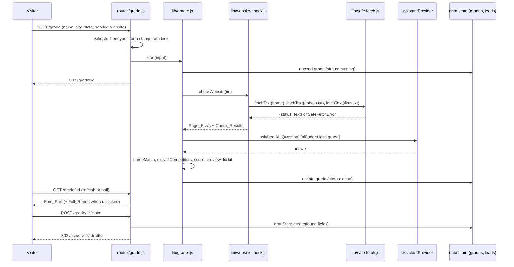

# Design Document: AI Visibility Grader

## Overview

The Grader is a public page, `/grade`, that checks one local business in about two minutes and ends with the fix on screen: the business's free First Answer Pages listing, already filled in from what the scan found. It is built on top of the finished `super-pages` spec and changes none of its behavior.

A Grade has three parts:

1. **Website checks**: fetch the home page, `/robots.txt` and `/llms.txt` safely, read them with built-ins, and score 12 Checks.
2. **AI answers**: ask the existing Assistant_Provider (Claude with web search in production, the mock in tests) "best <service> in <city>", find out whether the business is named, and pull out the competitors that were named instead.
3. **The fix**: a Free_Page_Preview that claims into the existing draft review flow, and a Fix_Kit of copy-and-paste changes for the business's own website.

### Design decisions at a glance

| Question | Decision |
|---|---|
| Where the work runs | In-process, after the redirect. `POST /grade` stores the Grade and starts `runGrade(id)` without awaiting it; the scan page polls. One Render instance, so no job queue. |
| No-JS scan screen | `<meta http-equiv="refresh" content="3">` while `running`. The optional script polls `status.json` once a second and swaps in the report. |
| HTTP client for business websites | `node:http` / `node:https` `request()` with a custom `lookup` function, not global `fetch`. The `lookup` hook checks every resolved address before the socket opens, so the connection can only go to a checked address (no DNS-rebinding gap). Redirects are followed by hand. |
| HTML reading | Hand-written. Elements and comments are removed by `indexOf` scanning (an unclosed tag cuts to the end), because lazy patterns go quadratic on unclosed tags. Attribute and text patterns run only on short, bounded pieces. No parser dependency. |
| AI provider | The existing `ctx.assistantProvider.ask({ prompt, category, businessName })`. No new provider in v1. |
| AI spending | `aiBudget.consume({ kind: 'grade' })`, a new kind with its own daily limit, inside the existing total cap. |
| Lead gate | `GRADER_LEAD_GATE=on` (default). `off` for contest judges and demos. Unlock is a signed cookie per Grade. |
| Secrets | New `GRADER_SECRET` (render.yaml `generateValue: true`) signs the form-start stamp and unlock cookies. If unset, a random per-process key is used and a warning is printed once; unlocks then reset on restart. |
| Storage | Two new collections, `grades` and `leads`, added to the data store allow-list. Same JSON-file writer and retention job as `drafts` and `quotes`. |
| Indexing | Every `/grade` page sends `X-Robots-Tag: noindex, nofollow`; sitemap, llms.txt, MCP and IndexNow never see Grades. One later change, approved by the owner on Nov 19, 2026 (Requirement 22, "Feature D"): the plain start form and the About page are open to search engines and listed in the sitemap; reports and everything else stay as described here. |
| Dollar figures | None. Every number on the report is measured. |

### Findings from reading the existing code

- `server/lib/assistant.js`: providers expose `ask({ prompt, category, businessName })` and resolve to `{ answer, provider, model, webSearch }`; the Anthropic adapter uses the server-side `web_search` tool with `max_uses: 3`; the OpenAI adapter has no web search. The mock is deterministic.
- `server/lib/seance.js`: `normalizeForMatch` (lowercase, punctuation to spaces, collapse spaces) and `detectNamed(name, answer)` (substring). `runSeance` needs a saved listing, so the Grader calls the provider directly and reuses only `normalizeForMatch`.
- `server/lib/ai-budget.js`: `consume({ kind })` with kinds `photo` and `seance`; photo has its own share; the Seance keeps a quarter of the total.
- `server/lib/rate-limiter.js`: `RULES` table and `consume(key, rule)` returning `{ allowed, retryAfterSeconds }`.
- `server/data.js`: `COLLECTIONS = new Set(['drafts', 'quotes', 'seance', 'pending'])`; `pruneExpired({ quotes, drafts })`.
- `server/lib/drafts.js`: `createDraftStore({ store }).create({ fields, missingFields, provider })` returns `{ status: 201, draft }`. The review page is `/rise/drafts/:id`.
- `server/lib/listing-fields.js`: `normalizePhone`, `normalizeState`, `tidyCity`, `mapCategory`, `validateFields`.
- `server/lib/admin-auth.js`: signed admin cookie with `createHmac`; `requireAdmin` middleware.
- `data/categories.json` has no roofers or HVAC; the Grader's service is free text and maps to a category only when a draft is created (falling back to `other`).

## Architecture



### File layout

| File | Role |
|---|---|
| `server/lib/ip-guard.js` | `isPublicAddress(ip)`: the range list from Requirement 3.2. |
| `server/lib/safe-fetch.js` | `createSafeFetcher({ request, lookup, clock, timeoutMs, maxBytes, maxRedirects, userAgent })` → `fetchText(url)`. |
| `server/lib/page-facts.js` | `readPageFacts(html)` → Page_Facts (also `reviewLinks`, `jsonLd.business.areaServed` and `hasReviewData`); `serviceAreaPattern(city)`. |
| `server/lib/robots.js` | `parseRobots(text)`, `mayFetchRoot(groups, agent)`. |
| `server/lib/grade-checks.js` | `CHECKS` table and `runWebsiteChecks(facts, robots, llms, input)`. |
| `server/lib/name-match.js` | `shortName(name)`, `isNamed(answer, { name, website })`, `extractCompetitors(answer, business)`. |
| `server/lib/grade-score.js` | `scoreGrade(results)`. |
| `server/lib/fix-kit.js` | `suggestedTitle`, `suggestedSummary`, `jsonLdBlock`, `llmsDraft`, `robotsLines`. |
| `server/lib/grader.js` | `createGrader(ctx)`: `start`, `run`, `recheck`, `unlock`, `claim`, `findReusableAi`. |
| `server/lib/grade-html.js` | Form, scan, report, about, admin pages. |
| `server/routes/grade.js` | Public routes. |
| `server/routes/admin.js` | Adds `/admin/grades` and `/admin/leads`. |
| `public/js/grade.js` | Optional: poll `status.json`, copy buttons. |
| `test/fixtures/grade/*.html` | Three saved home pages with personal details replaced. |

### Routes

| Method and path | Purpose | Limits |
|---|---|---|
| `GET /grade` | Form | none |
| `POST /grade` | Validate, start, 303 to report | `grade` 5/hour, `grade-day` 6/day per client (each check can use 3 AI calls and the whole site shares 60 a day; lowered from 20 in review) |
| `GET /grade/about` | What the Grader reads and why | none |
| `GET /grade/:id` | Scan screen or report | none |
| `GET /grade/:id/status.json` | `{ status, steps, done }` for the script | none |
| `POST /grade/:id/unlock` | Lead_Form | `grade-unlock` 5/hour per client |
| `POST /grade/:id/claim` | Create or reuse the Draft | `rise` rule (existing) |
| `POST /grade/:id/recheck` | Website checks again | 1 per 2 minutes per Grade, 10/hour per client |
| `GET /admin/grades`, `GET /admin/leads`, `POST /admin/grades/:id/delete` | Admin | `requireAdmin` |

`/grade/about` is registered before `/grade/:id`. Grade_Ids are 22-character base64url strings; any other `:id` gets 404 without a store read.

## Components and Interfaces

### ip-guard.js

`isPublicAddress(ip: string): boolean`. Uses `net.isIP`. IPv4 is parsed to a 32-bit number; IPv6 is expanded to eight 16-bit groups (handling `::` and an embedded dotted IPv4 tail). Refused ranges:

- IPv4: `0.0.0.0/8`, `10.0.0.0/8`, `100.64.0.0/10`, `127.0.0.0/8`, `169.254.0.0/16`, `172.16.0.0/12`, `192.0.0.0/24`, `192.0.2.0/24`, `192.88.99.0/24`, `192.168.0.0/16`, `198.18.0.0/15`, `198.51.100.0/24`, `203.0.113.0/24`, `224.0.0.0/4`, `240.0.0.0/4` (includes `255.255.255.255`).
- IPv6: a native IPv6 address is public only inside `2000::/3`, minus `2001::/23`, `2001:db8::/32`, `2002::/16` and `3fff::/20`. `::ffff:0:0/96`, `::/96` and `64:ff9b::/96` are judged by their embedded IPv4. Everything else is refused, including site-local `fec0::/10`, unique-local, link-local, multicast, any string containing `%`, and any string the expander cannot parse.

Anything `net.isIP` rejects is not public.

### safe-fetch.js

```js
createSafeFetcher({
  request = { http: http.request, https: https.request },
  lookup = dns.lookup,
  timeoutMs = 10000, maxBytes = 2 * 1024 * 1024, maxRedirects = 5,
  userAgent,
}) => ({ fetchText(url, { accept }) })
```

`fetchText` resolves to `{ status, finalUrl, contentType, text, truncated }` or rejects with `SafeFetchError` whose `code` is one of `bad_url`, `blocked_address`, `timeout`, `too_large`, `too_many_redirects`, `connect_failed`.

1. Parse with `new URL()`. Refuse unless protocol is `http:` or `https:`, `username` and `password` are empty, and the port is empty, `80` or `443`.
2. Read the host from `url.hostname` (never the raw input: WHATWG URL already turns decimal, hex and octal IPv4 into dotted form) and strip `[` and `]`. If `net.isIP` is true for the result, refuse unless `isPublicAddress`.
3. Otherwise resolve the host in `fetchText` with `lookup(host, { all: true })` and refuse with `blocked_address` when the list is empty or any address is not public. Then call `request[protocol](url, { method: 'GET', headers, agent: false, lookup: pinnedLookup, signal })`. `pinnedLookup` never resolves again: it answers `cb(null, [{ address, family }, …])` with the checked list when `opts.all` is set (Node 22 does this by default), and `cb(null, address, family)` otherwise. The socket can only open to a checked address, and TLS still verifies the certificate against the host name.
4. Headers: `User-Agent` (Requirement 3.7), `Accept`, `Accept-Encoding: gzip, deflate, br`. Nothing else.
5. On status 301, 302, 303, 307 or 308 with a `Location`, resolve it against the current URL and repeat from step 1, up to 5 times.
6. Pipe the body through `zlib.createGunzip`, `createInflate` or `createBrotliDecompress` per `Content-Encoding`, count decompressed bytes, and destroy the stream past `maxBytes` (result `truncated: true`, error `too_large` for the home page).
7. One `setTimeout` per fetch covers connect, redirects and body; on expiry the request is destroyed with `timeout`.
8. Decode as UTF-8 (or the `charset` in `Content-Type` when Node supports it through `TextDecoder`, else UTF-8).

The transport and lookup are injectable; tests pass fakes and never open sockets.

### page-facts.js

`readPageFacts(html: string) => PageFacts`

1. Truncate to 2 MiB. Remove `<!-- ... -->` comments.
2. Collect `<script type="application/ld+json">…</script>` bodies (type match case-insensitive, attribute order free) before removing other scripts.
3. Count `<script` tags, then remove `script`, `style`, `noscript`, `template`, `svg` elements by `indexOf` scanning for the open and close tags (no lazy regular expressions).
4. `title`: first `<title>` text. Meta tags: scan every `<meta …>` tag, read its attributes with one attribute pattern (`name`, `property`, `content`, `charset`), and keep `description`, `og:title`, `og:image`, `viewport`.
5. `h1s`: text of each `<h1>…</h1>` with inner tags stripped.
6. Images: every `` tag; missing alt means no `alt` attribute or an empty or whitespace value.
7. `telLinks`: `<a` tags whose `href` starts with `tel:` (case-insensitive, after trimming).
8. `ctaLabels`: inner text of `<a>` and `<button>` elements and `value` of `<input type=submit|button>`, each trimmed and capped at 60 characters.
9. `text`: replace remaining tags with spaces, decode entities (named: `amp lt gt quot apos nbsp ndash mdash rsquo lsquo ldquo rdquo hellip copy reg`; numeric decimal and hex), collapse whitespace.
10. `jsonLd`: for each block, `JSON.parse` in a try; on success, collect `@type` values from the top object, from each item of a top-level array, and from `@graph`; find the first business-typed node (type list below) and read `name`, `telephone`, `address` (string or `PostalAddress`), `openingHours` / `openingHoursSpecification`, `url`. On failure, record `{ unreadable: true }`.
11. `scriptBuilt`: `text.length < 200 && scriptCount > 0`.

Business types: `LocalBusiness`, `Restaurant`, `FoodEstablishment`, `CafeOrCoffeeShop`, `BarOrPub`, `Bakery`, `HomeAndConstructionBusiness`, `RoofingContractor`, `HVACBusiness`, `Plumber`, `Electrician`, `GeneralContractor`, `HousePainter`, `Locksmith`, `MovingCompany`, `AutomotiveBusiness`, `AutoRepair`, `HealthAndBeautyBusiness`, `HairSalon`, `BeautySalon`, `DaySpa`, `LegalService`, `Attorney`, `ProfessionalService`, `FinancialService`, `InsuranceAgency`, `RealEstateAgent`, `Dentist`, `MedicalBusiness`, `Store`, `CleaningService` (non-standard but common), `Organization` only when it also carries `telephone` and `address`.

Patterns used by Checks (all case-insensitive):

- Hours: a day word (`mon|tue|wed|thu|fri|sat|sun` and full names) within 40 characters of a time (`\d{1,2}(:\d{2})?\s?(am|pm|a\.m\.|p\.m\.)`), or a time range (`<time> (-|–|to) <time>`), or `24/7`, `open 24 hours`.
- Street address: `\b\d{1,6}\s+(?:[A-Za-z0-9.'-]+\s){0,4}(St|Street|Ave|Avenue|Rd|Road|Blvd|Boulevard|Dr|Drive|Ln|Lane|Way|Ct|Court|Pkwy|Parkway|Pike|Hwy|Highway|Cir|Circle|Pl|Place|Ter|Terrace)\b`.
- Call to action (whole words): `call`, `book`, `schedule`, `quote`, `estimate`, `order`, `reserve`, `reservation`, `appointment`, `get started`.
- City and service in the title: the normalized title contains the normalized city, and at least one service word of 4 or more letters (or its singular, by dropping a trailing `s`).

### robots.js

`parseRobots(text) => Group[]` where `Group = { agents: string[], rules: { allow: boolean, path: string }[] }`. Lines split on `\r?\n`, `#` comments removed, `field: value` split at the first colon, field compared case-insensitively. A `User-agent` line after rules starts a new group; consecutive `User-agent` lines share a group.

`mayFetchRoot(groups, agent)`: pick the group whose agents include `agent` (case-insensitive exact token), else the group with `*`, else allow. Among that group's rules whose path is a prefix of `/` (`/` itself, `/*`, or empty `Disallow`, which allows), the longest path wins; on a tie `Allow` wins; an empty `Disallow:` value means allow all.

### name-match.js

- `shortName(name)`: normalize with `normalizeForMatch`, drop a leading `the`, drop trailing legal words (`llc`, `l l c`, `inc`, `incorporated`, `co`, `company`, `corp`, `corporation`, `ltd`, `pllc`, `pc`, `lp`), trimmed. Returned only when it has at least 2 words or 6 characters; else `null`.
- `registeredDomain(website)`: host without `www.`, cut to the last two labels (three when the second-to-last is a known two-letter public suffix such as `co.uk`, from a short fixed list).
- `isNamed(answer, { name, website })`: true when the normalized answer contains the normalized name, the short name, or the registered domain (matched on the raw lowercased answer, since normalizing would split the dot).
- `extractCompetitors(answer, business)`: read lines matching `^\s*(\d+[.)]|[-*•])\s+` and every `**…**` span; for each, strip markdown, take the text before the first separator (` - `, ` – `, ` — `, `:`, `(`, ` | `), trim, keep names of 2 to 60 characters that start with a letter or digit, drop ones `isNamed` matches to the business, de-duplicate on normalized form, keep the first 5.

### grade-checks.js

```js
CHECKS = [
  { id: 'ai-bots-allowed',    group: 'ai_readable',     points: 8 },
  { id: 'business-labeled',   group: 'ai_readable',     points: 8 },
  { id: 'info-sheet',         group: 'ai_readable',     points: 4 },
  { id: 'title-city-service', group: 'search_basics',   points: 7 },
  { id: 'one-headline',       group: 'search_basics',   points: 4 },
  { id: 'summary',            group: 'search_basics',   points: 4 },
  { id: 'image-descriptions', group: 'search_basics',   points: 3 },
  { id: 'share-picture',      group: 'search_basics',   points: 2 },
  { id: 'tap-to-call',        group: 'customer_basics', points: 4 },   // was 5; see "Owner-approved features"
  { id: 'hours-shown',        group: 'customer_basics', points: 3 },   // was 4
  { id: 'address-shown',      group: 'customer_basics', points: 3 },   // unchanged; worded as a service-area Check when noStorefront
  { id: 'call-button',        group: 'customer_basics', points: 2 },   // was 3
  { id: 'reviews-visible',    group: 'customer_basics', points: 3 },   // new
  { id: 'ai-named',           group: 'ai_answers',      points: 30 },
  { id: 'google-profile',     group: 'google_profile',  points: 15 },
]
```

Group totals: ai_answers 30, ai_readable 20, search_basics 20, customer_basics 15, google_profile 15 = 100. Each entry also has `label` (plain name), `passText`, `failText` (detail), and `fix` (at most 160 characters). Example fixes:

- `ai-bots-allowed`: "Your website tells some AI assistants to stay out. Replace the lines that block them in robots.txt with the lines in your fix kit."
- `business-labeled`: "Add the business label block from your fix kit to your home page so AI can read your name and phone."
- `title-city-service`: "Change your page title to the one in your fix kit so it says what you do and where."
- `tap-to-call`: "Make your phone number a tap-to-call link so people on phones can call you in one tap."

Text-based Checks (`title-city-service` excepted, since the title is not page text) are `not_checked` when `scriptBuilt` is true.

### grade-score.js

`scoreGrade(results) => { score, earned, available, failed, counted, byGroup }`. `ai-named` contributes `earnedPoints` from Requirement 8.1 (it carries `earned` on its result); every other `pass` contributes its full points and `fail` contributes 0. `score = available >= 40 ? Math.round(100 * earned / available) : null`. `failed` counts `fail` results; `counted` counts `pass` plus `fail`.

### fix-kit.js

- `suggestedTitle({ name, service, city, state })`: try `name | Service in City, ST`; if over 60, try `name | Service in City`; then drop whole words from the end of the service; then `name | City`; finally the name cut at a word boundary to 60.
- `suggestedSummary(...)`: "<Name>: <service> in <City>, <ST>. Call <phone> today." with the phone part only when found, followed by "Serving <City> and nearby areas." when it fits, cut at a word boundary to 160.
- `jsonLdBlock(found)`: `{ "@context": "https://schema.org", "@type": "LocalBusiness", name, telephone?, url?, address?, openingHours?, areaServed: city }`, `JSON.stringify(…, null, 2)` with `<` replaced by `\u003c`, wrapped in `<script type="application/ld+json">`.
- `llmsDraft(found)`: Markdown: `# <Name>`, a one-line summary, then `- Service:`, `- Area:`, `- Phone:`, `- Website:`, `- Hours:` lines for found fields.
- `robotsLines(blockedAgents)`: one `User-agent: <agent>` plus `Allow: /` group per blocked agent.

### grader.js

`createGrader({ store, assistantProvider, aiBudget, safeFetcher, notifier, clock, newId, config })`:

- `start(input)`: normalize input, create the Grade (`running`, steps `[]`), look for a reusable AI result (Requirement 14.3), then `queueMicrotask(() => run(id))` and return the id. Running promises are kept in a `Map` so a second `run` for the same id is ignored.
- `run(id)`: website steps (with a 30 s overall budget through `AbortSignal.timeout`), then the free AI_Question (skipped when reused), then preview and fix kit, then `done`. Each step appends `{ name, state, ms }` to `steps` through `store.collection('grades').update`.
- `askAi(grade, prompt)`: `aiBudget.consume({ kind: 'grade' })` first; refused means `not_checked` ("AI check limit reached for today"). Then `assistantProvider.ask({ prompt, category: mapped category or '', businessName: input.name })` with a 120 s `Promise.race` timeout. Stores `{ prompt, provider, model, webSearch, answer (cut to 4,000 code points), named, competitors, ms, at }`.
- `unlock(id, lead)`: store the Lead, run the two extra questions in the background, recompute the Score.
- `claim(id)`: build fields from the found facts, call `draftStore.create`, store `draftId`.
- `recheck(id)`: re-run website steps only; keep `previousScore`.
- `isStale(grade, now)`: `running` and older than 4 minutes.

### Unlock cookie and form stamp

- Form stamp: hidden field `t = <ms>.<hmac(secret, 'form:' + ms)>`. Accepted when the HMAC matches, the age is at least 3 s and at most 2 hours.
- Unlock cookie: name `g_<id>`, value `hmac(secret, 'unlock:' + id)`, `HttpOnly`, `SameSite=Lax`, `Secure` in production, `Path=/grade/<id>`, `Max-Age` 90 days. Checked with `timingSafeEqual`.

### AI_Budget change

`consume({ kind })` gains `'grade'`. New state `grade` counted per Chicago day like `photo`. Rules: blocked when `total >= cap`, or when `kind === 'grade'` and `grade >= gradeCap`, or when `kind` is `photo` or `grade` and `photo + grade >= cap - ceil(cap / 4)`. `gradeCap = GRADE_AI_CALLS_PER_DAY` (default 60, at least 0). The persisted file gains a `grade` count; files without it load as 0.

### Notifier change

Today a notifier is `{ name, notify({ quote, listing }) }`. Each implementation gains `notifyLead({ business, score, reportUrl, lead })`. Only the Resend email to the admin includes the visitor's name, phone and email; the mock and console notifiers never print them:

- mock: records the call in memory;
- console: prints one line with the business name, score and link;
- none: does nothing;
- Resend: emails `ADMIN_EMAIL` only (never a business owner) with the subject "New grader lead: <business>" and the report link; and the visitor's name, phone and email, so the admin can follow up right away.

`notifyLead` never throws, matching `notify`.

### Retention change

`pruneExpired` gains `grades` and `leads` options; both drop records whose `createdAt` is more than 90 days old. Records with a missing or invalid `createdAt` are kept, matching the quotes rule.

## Implementation notes from the code review

These were checked against the code and on Node 22, and they are part of the design.

- **Assistant call.** The real interface is `ask({ prompt, signal, category, businessName, consumeExtra })`, and the result may include `sources`. Pass `signal: AbortSignal.timeout(120000)` and `consumeExtra: () => aiBudget.consume({ kind: 'grade' }).allowed === true`, so a continued call is counted. Like the Seance, do not consume budget for the mock. In production with the mock in use, record `ai-named` as `not_checked` ("AI check isn't connected") and show no demo answer.
- **Background work.** Every background promise (`run`, the extra questions, recheck) ends in a `.catch` that logs the Grade_Id only. Node 22 exits on an unhandled rejection.
- **Budget file.** Write `grade` to the budget file only when it is above 0, so existing files and tests stay byte-identical.
- **Retention.** `pruneExpired` gains `grades` and `leads` options that default to false, and returns their counts only when asked. The startup call becomes `pruneExpired({ grades: true, leads: true })`, and `grader.start()` calls `pruneExpired({ quotes: false, drafts: false, grades: true, leads: true })`. Pruning runs at startup and on new records; there is no timer.
- **Grade ids.** A new `newGradeId` dependency (default `randomBytes(16).toString('base64url')`); `ctx.newId` is not used for Grades. New `createApp` deps: `safeFetcher`, `newGradeId`.
- **Layout.** `layout()` gains an optional `head` string that defaults to empty and leaves existing output byte-identical. The scan page's refresh tag goes inside `<noscript>` in the head, so pages with JavaScript poll instead of reloading.
- **Recheck.** A recheck never sets `status: 'running'`; it uses a separate `recheckRunning` flag, so `isStale` cannot fail an old Grade. Rate rules: `grade-recheck` (10 per hour per client) and `grade-recheck-grade` (1 per 2 minutes per Grade). `grade` and `grade-day` are consumed together with `consumeAll`.
- **Claim.** The draft review page shows the owner's email, so a Draft is reused only when the same browser holds a signed `gc_<id>` cookie set at claim time; any other visitor gets a new Draft. Fields go through `validateFields(fields, categories)` as `/rise/manual` does; hours are `{ monday: '…' }` style or left out; `website` is not a listing field and is dropped; the Draft's provider is `'grader'`, added to the admin page's provider labels.
- **Name matching.** Match on normalized text padded with spaces, so "ace plumbing" does not match "space plumbing". `shortName` returns null when every remaining word is a service, city, state or generic word (for example "roofing"). The domain is matched in normalized form ("billragan com"). `isNamed` also returns the business's `position` in the extracted list when it has one.
- **Fix kit.** The summary has no minimum length. The title may hard-cut a single word longer than 60, and lengths count code points.
- **Smaller points.** Store `extraAiStartedAt` before the extra questions start, so repeated views cannot start them twice. Call `notifyLead` only when it exists, inside try/catch with a timeout. Serve `status.json` for running Grades from memory. Add grader leads (kept 90 days) to `/privacy`. Robots groups naming the same agent are merged. Text-based Checks are `one-headline`, `hours-shown`, `address-shown`, `call-button` and `reviews-visible`. The wording ban test uses `/\bYP\b/`, since a plain substring check matches `<!DOCTYPE`.

## Owner-approved features (Nov 18)

Requirements 18 to 22. The features are for every small business, not one client: a business that goes to its customers (A), a business whose reviews live only inside Google (B), a listing that links to the business's own site (C) and, once the owner confirms, search engines finding the main pages (D). Nothing here changes a Grade made without the new checkbox, except that the report gains one Check (`reviews-visible`).

### Feature A: No storefront (Requirement 18)

**Form and input.** `grade-html.js` `gradeFormPage` gains one checkbox after the website field: `<input type="checkbox" id="g-nostorefront" name="noStorefront" value="1">` with the label "We go to our customers (no storefront)" and, in the hint style, "Check this box if you go to your customers and don't show a street address." `routes/grade.js` normalizes `noStorefront` to `true` only when the value is exactly `'1'` (or `'on'`); the normalized input gets `noStorefront: true` only then, and no key otherwise. A 422 re-render keeps the box as typed; the failed page's "Start again" form carries it as a hidden field. The reuse `key` (Requirement 14.3) is unchanged: the AI answers do not depend on the box. The value is never logged (logs hold only the Grade_Id, step names, counts and timings).

**The check.** `address-shown` keeps its id, group and points. `CHECKS` entries may carry `serviceArea: { label, passText, failText, fix }`. `checkById(id, input)` (input optional) returns the entry with that variant merged in when `input.noStorefront` is true; every place that shows a label, detail or fix (report rows, "Fix these first", full report) passes the Grade's input. Variant text:

- label: "Service area on your home page"
- passText: "Your home page says what area you serve."
- failText: "We found no service area on your home page."
- fix: a function of the Grade's input, `fix(input)`: `Add a line to your home page that names the area you serve, like "Serving <city> and nearby areas".` with `<city>` the Grade's own city (stored as typed, escaped when shown) or "your city" when it is empty. WHEN the sentence is longer than 160 code points, the example is dropped and the fix is `Add a line to your home page that names the area you serve.`; words are never cut. `checkById(id, input)` calls it, so the variant's `fix` is a string in the merged entry.

`runWebsiteChecks({ facts, robots, llms, input })` already receives `input`; with `input.noStorefront` it judges `address-shown` with `SERVICE_AREA_PATTERN.test(facts.text)` or `Boolean(facts.jsonLd.business?.areaServed)`, and otherwise as today (`STREET_PATTERN`). It stays a text-based Check (`not_checked` when `scriptBuilt`, "No website given" and "We couldn't reach your website." as today).

`serviceAreaPattern(city)` is exported from `page-facts.js` and built per Grade. It is matched against `normalizeForMatch(facts.text)` (punctuation gone, lower case), so the city is normalized the same way (`normalizeForMatch(city)`: "St. Louis" becomes "st louis") and then escaped character by character for use in a regular expression (`s.replace(/[.*+?^${}()|[\]\\]/g, '\\$&')`). An empty or all-punctuation city after normalizing has no city alternative at all (never an empty alternative, which would match everywhere). Building and running it never throws. It matches any of:

- `service areas?`;
- `areas? we serve`;
- `we serve`, `we proudly serve`, `proudly serve` or `serving`, followed in the same sentence (before a period, "!", "?" or a line break) and within 120 characters (`[^.!?\n]{0,120}`) by the city name or one of the area words below. This is matched on the page text before punctuation is taken out (V79), and checked backward from the city or area word so a page full of "serving" costs nothing; the city's words may be joined by spaces or punctuation ("St. Louis") by the city name or one of `area`, `areas`, `county`, `counties`, `surrounding`, `nearby`, `communities`;
- the city name followed by `and (the )?(surrounding|nearby|neighboring) (areas?|communities|towns|cities|counties)`.

"We serve breakfast all day" and a bare "serving biscuits" do not match. Unticked Grades never use this pattern (the restaurant fixture contains "serving" and must keep its result). Only bounded windows are used (no open-ended or lazy matching), and a 1 MB page is read in well under the 200 ms limit.

**Business label reading.** `readPageFacts` adds `areaServed` (text) to the first business node: a string, an object with `name`, or an array of those, joined with ", ", cut to 120 characters; empty string when absent. The key is added to the node object only; existing assertions on `name`, `telephone` and `address` are unaffected.

**Preview.** `previewCard(grade)`: when `grade.input.noStorefront`, the address line is `<p>Serves the <city> area</p>` (escaped) and the "Add your address" blank is never shown, even when `found.address` is set. Otherwise unchanged.

**Fix kit.** `jsonLdBlock(found)` gains `found.noStorefront`. When true: `areaServed` is `"<City>, <ST>"` (city alone when the state is empty), and `address` is left out entirely. Otherwise unchanged (`areaServed: city`, address as today). `grade-html.js` passes `noStorefront` from the Grade into the kit. The summary and llms draft never print an address, so they do not change; the summary's "Serving <City> and nearby areas." already fits.

**Claim.** `grader.claim(id)` builds the Draft fields; when `grade.input.noStorefront`: `address: ''` and `serviceArea: \`${city} and nearby areas\``, passed through `validateFields` as today. `address` is optional and `serviceArea` is non-empty, so neither is in `missingFields`. In the unticked case the existing values stay (`serviceArea: city`, `address: found.address`).

**Listing pages.** Checked in the existing code: `html.js` `listingDetail` already shows "City" in place of "Address" when `listing.address` is empty and always shows "Service area"; `schema.js` already leaves out `streetAddress` and keeps `addressLocality`, `addressRegion` and `areaServed` for a listing with no address (`test/schema-rich.test.js` covers it). So no change to those files; one example test renders a claimed no-storefront Draft's listing and checks both.

### Feature B: Reviews AI can see (Requirement 19)

**Page reading.** `readPageFacts` gains:

- `reviewLinks`: the `href` of each `<a>` (after trimming, `https` only) that passes `reviewsLinkHost(href)` (below); at most 5, in page order.
- `jsonLd.business.hasReviewData`: true when the first business node has a non-empty `aggregateRating` or `review` value.

`readPageFacts` also gains `headings`: the text of every `<h1>`, `<h2>` and `<h3>` (each cut to 120 characters, at most 40 headings), collected with the same `indexOf` scanning as `h1s`. Reading never throws and stays within 200 ms for 2 MiB.

Review signals read from the page (case-insensitive; every pattern uses bounded windows such as `[^\n]{0,80}`, never open-ended or lazy matching):

- **Heading words.** `REVIEW_HEADING_PATTERN` is tested against each entry of `facts.headings`, not against the page text: `\b(reviews|testimonials)\b`, or `what (our |my )?(customers|clients|neighbors) (say|are saying)`. A page whose only "Reviews" is a link or menu item does not pass, because link text is not in `headings`: heading text that sits inside an `<a>` element, or in an `<h1>` to `<h3>` that is itself inside a `<nav>` element, is left out when `headings` is built.
- **Rating written out.** `\b[1-5](\.\d)?\s*stars?\b`, `\b[1-5](\.\d)?\s*out of\s*5\b`, a decimal before the slash: `\b[1-5]\.\d\s?\/\s?5\b`, or `[★⭐]{3,}`. A slash form without a decimal ("Closed 1/5", "Open 9/5") never counts.
- **Quoted comment with a name.** A quote of 20 to 400 characters in straight or curly quotes, followed within 40 characters by a dash and a capitalized name (`"…" - Dana R.`, `“…” — Mike T., Mar 2026`).

`reviewLinks` are read as the design's link rules say below (Reviews link on the listing): a Facebook link counts only when its path contains `/reviews`, a Nextdoor link only when its path starts with `/pages/`, and `search.google.com/local/writereview` never counts.

`reviews-visible` passes when a heading matches `REVIEW_HEADING_PATTERN`, or a rating or quoted comment is found in `facts.text`, or `facts.reviewLinks.length > 0`, or `facts.jsonLd.business?.hasReviewData`. Otherwise it fails. It is text-based (`not_checked` when `scriptBuilt`). A page can have a review link and no readable text; that still passes, since AI can follow the link. A page whose only signal is a footer link to a Facebook page, a "Reviews" menu link or a Google `writereview` form fails.

Fail detail: "We found no customer reviews on your home page. AI assistants often can't see reviews that are only inside Google." Pass detail: "Your home page shows customer reviews that AI can read." Fix (147 characters): "Put 3 or more of your real customer reviews on your home page, with each customer's first name and the date, and add a link to your Google reviews." The fix kit is unchanged by this Check: it adds no review text and no `aggregateRating` or `review` to the business label, so nothing is ever invented.

**Point split for Customer basics** (the group stays 15, the Checks stay 100, and the points available for a readable Grade stay 85 before `google-profile`):

| Check | Old | New | Why |
|---|---|---|---|
| `tap-to-call` | 5 | 4 | gives up 1 point |
| `hours-shown` | 4 | 3 | gives up 1 point |
| `address-shown` | 3 | 3 | unchanged, so "same points as the address check" holds for the service-area mode |
| `call-button` | 3 | 2 | gives up 1 point |
| `reviews-visible` | none | 3 | the new Check takes the 3 points the others gave up |

Three Checks give up one point each rather than one Check giving up three, so no single basic is cut by more than a quarter. A Grade that passes all five still earns 15.

**Old Grades: one rule (Requirement 19.8 and 19.9).** The code today mixes stored and computed numbers: `runExtraQuestions` in `grader.js` recomputes `g.score` with the current points the first time the extra questions run, the Check rows (`checkRow`) use the current points, and "Score by area" (`groupLines`) reads the stored `byGroup`. So the rule is that nothing is shown from a stored Score: `reportPage` works out `scoreGrade(grade.results)` once per render (the result list holds each `ai-named` result's `earned`, so it is complete) and uses it for the headline number, the "<failed> of <counted> checks need work" line, the "Score by area" lines and the Check rows. The stored `grade.score` is still written when a Grade finishes, is recomputed, or is rechecked, and is what the lead notice reads (the notice is sent only for new Grades, so it does not change); it is never used to draw the report. The admin Grades list (`grade-admin.js`, near line 53) also works out its score with `scoreGrade(grade.results)` instead of reading `grade.score`, so an old Grade shows 40 there as in the report, not the stored 42. A Grade stored without `reviews-visible` simply does not count that Check: an old restaurant Grade (33 of 82) shows 40 in the headline, the area lines and the rows, before and after the extra questions run. Code that looks up a Check by id tolerates a missing result.

The "Your score was <before> before. It is <now> now." line is shown only when `previousScore` is a number and the Grade's current results include `reviews-visible`. `recheck` stores `previousScore` only when the results before the Recheck already included `reviews-visible`; otherwise it stores `null`. So the report never compares scores across the change in points, and an unchanged old site does not read "42 before, 39 now".

### Reviews link on the listing (Requirement 20)

**Two validators, one list of hosts.** Both are exported from `server/lib/listing-fields.js`.

- `reviewsLinkHost(url)` judges what an owner types. It returns `'google' | 'yelp' | 'facebook' | 'nextdoor'` or `''`. It parses with `new URL()`; requires the trimmed text to start with `https://` (any letter case; `https:google.com/maps` parses but would point at our own site in an `href`), `protocol === 'https:'`, empty `username`, `password` and `port`, and a total length of 1,000 or fewer (query string and `#` part included, and kept; real Google review links with `#lrd=` often run past 300; the website field keeps its own limit of 300); and a host (after removing a leading `www.` or `m.`) of: `google.com` with pathname exactly `/maps` or starting `/maps/`, or pathname `/search` when the hash contains `lrd=` or the query contains `ludocid=` (its `/url` redirect is never accepted); `maps.google.com` with any path except `/url`; `g.co` with pathname starting `/kgs/`; `g.page`; `maps.app.goo.gl`; `search.google.com` with pathname starting `/local`; `yelp.com` with pathname starting `/biz/` (so `/biz_redir` and `/bizarre` are refused); `facebook.com` with any path except the redirects `/l.php` and paths starting `/flx/`; `nextdoor.com` with any path. Redirect addresses are refused because the listing's label would vouch for a link that can lead anywhere. `https://www.google.com/search?q=plumbers` returns `''`.
- `reviewsLinkOnPage(url)` judges links read from a home page, for the Check and the claim fill. It calls `reviewsLinkHost` first, then is stricter: Facebook only when the pathname ends with `/reviews` or contains `/reviews/` (so `/reviewsfake` is refused); Nextdoor only when the pathname starts with `/pages/`; and any `search.google.com/local/writereview` address returns `''`. A footer link such as `https://www.facebook.com/CapitalCityWindow` returns `''`.

`page-facts.js` uses `reviewsLinkOnPage` to build `reviewLinks`; `validateFields` uses `reviewsLinkHost`. The claim picks from `found.reviewsLink` (see Claim), which the scan fills with the best page link: a Google link first, then Yelp, then Facebook or Nextdoor, in page order within each kind.

**Listing field.** `normalizeFields` keeps `reviewsLink` only when `reviewsLinkHost` accepts it; the key is added to the result only when it has a value. This keeps every existing assertion on the field set valid (`test/listing-fields.test.js` allows only its model keys and passes random input that never contains this one), and keeps `validateFields` idempotent. Note that `normalizeFields({})` returns all of its usual keys with empty values, not `{}`; so the rule to test is that the result has no `reviewsLink` key when the input has none or an invalid one. The field is never in `missingFields`. `fieldsFromForm` in `routes/rise.js` and the draft form in `rise-html.js` gain a "Reviews link (optional)" input with the hint "A link to your reviews on Google, Yelp, Facebook or Nextdoor." When the submitted value is not empty and was left out, the review page shows "We left that link out. It must be an https link to your reviews on Google, Yelp, Facebook or Nextdoor." The admin Draft page adds a "Reviews link" row only when present.

**Listing page.** `listingDetail` in `html.js` adds, after the Service area row and only when `listing.reviewsLink` passes `reviewsLinkHost` again (defense in depth for hand-edited data): `<dt>Reviews</dt><dd><a href="…" rel="noopener noreferrer">See our reviews on Google</a></dd>`, with the label from the host and everything escaped. No rating, no count, no review text. Listings without the field render byte-for-byte as today.

**Machine-readable outputs (Requirements 20.6 and 21.7).** Checked in the code: `publicListing` copies every key except `ownerEmail`, so `/api/listings/:id` and the MCP `get_listing` tool return `reviewsLink` and `website` with no change. Four places need code, and each adds its line only when the field has a value, so a listing without them produces byte-for-byte the output it does today (the line-count properties in `test/llms.test.js` and the model-key check in `test/listing-fields.test.js` hold only then):

- `llms.js` (the listing block, near the `Service Area:` line): `Website: <url>` and `Reviews: <url>` lines;
- the MCP `summarize` text in `mcp.js`: the website and the reviews link as links labeled "Website" and "Reviews";
- `schema.js`: `sameAs` is an array of the website and the reviews link that are present, added to the business label only when the array is not empty; `url` stays the listing page;
- `html.js` `listingDetail`: the two rows above.

No page, file or tool shows a star rating, a review count or review text.

**Publishing.** `server/data.js` `buildListing` copies only the keys in its own `MODEL_KEYS` list, so a Draft's `reviewsLink` and `website` would be dropped when a Draft is approved. Add both keys there and copy each only when it is a non-empty string (the way `address` is handled), so a listing without them gains no key. The admin approval route and the draft submit route already pass fields through `validateFields`, which keeps the two fields.

**Claim.** `grader.claim(id)` sets `reviewsLink` from `found.reviewsLink`. The scan sets `found.reviewsLink` to the best link from the page's `reviewLinks` (a Google link first, then Yelp, then Facebook or Nextdoor), run through `reviewsLinkOnPage` and, again at claim time, `reviewsLinkHost`; it is an empty string when none. The claim does not need the page again, and `foundOf` returns `''` for old Grades. It is never read from an AI answer.

### Feature C: The business's own website on the listing (Requirement 21)

**Validator.** `normalizeWebsite(url)` is exported from `server/lib/listing-fields.js` and returns the cleaned address or `''`. It never throws and does no network lookup. It parses with `new URL()` after trimming, removes one trailing dot from the host (so `https://example.com./` is kept as `https://example.com/`, and `https://localhost./` and `https://127.0.0.1./` meet the checks below as `localhost` and `127.0.0.1` and are refused), and refuses, in this order: a value over 600 characters before parsing; a protocol other than `https:`; a non-empty `username` or `password`; a non-empty `port` (WHATWG parsing already drops a default `:443`, so `https://example.com:443/` is accepted as `https://example.com/` while `:8443` is refused); a host that `net.isIP` accepts after the brackets are stripped (every IPv4 and IPv6 address, public or not: a business's own site has a name); the host `localhost` or a name ending in `.localhost`; and a host with no dot. A valid value is rebuilt as `https://<host><pathname>`, with the query string and the `#` part dropped (so login and tracking parameters are never kept), and refused when that is longer than 300 characters. The existing public-address rules (`ip-guard.js`) are not needed here, since every IP literal is refused; the grader's safe fetcher is not involved.

**Listing field.** `normalizeFields` adds `website` only when `normalizeWebsite` returns a value (same pattern as `reviewsLink`): the key is absent otherwise, so the model-key and idempotence checks in `test/listing-fields.test.js` hold, and the result has no `website` key when the input has none or an invalid one (tests say this; they do not expect `{}`). It is never in `missingFields`. `fieldsFromForm` in `routes/rise.js` reads `website`; the draft form (`rise-html.js`) and the Draft review page add a "Website (optional)" input with the hint "The address of your own website, like example.com" (V90: text typed with no scheme gets `https://` in front and an `http://` address is rewritten as the claim does, before `normalizeWebsite`, which does not change); when a non-empty value was left out, the page says "We left that website out. It must be the address of your own website, like example.com." The admin Draft page adds a "Website" row only when present. `server/data.js` `MODEL_KEYS` gains `website` (see Publishing above).

**Output.** `listingDetail` adds `<dt>Website</dt><dd><a href="…" rel="noopener noreferrer">example.com</a></dd>` (host without `www.` as the text, everything escaped, nothing when empty); `schema.js` adds the `sameAs` array as described above; `llms.js` and the MCP `summarize` add the link when present.

**Claim.** `grader.claim(id)` sets `website` to `normalizeWebsite(claimWebsite(grade.input.website))` (empty when the owner gave none), where `claimWebsite` is a small step in `grader.js` that rewrites an `http://` address to `https://` with the same host and path and no port, without fetching anything. The check itself accepts `http` sites and ports, so `grade.input.website` can be `http://example.com:8080/menu?x=1`, which becomes `https://example.com/menu` (the query string is dropped by `normalizeWebsite`). The owner sees the value on the Draft review page and can change or clear it. The existing implementation note that "`website` is not a listing field and is dropped" no longer holds for this one key; every other key stays as it is.

### Feature D: Let Google and Bing find the main pages (Requirement 22) — approved Nov 19, 2026; build after F10

**What exists today.** `sitemap.xml` lists the home page, category pages that have live listings, and listings. `/about` and `/privacy` are served by `routes/pages.js`; `/verified` by `routes/verify.js`; `GET /rise` by `routes/rise.js` (only `/rise/drafts` is noindex). Every `/grade` response gets `X-Robots-Tag: noindex, nofollow` from one middleware in `routes/grade.js`, and the page shell adds the matching meta tag.

**Sitemap.** `generateSitemap(listings, baseUrl, categories, extraPages = [])` gains an optional fourth argument, a list of paths. The route passes `['/about', '/privacy', '/rise']`, plus `/verified` (after `/about`) only when verification is on, the same condition the verify router uses (`ctx.trust` is present; without it `/verified` is a 404, V89), plus `['/grade', '/grade/about']` when `config.graderEnabled !== false`, and passes none when `config.demoMode` is on (DEMO_MODE marks every page noindex). The default is an empty list, so `test/sitemap.test.js` ("URL count equals listing count plus one") and every other existing call keep their output. Each path is written as `<baseUrl><path>` with the existing escaping. To keep "only pages that return 200 and are not noindex" true as pages change, one example test requests each listed path through the app and checks status 200 and no `X-Robots-Tag: noindex`.

**Two open `/grade` pages.** The header middleware in `routes/grade.js` decides per request: when the method is GET (not HEAD), the request as sent (`originalUrl`) is exactly `/grade` or `/grade/about`, with no query string at all (a bare `?`, a trailing `/` and another letter case all count as different and stay closed; the canonical address uses the configured base address, never the request's Host), it sets `Referrer-Policy: no-referrer` and `Cache-Control: no-store` only; for everything else it sets the headers it sets today. The pages pass `indexable: true` to the page shell, which then leaves out the robots meta tag and adds a canonical link (`<base>/grade`, `<base>/grade/about`) and a `description`. `gradeFormPage` takes `indexable` and uses it only for the plain first render: the 422 re-render with errors, the honeypot or stamp refusals and every other caller leave it off, so they keep `noindex, nofollow`. `aboutPage` takes the same option. Titles and summaries: form "Can AI find your local business? Free AI Visibility Check | First Answer Pages" (the page shell adds no suffix, so the site name is written once in the title) with "See whether AI assistants name your local business when someone asks for one like it, and get a score with plain fixes. Free. No account needed." (V92, V93); about "About the AI Visibility Check" with a one-sentence summary of what the check reads. Both texts follow the wording rules (no promise that AI will name a business, no dollar figure).

**Unchanged.** Rate limits, the AI budget, the stamp and honeypot, `GRADER_ENABLED=off` (every `/grade` path is a 404 with `noindex, nofollow`), `llms.txt`, the MCP tools and IndexNow (Grades and reports never appear). Requirement 9.6 is amended as written there.

**Existing tests that pin the old rule** (changed only when Feature D is built, each with its reason):

| Where | Old | New | Why |
|---|---|---|---|
| `test/grade-flow.test.js`, "every /grade page is not indexed and sends no referrer": the list `['/grade', '/grade/about', …]` | all five paths must send `noindex, nofollow` and carry the robots meta tag | `/grade` and `/grade/about` leave the list (they get their own new test); the report, status JSON and `/grade/nope` stay, and a form shown again with errors and a request with a query string are added | Requirement 22.2 opens exactly those two pages |
| same file, "/grade stays out of sitemap.xml and llms.txt…": `sitemap.xml` `includes('/grade')` is `false` | no `/grade` text in the sitemap | the sitemap lists `/grade` and `/grade/about` and no report address (no `/grade/` followed by a 22-character id); the `llms.txt` assertion is unchanged | Requirement 22.1 and 22.2 |

Checked and unchanged: `test/sitemap.test.js` (the new argument defaults to empty), `test/production-samples.test.js` (no `/listings/` text, home page present), `test/polish.test.js` (every address starts with the origin), `test/public-pages.test.js`, `test/approval.test.js` (it reads listing ids from the sitemap by their `/listings/` path), `test/demo-mode.test.js` (in demo mode no extra pages are listed).

### Feature G: Stop bots from running checks over and over (Requirement 25) — approved Nov 19, 2026; build first

Each full check costs real money in AI fees (more with Feature E). The honeypot, the signed form timer, the per-address limits (5 an hour, 6 a day), the 7-day reuse of answers and the global daily AI allowance stay as they are. A bot that rotates addresses can still use up the whole day's allowance, so four things are added. Nothing is on until its setting is: without the Turnstile keys the form and route are exactly as today.

**1. The human check (Cloudflare Turnstile).** New `server/lib/turnstile.js`: `createTurnstile({ siteKey, secretKey, fetch = globalThis.fetch, timeoutMs = 5000 })` returns `null` unless both keys are non-empty, else `{ siteKey, verify(token, ip) }`. `verify` resolves to `'ok'`, `'failed'`, `'unreachable'` or `'misconfigured'`:

- no token, a token that is not a string, or one longer than 2,048 characters: `'failed'`, with no call to Cloudflare;
- otherwise one `POST https://challenges.cloudflare.com/turnstile/v0/siteverify` (a fixed address; `redirect: 'error'`; `AbortSignal.timeout(timeoutMs)`) with the form fields `secret`, `response` and `remoteip`. A reply of `{ "success": true }` is `'ok'`; `{ "success": false }` (including a used or expired token) is `'failed'`, except when its `error-codes` hold `invalid-input-secret`, `missing-input-secret` or `internal-error`: those mean the secret is wrong or Cloudflare is failing, not that the visitor is a bot, so they are `'misconfigured'` (otherwise one mistyped secret would turn every owner away); a network error, a timeout, a status of 500 or more, a reply that cannot be read or a reply without a true/false `success` is `'unreachable'`. The body is read whatever the lower status (Cloudflare does not say which status goes with a bad token), so a 4xx with `success: false` and `invalid-input-response` is `'failed'`. `remoteip` is sent as a plain IPv4 address when the visitor's address arrives as `::ffff:a.b.c.d`.

The secret and the token are never logged, stored or put in an error message; a log line holds only `turnstile=ok|failed|unreachable|misconfigured`. The verifier is injectable (`deps.turnstile`, like `safeFetcher`), so tests use a fake and make no network call. `config.js` gains `turnstileSiteKey` and `turnstileSecretKey` (trimmed strings, empty when unset). `app.js`: `ctx.turnstile = deps.turnstile !== undefined ? deps.turnstile : createTurnstile(config)`.

*On the form.* `gradeFormPage` takes `turnstileSiteKey`; when set it adds `<div class="cf-turnstile" data-sitekey="…"></div>` (escaped) before the submit button, a `<noscript>` line "Turn on JavaScript to confirm you're a person." and, through the page's `head` option, `<script src="https://challenges.cloudflare.com/turnstile/v0/api.js" async defer></script>`. This is the one exception to "every page works without JavaScript", and only while the keys are set. The widget adds the field `cf-turnstile-response`. The "Start again" form on the failed page (`failedPage`, which also posts to `/grade`) gets the same widget, script and `<noscript>` line when the check is on, so "Start again" does not bounce.

*On the route.* In `POST /grade` the order is: honeypot and stamp (as today), field validation (as today), then the human check, then the rate limits, then the start. A visitor who fails the human check does not use up any of the per-address or per-network counts. `'failed'` gives the form again with status 422, the visitor's entries kept and "Please try again: we couldn't confirm you're a person. If no box appears, turn off ad blockers or try another browser." next to the widget, and counts as turned away by the human check. `'ok'` counts a pass. `'unreachable'` and `'misconfigured'` let the check through, log `turnstile=unreachable` or `turnstile=misconfigured`, and (for `misconfigured`) set a flag shown on the admin page; the limits below still apply. A visitor can reach the "couldn't confirm" message without being a bot when the site key is wrong, the site's address is missing from the widget's hostname list in Cloudflare (error 110200), or an ad blocker or the network blocks the script; the text above covers the last, and the admin page and the "set up wrong" email below cover the rest. Every `/grade` response sends `Referrer-Policy: no-referrer`, and Cloudflare's documents do not say whether the widget needs a referrer, so the owner step in G6 runs one real check in a normal browser to find out; if it fails, deleting either key in Render turns the check off and the site works as before. The check is never switched off by itself, because a bot could make that happen.

*Content Security Policy.* Checked in the code: `app.js` sends only `Content-Security-Policy: frame-ancestors 'none'`, which does not limit scripts or frames, and the form page sends no other policy (`LIVE_CSP` belongs only to the live-answer page). So nothing changes now. If a script or frame policy is ever added, it allows `https://challenges.cloudflare.com` for `script-src` and `frame-src` on `GET /grade` and on the 422 re-render of `POST /grade` only. A test asserts the form page's policy header today, so a later change is noticed.

*Privacy page.* `routes/pages.js` adds one plain sentence, shown only when the human check is on (`ctx.turnstile`): "The form that starts an AI Visibility Check uses Cloudflare Turnstile to confirm you are a person; Cloudflare receives your address and browser details under its own privacy terms." The README's setting rows, and `render.yaml` (`TURNSTILE_SITE_KEY` and `TURNSTILE_SECRET_KEY` with `sync: false`, `GRADE_NETWORK_PER_DAY` with `value: "20"`), are updated. Colby creates the free Cloudflare account and pastes the two keys into Render; until then the feature is built and off.

**2. The per-network limit.** New `server/lib/network-key.js`: `networkKey(ip)` returns the network a visitor is on: for IPv4 the first three parts (`203.0.113.7` gives `203.0.113`); for IPv6 the first four groups of the expanded address, lower case, without leading zeros (`2001:db8:1:2:aaaa::1` gives `2001:db8:1:2`); an IPv4 address written inside an IPv6 one (`::ffff:203.0.113.7`) gives the IPv4 network; anything that is not an address gives the string itself, so unknown values are never lumped together. `rate-limiter.js` gains `RULES['grade-network'] = { limit: 20, windowMs: 24 hours }`, and `POST /grade` adds `{ key: \`grade-network:${networkKey(req.ip)}\`, limit: ctx.config.gradeNetworkPerDay ?? 20, windowMs }` to the existing `consumeAll([...])` with the per-address rules, so one refused rule counts none of them. A refusal uses status 429 and `Retry-After` like the other limits, but a network refusal has its own plain message, because the existing page says "a lot of checks from your address", which is wrong for a network (mobile carriers put many unrelated people behind one IPv4 /24, so strangers can reach 20 a day together): "A lot of checks have come from your network today. Please try again tomorrow, or from another connection." To tell which rule refused, the route checks the network rule on its own first through `rateLimiter.peek`, then runs `consumeAll` for all the rules so one refusal still counts none of them. `req.ip` already follows `TRUST_PROXY`; the README adds a line that if the site is ever put behind Cloudflare's proxy, `TRUST_PROXY` must be 2, or every visitor shares a few Cloudflare addresses. The setting `GRADE_NETWORK_PER_DAY` is a positive whole number read like `GRADE_MAX_RUNNING` (unset gives 20; anything else warns without echoing the value and gives 20). It limits only new Grades (not unlock, recheck or the live answer, which have their own limits).

**3. The heads-up email.** `ai-budget.js` gains day counters kept with the budget's own day logic and file (`ai-budget.json`, written the way the `grade` count is: a `notes` object only when it is not empty, so existing files stay byte-identical):

- `usage({ kind: 'grade' })` returns `{ used, left, limit }` for the Grader's share (`used` is the `grade` count; `left` is `remaining`, which is also held down by the shared caps in `remainingFor`, so `used + left` can be less than `GRADE_AI_CALLS_PER_DAY`);
- `note(name)` adds one to today's count for `name` and `notes()` returns all of them: `checks` (a Grade started), `humanPass`, `human` (turned away by the human check), `limit` (turned away by a per-address limit) and `network` (turned away by the per-network limit);
- `once(name)` returns true the first time it is called with `name` on a Chicago day and false after that, and the flag survives a restart the same day;
- `loadCounts` ignores a missing or malformed `notes` (a string, an array, non-number values) and keeps the day's spending counts; only a bad `day`, `total`, `photo` or `grade` drops the file as today, so a bad `notes` entry can never reset today's spending.

New `server/lib/grade-guard.js`: `createGradeGuard({ aiBudget, notifier, store, clock, config, log })` returns `{ turnedAway(kind), watch(), summary() }`. `turnedAway('human' | 'limit' | 'network')` and `passed()` call `aiBudget.note` (`human`, `limit`, `network`, `humanPass`). `watch()` is called, without waiting, after each AI call is counted (the grader's `consume` wrapper) and after each new Grade starts; for each threshold of 50 and 90 it asks `usage()` and works out the share as `used ÷ (used + left)`, because what is really left can be smaller than the setting (the shared caps); it sends nothing when `used + left` is 0. When the share reaches the threshold and `aiBudget.once('email' + threshold)` is true, it calls `notifier.notifyAllowance({ percent: threshold, used, left, limit: used + left, checks })`, where `checks` is today's `checks` counter from the budget's notes (it goes up when a Grade starts), so no AI call reads `grades.json`. It never throws and ends in a `.catch` that logs the threshold only. `watch()` itself catches everything (a throw, a rejection, a failing notifier) and always returns `undefined`, so `started()` and the live-answer route call it with no try/catch and a request can never get a 500 from it; it never waits for an email. `once()` is called only at the moment of sending (not when no email service exists), and it returns true before the flag is on disk and before the send finishes: a crash in between can send a second email after the restart, and a failed email is not tried again that day. Both are accepted. The budget file's writes are coalesced (at most one running and one waiting, the waiting one writing the state as it is when it starts), so a flood of refused requests costs a few writes, not one each. Both thresholds can send on the same call; each sends once a day. A third email, "The human check may be set up wrong" (counts only), is sent once a day to `ADMIN_EMAIL` when `human >= 10` and `humanPass === 0` today. That rule runs from `turnedAway('human')` as well as from `watch()`: when the human check turns everyone away, no AI call is counted and no Grade starts, so `watch()` would never run and the email would never go out. With `NOTIFIER` unset no email service exists (`config.js`), so nothing is sent and the admin page says so.

`notifier.js` gains `notifyAllowance({ percent, used, left, limit, checks })` on every notifier, following `notifyLead`: the mock records the call in memory; the console notifier prints one JSON line with those five numbers; the none notifier does nothing; the Resend notifier emails `ADMIN_EMAIL` only, with the subject "AI Visibility Check: <percent>% of today's AI calls used" and a body of the five numbers in plain words ("Used 30 of 60 calls, 30 left. 6 checks run today."). It never includes a business name, an owner's details or an answer, and never throws. The third email goes through a second method of the same kind, `notifyHumanCheck({ human })` (subject "AI Visibility Check: the human check may be set up wrong", a body that says how many checks the human check turned away today and passed none), on every notifier.

**4. The admin Grades page.** `grade-admin.js` shows one block above the list from `guard.summary()`, all from `aiBudget` (no read of `grades.json`):

- "Human check: on", "off (no Turnstile keys)" or "on, but Cloudflare reported a problem (wrong secret key or an error on its side); checks are let through" (from the `misconfigured` flag; an `internal-error` can be an outage at Cloudflare and not a wrong key);
- "Heads-up emails: on" or "off (no email service set)" (from `NOTIFIER`);
- "Today: <used> AI calls used, <left> left. <n> checks run.";
- "Human check today: <humanPass> passed, <human> turned away." and "Limits today: <limit> turned away by the per-address limits, <network> by the per-network limit.", each on its own line, worded so they do not read like the setup line "Human check: on". The checks count says "1 check run" for one and "<n> checks run" otherwise. If `guard.summary()` throws, the block shows zeros: the counts are never the reason the page fails.

*Counting.* A pass calls `note('humanPass')`; a failed human check calls `note('human')`; a refusal by a per-address rule calls `note('limit')`; a refusal by the per-network rule calls `note('network')`; a started Grade calls `note('checks')`. The honeypot and the form timer are not counted.

**5. Google's live answer.** `POST /grade/:id/google-live` is gated only by the `ran` cookie (90 days) and 3 an hour per Grade and 6 an hour per address, so one Grade could make 72 paid calls a day and every Grade a bot made on earlier days adds 3 an hour. This is the second addition of Requirement 25.10, beside the per-network limit: at most 3 live answers per Grade in total, counted on the stored Grade (`liveAnswers`, incremented when the call is allowed, so a restart does not reset it) and checked before the call is made; the 4th is refused with status 429. Three details: (1) *When it counts.* The route first checks the Grade's count (a quick look), then calls the budget's `consume`; only when `consume` succeeds does it check and raise `liveAnswers` inside one `grades().update`, so two requests at the same moment cannot both see 2 and make 4, a request the budget refuses never uses up one of the owner's 3, and a call that then fails at Google still counts (it was paid for). The update that finds the count already at 3 refunds the call (`aiBudget.refund`) and answers 429. (2) *The message.* The cap lasts for the life of the report, so "try again tomorrow" would not help: "You've seen Google's live answer 3 times for this report. Run a new check to see it again." (3) *The button.* `reportPage` hides "Show Google's live answer" once `liveAnswers` is 3 or more. The hourly rules stay as they are. The live call's `consume` is followed by `watch()` like every other counted call.

*Tests* (new file `test/grade-guard.test.js`, additions only; a fake verifier, a fake notifier and a fake clock; no network):
- with keys set, a missing or bad token blocks the check before any AI call or fetch (the fake assistant and fake fetcher are never called), and a good token runs it;
- without keys, the form has no widget and everything behaves as today;
- an unreachable verifier lets the check through; each of `invalid-input-secret`, `missing-input-secret` and `internal-error` is treated as `misconfigured` (the check runs, `turnstile=misconfigured` is logged without the secret, and the admin page says the secret is wrong), while `invalid-input-response` and `timeout-or-duplicate` still turn the check away;
- the "Start again" form on the failed page carries the widget, script and `<noscript>` line when the check is on, and none when it is off;
- the 422 text includes "If no box appears, turn off ad blockers or try another browser.";
- the 21st check in a day from one network (an IPv4 `/24`, and an IPv6 `/64`) is turned away with 429 and `Retry-After`, while a different network is not; `GRADE_NETWORK_PER_DAY` is read as described; `networkKey` examples, including an IPv4-mapped address;
- the 50% and 90% emails are sent once each per day (a fake clock moves to the next day and they can send again), carry counts only, and a notifier that throws does not stop a check;
- nothing logs a token, a secret or an owner's details (the test captures `stderr` during a check with a secret-looking token and secret);
- a network refusal shows its own message and is counted apart from an address refusal; the README line about `TRUST_PROXY` is present;
- the thresholds use `used ÷ (used + left)` (a case where the shared caps hold `left` down still sends the 90% email), nothing is sent when `used + left` is 0, a grades file with thousands of Grades is never read by `watch()`, and "off (no email service set)" shows when `NOTIFIER` is unset;
- the "set up wrong" email is sent once a day when the human check has turned away 10 or more checks and passed none, counts only, and the check is never switched off; 10 refusals by the human check and no passes send the email once with no AI call and no Grade started;
- a budget file whose `notes` is a string (or an array) loads, keeps today's `total`, `photo` and `grade` counts, and a file without `notes` loads as before;
- the 4th live answer on one Grade is refused with the message above, even hours later and after a new app on the same data directory; the 1st to 3rd are allowed; two requests at the same moment with the count at 2 give one 200 and one 429; a request the budget refuses does not use one of the 3; a call that fails at Google still counts; the button is hidden once 3 are used; the live answer calls `watch()` after its `consume`;
- the admin Grades page shows the setup lines (human check on or off or wrong key, heads-up emails on or off) and today's counts (passes, human refusals, address refusals, network refusals), and the counts survive a new app on the same data directory the same day.

### Feature E: Ask Claude three times (Requirement 23) — approved Nov 19, 2026; build after F1 to F13

Claude answers a little differently every time, and one answer can swing the score by up to 30 points. The free check therefore asks the main question three times at once. Nothing else about scoring changes.

**Setting.** `config.js` adds `gradeMainAsks` from `GRADE_MAIN_ASKS`: a whole number 1 to 3, default 3; anything else warns (without echoing the value) and gives 3. The README lists it. The grader reads `config.gradeMainAsks` (a missing value counts as 3).

**Asking.** `askQuestion` gains `asks` (the free question passes `gradeMainAsks`; each extra question after unlocking passes 1, and second opinions stay at one each). The first ask is planned as today (`consume()`; refused means `limit`). Asks 2 and up are planned only while `aiBudget.peek({ kind: 'grade' }).remaining > SECOND_OPINION_RESERVE` (12) is true before each one and `consume()` succeeds, which is the second-opinion reserve, so the extra asks never take the last calls from another owner's check. The numbers: with 0 calls left the check still runs and only the AI part is skipped, as today ("AI check limit reached for today", partial score); with 13 left, 1 ask is made (after it 12 are left, which is not more than 12); with 14 left, 2 asks; with 15 or more, 3 asks. Second opinions are planned after the asks under their own existing rule (they need more than 12 left), so with 15 or fewer calls left the second opinions are skipped. A resend inside an ask (the `pause_turn` call that `consumeExtra` charges) is made for asks 2 and up only while more than 12 calls remain. When it is refused, that ask counts as not run: the paused reply's text is usually a preamble ("I'll search…") that `anthropicAnswer` would return as the answer, and it would be scored "not named" and lower the score, which Requirement 23.4 forbids. So the `consumeExtra` wrapper for asks 2 and up sets a flag when it refuses, and the grader drops that ask's result. Ask 1 keeps today's rule. The demo assistant gives the same answer to the same prompt, so with the demo assistant the question is asked once. All planned asks start together (`Promise.all` over the same `run`), each with its own 120-second deadline and its own retry for a 429 or 529; a call that ends in 429 or 529 is refunded (V45). The function returns `{ entries, mainState, planned, asked }`: the answered main entries (up to `asks`), the number of asks the settings wanted, and the number the allowance let it make.

**Entries.** Each main entry for the free question carries `ask: 1 | 2 | 3` when `planned > 1`; with one ask the entry is exactly what it is today. Checked in the code: the places that key an answer by `prompt` and `provider` are second-opinion paths only (`saveLateSecond`, the final merge of late entries), `have(name)` (any answer for the prompt means "do not ask again", which is right for carried-over answers), and `rereadCarried` (per entry). So three main entries for one prompt need no change there. `aiNamedResult` counted every main answer (changed by D1, below: it now counts the free question's answers only): `earned = round(30 × named ÷ ran)` over the free question's answers and the extra questions' answers, with the detail "named your business in X of Y answers". A failed ask is simply missing, so it is not in `ran`; when no ask answered, `mainState` is `failed` and the score is partial (V47). Each answer is read by the name check on its own (an extra Gemini decision call per answer when that check is on, not counted against the allowance, as in Requirement 7.11d).

**Scan step.** The AI step's finding reads as today when one ask was planned. With more it keeps the number asked apart from the number answered, in one form everywhere (V103): "Asked Claude 3 times and got 3 answers." or "Asked Claude 3 times and got 2 answers." ("1 answer" for one) and, when the allowance cut the asks short, "Asked Claude 2 times, not 3, because we reached today's limit. Got 2 answers." A repeat check that carries more than one answer reads "Used Claude's answers from earlier this week."; one carried answer keeps "Used an answer from earlier this week".

**Report.** In `aiFree` the free answers are the main answers whose prompt equals the first main answer's prompt; they are `mainAnswers`. The report never compares with `freeQuestion(input)`: after Feature F older Grades carry the older wording of the question, and so does the data in `test/grade-report-list.test.js` (its prompt at line 160 has no "businesses" while its service is at line 136), and a strict match would show "We couldn't ask AI" and break the V52 tests. With one free answer, nothing changes. With more than one:

- the lead line reads "We just asked Claude 3 times. Claude named your business in 2 of 3 answers." (or "in none of 3 answers"); when fewer answers came back than were asked it reads "We just asked Claude 3 times and got 2 answers. Claude named your business in 1 of the 2." (or "in none of the 2", "in 2 of the 2") (V100). The times asked are `max(answers, highest ask number)`, where only ask numbers that are whole numbers from 1 to 3 count (V106);
- one hint paragraph under the lead line (V101, V102, V109): "AI answers change from one time to the next, so we ask the same question 3 times. This list is from answer 1, the first one that named you." (or "This list is from answer 1." when none named it). The number is the times asked. When today's limit cut the asks short, the grader stores `aiMain.asks = { planned, asked }` (only then; every other Grade is stored as before), and the first sentence becomes "AI answers change from one time to the next, so we ask the same question 3 times. Today we could ask only 2 times because we reached today's limit." (V107). The report uses the stored numbers only when they are whole numbers with 1 ≤ asked < planned ≤ 3 and asked equals the times asked;
- the ranked list (`competitorList`, with V38, V52 and the partial rules) and the outcome sentence come from the shown answer: the first answer with `named`, else the first answer; the "This list is from answer …" sentence is numbered among the answers that came back (when ask 1 failed and asks 2 and 3 answered, they read "answer 1 of 2" and "answer 2 of 2"), not by ask number;
- a single closed `<details><summary>See Claude's answers</summary>` holds each answer (labeled "Answer 1", "Answer 2", …) through `readableAnswer`, each in its own `<blockquote>`; the second-opinion blocks are as today;
- in the full report's "Every answer" section each main answer's line reads "Claude, answer 2 of 3: …", and the count is said once, in one form with or without second opinions: "Claude named your business in 2 of its 5 answers." (V104, V108; the bold "Named in 2 of 5 answers." is gone). This is the one accepted exception to "a Grade with one answer per question looks as today" (V110): such a Grade's full report shows that sentence in place of the bold line, and nothing else on it changes. "Claude was asked it 3 times" uses the same times asked as the lead line.

**The answers section counts questions, not answers.** `answersSection` today sets `q = main.length` and writes "We asked … the same <q> questions", and line 493 repeats the count. With 3 asks that would read 3 questions in the free report when it was 1, and 5 after unlocking when it was 3. It counts distinct questions (distinct prompts among the main answers), and when the free question was asked more than once it says so: "We asked Claude, ChatGPT and Grok the same 3 questions. Claude was asked the first one 3 times." (with only the free question, "We asked Claude and ChatGPT the same question. Claude was asked it 3 times.") Requirement 7.5's example ("We asked Claude once just now.") and 7.14's example are updated to match; the lead line of the free part uses the plural form shown above.

**The about page.** `aboutPage` (Requirement 16.1) says today "We ask Claude up to three questions…". It now says (with "3" for both numbers, V105): "We ask Claude up to 3 questions about the best businesses of that kind in that city, and the first one up to 3 times, because AI answers change from one time to the next." The page is about to be open to search engines (Feature D), so it must be right. A test pins the sentence.

**Partial score.** The partial-score rule of V47 is Requirement 8.4 (it was only in tasks.md before); Requirement 23.4 cites it.

**Reuse and old Grades.** A Grade made with one answer per question is shown as today, except the "Every answer" count line (V104, V108, V110; see the report section above). `reusableAnswers` (grader.js) today copies every answer from the earlier Grade, and `aiNamedResult` counts every main answer whatever its question, so after Feature F rewords a service an earlier answer to "…HVAC Repair…" plus a new ask of "…HVAC repair…" would score "named in 1 of 2 answers" and Claude would be asked again (the reviewer ran this). So only answers whose prompt is exactly the new Grade's free question, or one of its two extra questions, are copied. An earlier Grade with the old wording gives no carried answers for a service whose wording changed, and the new asks stand alone. When answers are carried over (Requirement 14.3), the carried answers count as asked and Claude is not asked again for that question, whether there are one or three, and they are introduced the same way as fresh ones: "We asked Claude 3 times on Nov 19." (one answer: "We asked Claude on Nov 19.", as today).

**Existing tests (listed, as the spec rules ask).** Many existing tests count Claude's calls or answers with the default test config, and the default is now 3. They are not changed in what they assert: each existing test file that starts the Grader gets `gradeMainAsks: 1` in the default config of its own `startEnv`: one added property each in thirteen files (corrected in J1; four were named here first, and E1's search found nine more that start a Grade): `test/grade-flow.test.js`, `test/grade-lead.test.js`, `test/grade-review-fixes.test.js`, `test/grade-load.test.js`, `test/grade-open-pages.test.js`, `test/grade-live-cap.test.js`, `test/grade-kit-claim.test.js`, `test/grade-guard.test.js`, `test/grade-counts.test.js`, `test/grade-alerts.test.js`, `test/grade-admin-counts.test.js`, `test/grade-turnstile.test.js` and `test/grade-no-storefront.test.js`. Each is listed in the "Numbers that change in existing tests (and why)" table below, and nothing else in those files changes. After E2 the cloud also reruns the load test with 3 asks. That is exactly "`GRADE_MAIN_ASKS=1` behaves as today", so every existing assertion on `calls`, `ai.length`, the allowance and the report text holds. New tests live in `test/grade-main-asks.test.js` and set `gradeMainAsks: 3` themselves.

*Tests* (additions only; fake assistants, fake clock):
- three fake answers "named, named, not named" give 20 of 30 points and the text "named your business in 2 of 3 answers";
- one fake ask that fails, with the other two answering "named" and "not named", gives "named your business in 1 of 2 answers" and 15 of 30 points, with no penalty for the failure; a Grade where all three fail has `ai-named` not checked and a partial score;
- `GRADE_MAIN_ASKS=1` behaves exactly as today (one call, one entry, no `ask` field, the old sentence);
- the allowance is charged 3 times for 3 asks; each reserve number is pinned in its own test: 0 calls left still runs the check with the AI part skipped ("AI check limit reached for today", partial score), 13 left makes 1 ask, 14 left makes 2 asks and 15 or more makes 3, and the finding reads "Asked Claude 2 times, not 3, because we reached today's limit. Got 2 answers."; with 15 or fewer left the second opinions are skipped;
- a fake Claude whose reply needs a resend (`pause_turn`): ask 1 resends as today, while asks 2 and 3 resend only while more than 12 calls remain; with 12 or fewer left a refused resend makes that ask count as not run (its preamble text is dropped, the score is not lowered, and "named in X of Y" counts only the asks that ran);
- the demo assistant is asked once, not three times;
- answers for a differently worded question are not carried over: an earlier Grade with the old wording ("…HVAC Repair…") gives no carried answers, Claude is asked, and the score counts only the new asks ("named in 1 of 3 answers", not "1 of 4");
- the free report finds its answers by the first main answer's prompt, so an older Grade whose prompt differs from today's wording (and `test/grade-report-list.test.js`'s data) still shows its answers and does not say "We couldn't ask AI";
- the answers section says "the same 3 questions" for the free question plus the two extra questions (not 5), and adds "Claude was asked the first one 3 times."; a carried group reads "We asked Claude 3 times on Nov 19."; with ask 1 failed the answers read "answer 1 of 2" and "answer 2 of 2";
- the about page sentence about the first question being asked up to 3 times;
- the report says "named your business in 2 of 3 answers", shows the ranked list from the first answer that named the business with "This list is from answer 1, the first one that named you." (and "This list is from answer 1." when none named it), and each answer opens under "See Claude's answers";
- carried-over answers mean no new asks;
- the three asks use the retry rule and a refunded call is not charged (fake 429).

### Feature F: The question reads naturally (Requirement 24) — approved Nov 19, 2026; build after Feature E

**One helper, one form.** `grader.js` exports `servicePhrase(service)`, which returns `{ named }`: the cleaned phrase with its last word made plural by the fixed lists below, or with " businesses" added when the last word is on none of them. It is used in all three questions and the scan step (V111; the earlier `plain` form, used only in "I need … in", is removed with its tests).

*Cleaning*, in this order:

1. Trim and collapse runs of spaces. Remove trailing periods, commas, exclamation marks, question marks, colons and semicolons ("plumbers." reads "plumbers"; "A/C" and "B&B" are untouched) (V116).
2. Capitals, word by word (V115):
   - an all-capitals word (no lower-case letter) of 5 or more letters and letters only is made lower case (PLUMBERS, ROOFING, ELECTRICIANS); any other all-capitals word is kept (4 letters or fewer, or holding a slash, a digit, "&" or other marks: HVAC, A/C, CPA, DJ, IT, BBQ, RV, B&B);
   - a word with a capital inside it after a lower-case letter (iPhone), a nationality or cuisine word (Mexican, Italian, Chinese, Thai, Japanese, Indian, Greek, French, Korean, Vietnamese, Cuban, Cajun, Caribbean, Mediterranean, American, Spanish, German, Irish) and "Dr." are kept as typed;
   - when the phrase is in Title Case (every word that has letters starts with a capital, not counting the joining words and, or, of, the, for, in, on, at, by, to, with, a, an), every other word gets a lower-case first letter ("Plumbers and Electricians", "Heating & Air", "Pressure Washing Companies"); otherwise only the first word does, and the owner's other words are kept as typed.
   - a phrase of two or more words with no lower-case letter at all is made lower case word by word instead (V121: "LAWN CARE", "HVAC REPAIR", "MEXICAN RESTAURANT"), except that a word holding a digit keeps its capitals (V126: "A1 TOWING" gives "A1 towing businesses"; a single word with a digit is kept as typed, as before); steps 3 and 4 then apply. A single all-capitals word keeps the rule above (HVAC, CPA, BBQ stay).
3. By each word's lower-case form, whatever was typed: a joining word (and, or, of, the, for, in, on, at, by, to, with, a, an) is written in lower case (V120: "PLUMBERS AND ELECTRICIANS" gives "plumbers and electricians"); a keep-capital word gets its capital (V122; the list is Mexican, Italian, Chinese, Thai, Japanese, Indian, Greek, French, Korean, Vietnamese, Cuban, Cajun, Caribbean, Mediterranean, American, Spanish, German, Irish, Asian, Hawaiian, Brazilian, Ethiopian, Lebanese, Turkish, Peruvian, Tex-Mex); an abbreviation is raised, looked up with and without a final "s" (V115, V119): a/c → A/C, hvac → HVAC, cpa → CPA, dj → DJ, bbq → BBQ, rv → RV, b&b → B&B, so "CPAs", "cpas" and "Cpas" give "CPAs" and "DJs", "RVs", "B&Bs" work the same. "it" → "IT" only as the first word when the next word is "support" or "services".
4. Food typed without "restaurant" (V123), fixed rules checked before the last-word rules, nothing general: a cuisine word last ("Italian", "authentic Thai") adds " restaurants"; "food" after a cuisine word becomes "restaurants" ("Thai food" gives "Thai restaurants"); a last word on the list BBQ, barbecue, sushi, seafood, tacos, burgers, wings, ramen, pho, steak adds " restaurants"; "pizza" adds " places"; "Bar & Grill" and "bar and grill" give "bar and grill restaurants". V125: the food words typed as plurals lose their final "s" first: "tacos", "burgers", "wings" give "taco restaurants", "burger restaurants", "wing restaurants", and the singular "taco", "burger", "wing" give the same. V128 (replacing V127, which was too wide): " restaurants" follows "food" only when the word before it is fast, soul, comfort, street, vegan, vegetarian or southern ("fast food restaurants"); a cuisine word before "food" keeps the V123 rule ("Thai restaurants"); any other phrase ending in "food" goes on to the last-word rules and gets " businesses" ("pet food businesses"), and "food" alone, in any capitals, gives "food businesses". V129: "grocery", and a phrase ending in "grocery", give "… grocery stores"; deli and steakhouse are on the takes-"s" list (V132 and V133 narrow the rest of the V129 entry: "house" and "grill" have their own rules, below); donuts, doughnuts, bagels, cupcakes and smoothies lose their final "s" and ice cream, frozen yogurt, Italian ice, coffee, tea and boba add " shops" ("donut shops", "ice cream shops"; the singular donut, doughnut, bagel, cupcake and smoothie give the same); breakfast, brunch, lunch and dinner as the last word give " restaurants". V131 (checked first, before the meals rule): a phrase ending in "bed and breakfast" or "bed & breakfast", in any capitals, gives "bed and breakfasts", never " restaurants". V132: "house" is made plural only when the word before it is steak, pancake, waffle, coffee, tea, chop, ale, oyster, crab or fish ("steak houses", "coffee houses"); any other phrase ending in "house" follows the normal rules ("open house businesses", "tree house businesses", "house businesses"). V133: "grill" is not made plural: a phrase ending in "grill" gets " restaurants" ("grill restaurants", "BBQ grill restaurants"), and "bar and grill" keeps "bar and grill restaurants". V130: AC, TV, CPR, DUI, CDL, ATV, SEO, PC, EV, HOA, CBD, MRI, ER and AV join the raise list, so they are capitals however typed and with or without a final "s" ("ac repair" gives "AC repair businesses"; UPS is a brand and is left out). Anything else goes on to the last-word rules.

*The last word* (fixed lists, not general English plural rules; no general "-er", "-or" or "-ian" rule, since "water heater", "garage door", "computer" and "Italian" would turn into products or people) (V112 to V114). Compared in lower case; the ending is always lower case, so capitals follow the word ("CPAs", "DJs"):

- "business" becomes "businesses";
- these end in "s" but are not a plural of a business, and get " businesses": arts, gas, bus, lens, glass, fitness, wellness, logistics, analytics, electronics, cosmetics, aesthetics, graphics, news, sales; so does any word ending in "ss";
- any other word ending in "s" is already plural (rentals, services);
- a nationality or cuisine word is never made plural (as the last word it is caught by the food rules first: "Italian restaurants");
- "es": church, wash, coach;
- "y" to "ies": company, agency, bakery, brewery, winery, notary, pharmacy, nursery, laundry, distillery, creamery ("grocery" is not on it, V124: "grocery businesses", while "grocery store" gives "grocery stores");
- handyman becomes handymen;
- "s": contractor, shop, service, crew, store, salon, studio, clinic, restaurant, cafe, firm, lawyer, doctor, plumber, roofer, painter, cleaner, landscaper, mechanic, barber, photographer, realtor, agent, groomer, inspector, attorney, locksmith, chiropractor, tutor, tailor, jeweler, bookkeeper, vet, trainer, walker, builder, gym, spa, bar, hotel, motel, daycare, preschool, boutique, barbershop, place, truck, home, school, park, diner, pub, mover, caterer, office, center, garage, dealership, cpa, dj (the note's two-word entries, such as "dog walker", "pizza place" and "funeral home", are covered by their last word);
- words ending in "ist" (dentist, florist, therapist) or "ician" (electrician, technician, beautician, optician), and veterinarian, pediatrician, dietitian, librarian, guardian, take "s";
- anything else gets " businesses".

`freeQuestion`, `extraQuestions` and `stepNames` call it, so the questions and the scan step read from the same phrase:

| Typed | `named` |
|---|---|
| plumbers | plumbers |
| Window cleaning and pressure cleaning | window cleaning and pressure cleaning businesses |
| HVAC repair | HVAC repair businesses |
| hair salons | hair salons |
| Pressure washing companies | pressure washing companies |
| roofing company | roofing companies |
| cleaning business | cleaning businesses |
| dentist | dentists |
| auto glass | auto glass businesses |
| bakery | bakeries |
| handyman | handymen |
| iPhone repair | iPhone repair businesses |
| A/C repair | A/C repair businesses |
| Mexican restaurants | Mexican restaurants |
| Pressure Washing Companies | pressure washing companies |

The 30 services from the W1 review (V111 to V117), each pinned with its exact three questions:

| Typed | `named` | Typed | `named` |
|---|---|---|---|
| dentist | dentists | Italian | Italian restaurants (V123) |
| car wash | car washes | martial arts | martial arts businesses |
| CPA | CPAs | Heating & Air | heating & air businesses |
| DJ | DJs | a/c repair | A/C repair businesses |
| gym | gyms | PLUMBERS | plumbers |
| med spa | med spas | plumbers. | plumbers |
| daycare | daycares | Plumbers and Electricians | plumbers and electricians |
| church | churches | Window cleaning and pressure cleaning | window cleaning and pressure cleaning businesses |
| 24 hour locksmith | 24 hour locksmiths | HVAC repair | HVAC repair businesses |
| bakery | bakeries | handyman | handymen |
| law firm | law firms | tree service | tree services |
| Roofing Company | roofing companies | pet grooming | pet grooming businesses |
| Mexican restaurants | Mexican restaurants | real estate agent | real estate agents |
| IT support | IT support businesses | Thai food | Thai restaurants (V123) |

The cases from the review of V111 to V118 (V119 to V124), each pinned in the table test:

| Typed | `named` | Typed | `named` |
|---|---|---|---|
| CPAs, cpas, Cpas | CPAs | DJs, djs, Djs | DJs |
| RVs | RVs | B&Bs | B&Bs |
| PLUMBERS AND ELECTRICIANS | plumbers and electricians | Plumbers AND Electricians | plumbers and electricians |
| LAWN CARE | lawn care businesses | HVAC REPAIR | HVAC repair businesses |
| MEXICAN RESTAURANT | Mexican restaurants | IT SUPPORT | IT support businesses |
| HVAC | HVAC businesses | BBQ | BBQ restaurants |
| mexican restaurants | Mexican restaurants | asian restaurants | Asian restaurants |
| Italian | Italian restaurants | authentic Thai | authentic Thai restaurants |
| Thai food | Thai restaurants | Mexican food | Mexican restaurants |
| sushi, seafood, ramen, pho, steak, barbecue | … restaurants | tacos, burgers, wings (and taco, burger, wing) | taco restaurants, burger restaurants, wing restaurants (V125) |
| A1 TOWING | A1 towing businesses (V126) | A1 | A1 businesses |
| fast food, soul food, FAST FOOD, comfort food | fast food restaurants, soul food restaurants, fast food restaurants, comfort food restaurants (V128) | pet food, health food, dog food | pet food businesses, health food businesses, dog food businesses (V128) |
| bed and breakfast, Bed & Breakfast, BED AND BREAKFAST | bed and breakfasts (V131) | open house, tree house, house | open house businesses, tree house businesses, house businesses (V132) |
| grill, BBQ grill, Bar & Grill | grill restaurants, BBQ grill restaurants, bar and grill restaurants (V133) | | |
| food, FOOD | food businesses (V128) | Indian grocery, grocery | Indian grocery stores, grocery stores (V129) |
| deli, steakhouse, steak house, coffee house | delis, steakhouses, steak houses, coffee houses (V129, V132) | donuts, bagels, smoothies, ice cream, coffee, tea | donut shops, bagel shops, smoothie shops, ice cream shops, coffee shops, tea shops (V129) |
| breakfast, brunch, lunch, dinner | … restaurants (V129) | AC REPAIR, ac repair, TV REPAIR, DUI LAWYER, CPR TRAINING | AC repair businesses, AC repair businesses, TV repair businesses, DUI lawyers, CPR training businesses (V130) |
| pizza | pizza places | Bar & Grill, bar and grill | bar and grill restaurants |
| grocery | grocery businesses | grocery store | grocery stores |

Every keep-capital word is also pinned typed in lower case, in capitals, alone and before "food". Left as they are on purpose (V119 note): "Dr. Smith Dental Office", "Mr. Fix It", "St. Louis style pizza", "church of christ", "taxes", "used cars", "Men's haircuts", "24 hour" without a hyphen, and "plumber" versus "plumbers" asking again.
| nail salon | nail salons | photographer | photographers |

The three questions (V111) are "Who are the best <named> in <city>, <ST>? Name your top 5.", "I'm looking for <named> in <city>, <ST>. Which ones would you recommend?" and "Which <named> in <city>, <ST> do people recommend most?". Already clean services ("plumbers", "roofers", "accountants") give exactly today's free question and scan step; the two extra questions change for every service, which is intended. The Google live question uses `freeQuestion`, so it follows. The service as typed is still stored in `input.service` and shown on the report; the category mapping, the reuse key and the report's other texts keep using it. "Plumbers", " plumbers ", "PLUMBERS" and "plumbers." give exactly the questions of "plumbers", so a repeat check reuses its answers (V117).

**Existing tests.** Checked by searching `test/`: the only tests that pin the free question or the scan step text use already clean services (`test/grade-lead.test.js` line 711 "accountants", `test/grade-flow.test.js` line 478 "plumbers"), so they do not change. No existing test outside `test/grade-question.test.js` quotes the old second or third question; the others build them with `extraQuestions(...)` and follow. Answers carried over from an earlier Grade have the older prompt text. They are not copied when the prompt differs (see "Reuse and old Grades" in Feature E), so the new asks stand alone and nothing is counted twice; the one-time cost is that the main assistant is asked again for the two extra questions of a Grade made before V111.

**Fix kit title (V118).** `suggestedTitle` in `fix-kit.js` tried, in order, the title with the whole service and the state, then without the state, then the service cut to fewer and fewer words, so a long service read "Test Biz 3 | Window cleaning and pressure in Tallahassee". That cut is older than Feature F. It now tries "<name> | <Service> in <city>, <ST>", then "<name> | <city>, <ST>" (the service left out, the state kept), then "<name> | <city>", then the name; it never cuts the service or drops only the state while the service is shown.

*Tests* (`test/grade-question.test.js`, additions and the W1 tests updated to one form): every row of both tables; each rule of the cleaning and of the last word, each list entry pinned; "water heater", "garage door" and "computer" get "businesses"; "Italian", "Indian", "Asian", "Hawaiian", "Brazilian" and "vegetarian" are never given a plural "s"; spaces and trailing punctuation; the three questions word for word for the 30 services; the N2 tests ("PLUMBERS" now equals "plumbers"; "ROOFING" and "Plumbers and Electricians" are lowered; HVAC, A/C, CPA, DJ, IT support and BBQ keep their capitals); never throws on odd input; the phrase is escaped where it is shown; the stored input keeps the typed text. `test/grade-fix-kit.test.js` gains one V118 test.

### Final page read (V134 to V145)

Page text and small display fixes only. Scoring, points and what is counted do not change. Some of the text is older than this month's features.

- **V134.** `reportPage` reads the stored steps, never the live fetch: a Grade with a website whose step "Finding your website" or "Reading your home page" is `failed`, and an integer score, shows "Partial score: we couldn't read your home page, so most website checks aren't counted. Your website may be blocking automated visitors." in the style of the "Claude didn't answer" notice, under the number on the locked and the unlocked report (the second sentence only when the finding is "We couldn't read your home page."; a slow or too large site gets only the first). When the step 0 finding is exactly "We couldn't reach your website." (`WEBSITE_UNREACHED`, exported from `grader.js`), a second line reads "We couldn't reach <host>. Check the spelling and run the check again." (`hostOf`, escaped; never the typed address). A hand-built Grade with no steps shows neither. Older than Feature A: it was already so for a site that blocks our reader.
- **V135.** One hint under "Score by area": "Your score is the share of the points we could check: 73 of 85." (the score's `earned` and `available`; none when there is no integer score).
- **V136.** Check labels read right for a pass and a fail: "Can AI assistants get in?", "Business label for AI", "Page title", "Main headline on the home page", "Page summary", "Can AI see your reviews?". The label is read from `CHECKS` when the page is drawn and is never stored in a Grade (stored results hold the id, result and detail), so stored Grades follow. The other labels are nouns ("Hours on the home page") and stay.
- **V137.** When no phone was found the business label holds `"telephone": "ADD YOUR PHONE NUMBER"` and its help says "Put your phone number in before you paste." Never an invented number.
- **V138.** The recheck route peeks at the per-Grade rule when `consumeAll` refuses; if that rule is the full one, the page says "You just checked again. Please wait two minutes." with "Back to the report". The limits and the 429 with `Retry-After` stay.
- **V139, V140.** With no website and the daily limit as the reason: "We couldn't run any checks this time. Please try again tomorrow."; the limit sentences say "tomorrow" ("You can run the check again tomorrow.", "Check again tomorrow for your full score."). A main assistant that did not answer: "Claude didn't answer this time. Please run the check again later."
- **V141.** "Free. No account needed." in the description of `/grade` (the only place the phrase appeared).
- **V142.** "Your 1 picture has no description."; "none of its N answers" in the stored `ai-named` detail and in "Every answer" (older Grades keep their stored "any of" text); "That is all for today"; form error text in sentence case (the `text-transform` is gone from `.missing-note`); "AI Visibility Check" on the privacy page; Claude's answers first under every question; the robots.txt help "Replace the lines that block these assistants with these lines in your robots.txt file, so they can read your website."; "Each is read at most once per check."; the form intro "We ask AI assistants to name the best businesses like yours in your city, and see if they name you."
- **V143.** `applyTitleSuffix` (`html.js`) is installed in `app.js` after the other two page wrappers, so it runs first: any `<title>` that does not hold the site name gets " | First Answer Pages", then SITE_NAME is swapped in. The home page keeps "First Answer Pages: Local Business Directory". The three titles written with a colon ("List your business free", "Type in your listing"/"Check your listing", "Get the Verified stamp") now use the bar.
- **V144.** `readAddress` builds "street, city, ST ZIP"; `usAddressStyle` (new `address-style.js`) also turns an older stored ", TN, 37064" into ", TN 37064" when `foundOf` reads a Grade. In the business label only the street goes in `streetAddress` (`stripAddressTail` from `schema.js`), with `addressLocality`, `addressRegion` and `postalCode` in their own fields.
- **V145 (checked, not changed).** The email given to open a report goes to `leads.json` and the admin notice only; the draft's "Your email" box starts empty, because `claim()` builds the draft from the typed input and the page facts and never reads a lead. The specs are silent on prefilling it and the privacy text says a lead is for the report; prefilling would need a decision. The category and city page has `<link rel="canonical">` to `/?category=<slug>` without the city; the code comment says that is intended and `test/public-pages.test.js` pins it; no requirement or design line covers it.

### Owner decisions D1 to D5 (Requirements 26 to 30), approved Nov 23, 2026

Built: D1 to D5 (tasks O1 to O5, with the O3 changes of V172 to V174); the checkpoint O6 is left. Build order: O1 to O5, one task each, then the checkpoint O6 (see tasks.md). D6 (the `/grade` title) is no change.

**D1. The score never drops when the full report opens (Requirement 26).**

*Why it moves today.* `aiNamedResult` counts every main answer whatever its question, and `runExtraQuestions` recomputes the stored results after the two extra questions, so "named in 2 of 3" (20 of 30) becomes "2 of 5" (12 of 30) right after the owner sends contact details.

*The rule.* One helper in `grader.js`, `freeAnswersOf(ai)`: the main assistant's (non-second-opinion) answers that are not extra-question answers, to the `prompt` of the first of them. It is the rule `aiFree` used (the report never compares with today's wording of the question, so Grades made with older wording still work), now shared by the score, the report and the admin list. **An extra answer is never the free answer (V151):** the code runs the two extra questions even when the free question failed (it no longer does when the free question hit the daily limit, V162), so a Grade can have an extra answer as its first main answer, and so can a repeat check that carries only extra answers. Each new extra-question entry is therefore stored with `extra: true` (in `runExtraQuestions`), and `freeAnswersOf` skips entries with `extra: true`. For a Grade stored before the flag, an answer is also skipped when its question starts the way the extra questions have always started: "I need ", "I'm looking for " or "Which " (the free question always starts "Who are the best "). The reviewer's note said to skip an answer whose prompt does not start with "Who are the best "; the build uses the reverse test instead, because hand-built Grades in the tests carry other free-question wording (for example "best window cleaners in Tallahassee, FL") that must keep counting as the free answer. `aiNamedResult(ai, aiMain)` uses `freeAnswersOf(ai)` where it used every main answer; the points rule (`round(30 × named ÷ ran)`), the `pass`/`fail` result and the detail wording ("Yes. Claude named your business in 2 of 3 answers.", "No. Claude named your business in none of its 3 answers.", and with one answer "Yes. Claude named your business." / "No. Claude did not name your business.") stay. With no free answer the result is `not_checked`, as today.

*One number everywhere.* A second exported helper, `scoredResults(grade)`: the stored results with the stored `ai-named` result worked out again from `grade.ai` by `aiNamedResult`, when the Grade has a stored `ai-named` result and at least one main answer (a Grade with no main answer at all, or with no `ai-named` result, keeps its results as they are). When the main answers are all extra answers, the recomputed result is `not_checked`, so an old Grade whose free question failed and whose extras were scored shows a partial score with the true reason. `shownScore` (so the lead's stored score at unlock), `currentScore` and `isPartialScore`'s input in `reportPage` (one `view = { ...grade, results: scoredResults(grade) }` used for the headline, the failed line, the area lines, the Check rows, "Fix these first" and the partial line), and the admin Grades list all read `scoredResults`. The stored `grade.score` stays what the notice reads, never what draws a page, as in "Old Grades: one rule". A Recheck takes `previousScore` from `shownScore(g)` (the recomputed number), not from the stored `score.score`, so an old Grade's "before" line never compares two rules.

*What stays the same.* The two extra questions and every second opinion are still asked, stored and shown; budget, reserve and rate rules do not change. `runExtraQuestions` still appends the answers and recomputes the stored result, which now comes out the same. Its line that sets `aiMain.state` to `ok` once the main assistant answers an extra question is removed: an extra answer no longer rescues an AI part that the free question did not give, so the partial line keeps its true reason (the daily limit, or "Claude didn't answer"). The extra questions are still asked when the free question failed (an assistant that is not connected cannot be asked, and since V162 none are asked when the free question hit the daily limit): they are shown, flagged and not counted, and the AI part stays not checked and partial.

*The full report* (`answersSection`; "free answers" are `freeAnswersOf`; "other answers" are the main assistant's answers to the extra questions):
- The count line counts the free answers only and is shown when there is more than one: "Claude named your business in 2 of its 3 answers." ("none of its 3 answers" as in V142).
- A line of its own for the extra questions, shown when there are any: "On the 2 other questions, Claude named your business in 1 of 2. They are not counted toward your score." ("in none of 2"). With one other answer: "On the other question, Claude named your business. It is not counted toward your score." or "…Claude did not name your business. It is not counted toward your score."
- Under "Every answer", the main assistant's answer to an extra question is labeled "Claude (not counted toward your score)"; a second opinion keeps "ChatGPT (for comparison only)"; the free answers keep "Claude" or "Claude, answer 2 of 3".
- The sentence that said "Only Claude's answers count toward your score, so your score stays steady from check to check" is replaced by two paragraphs. First, when there are second opinions: "We asked Claude and ChatGPT the same 3 questions. Claude was asked the first one 3 times. ChatGPT's answers are below so you can compare." ("The other assistants' answers are below so you can compare." for more than one). Second, whenever any answer is not counted: "Your score counts only Claude's answers to the first question, so it does not change when you open this report."
- The about page says "Only Claude's answers to the first question count toward the score." and the Google live answer's hint says "Your score comes from Claude's answers to the first question only."
- README: the Lead gate paragraph says opening the full report asks Claude two more questions, once each, and that the score counts only Claude's answers to the free question (up to 3 with `GRADE_MAIN_ASKS` at its default), so it does not change when the report opens.

*Old stored Grades (accepted).* A Grade that was unlocked, with its extra answers counted, shows the recomputed number. Some go up (the extra answers did not name the business and the free ones did) and some go down (the other way round: a Grade whose free answer did not name the business but whose extras did goes from 20 of 30 to 0, and its `ai-named` Check turns from pass to fail); both follow from the owner's rule (V152). The admin Grades list and a Recheck's `previousScore` use `scoredResults` / `shownScore`. Lead emails already sent hold the number from before the extras ran, so no action. Stored `results` and `score` are not rewritten by a page view; they change the next time extras or a Recheck run, to the same number. A repeat check's carried answers: `reusableAnswers` still copies the free and the two extra answers, and `freeAnswersOf` ignores the extras.

*Tests.* New (`test/grade-owner-score.test.js`): a Grade unlocked with the extras answering differently from the free question has the same score before and after (equal stored and shown score, lead score, admin list, the report's headline); "named in 2 of 3" stays 20 of 30 after unlock; the count lines, the other-questions line (both forms), the labels and the two paragraphs; old unlocked Grades (a stored Grade with extra answers) go up in one case and down in the other, shown by report, admin list and Recheck's "before" number; carried extra answers never count; the free question failing keeps the partial line's reason; the second opinions still never count. Existing lines that change are in the table below.

*The O1 code review (V157 to V163), applied before O3.*
- **V157 (owner's option a: nothing new is spent).** "Check again" reads the website again and never asks Claude, so it cannot give the AI part back. The partial line now reads "Partial score: <reason>, so the AI part isn't counted. Run a new check later for your full score." ("tomorrow" for the daily limit), with "Run a new check" a link to `/grade?from=<Grade_Id>`. `GET /grade` reads `from` (only when it matches the Grade_Id pattern and the Grade exists) and fills the form with that Grade's name, city, state, service, website and "no storefront" box. The details come from the stored Grade, never from the address, so nothing typed is in a URL; the page has a query string, so it is `noindex, nofollow` and never an open page; opening it asks nothing. The Recheck button and its hint are unchanged.
- **V158.** `answersSection` branches on the free answers being empty (not on there being no main answer): "Claude did not answer the first question, so this check has no AI score. The other answers are shown below but not counted toward your score." The count of questions is the number of different questions asked by anyone (ChatGPT answering all 3 reads "the same 3 questions" even when Claude answered 2). The "Your score counts only…" sentence is left out then, because that sentence already says it. When nothing at all answered, the older sentence stays.
- **V159.** Under "Every answer" the free question's prompt (or today's wording of it when no free answer exists) sorts first; the other questions keep their order.
- **V160.** The score sentence: "…answers to this question…" while one question has been asked; "…so it stays the same as more answers come in." when `leadGate` is off (`answersSection` takes `{ leadGate }`); otherwise as before.
- **V161.** `dailyLimitHit(grade)`: the stored state is `limit`, or the AI step's stored finding is "AI check limit reached for today" (the old rescue line overwrote the state). The partial line, the free part's no-answer text and the no-website notice use it. Old Grades saved by that line can go from a full score to a partial one: a third kind of change beside up and down.
- **V162 (owner: yes).** `startExtraQuestions` returns without starting when the free question's state is `limit` (as it already does for `not_connected` and `off`), so no extra question and no second opinion for it is asked and `extraAiStartedAt` stays empty; a repeat call writes nothing. The full report says "The other questions were not asked because today's limit for AI checks was reached." (also when there are no answers at all). A free question that failed for another reason still has its extras asked.
- **V163.** `aiOf`, `freeAnswersOf` and `scoredResults` leave out entries that are not objects (arrays and null included).
- **The O2 and V157 to V163 code review (V164 to V171).**
  - **V164.** `dailyLimitHit` finds the AI step by its finding (`AI check limit reached for today`, which only the AI step writes), not by its name. A Grade saved before the question was reworded names that step with the service as typed ("Asking AI to name the best plumber in Nashville").
  - **V165.** One helper in `grader.js`, `isEntry` (an object that is not null or a list), is used wherever stored answers are read on the server: `have` in `askQuestion` (and `existing` defaults to an empty list), `saveLateSecond`, `reusableAnswers`, `rereadCarried`, the carried-plus-new list in `run`, and the append in `runExtraQuestions`. A repeat check from "Run a new check" no longer returns 500 when an earlier Grade has a null in `ai`, and unlocking such a Grade runs its extras.
  - **V166.** When `dailyLimitHit(grade)`, the sentences that said Claude did not answer say "We couldn't ask Claude the first question because today's limit for AI checks was reached, so this check has no AI score. The other answers are shown below but not counted toward your score." (extras answered), "We couldn't ask Claude because today's limit for AI checks was reached, so this check has no AI score. The answers from ChatGPT are here so you can compare." (second opinions only, in the full report) and "We couldn't ask Claude this time because today's limit for AI checks was reached, so this check has no AI score." (the free part).
  - **V167 (spec only).** Requirements 7.2, 12.2 and 12.4 (the note said 13.2 and 13.4; Requirement 13 is "Check Again" and says nothing about the extras) now carry "except when the free question hit the daily limit (Requirement 26.7)".
  - **V168.** `/grade?from=` fills the form only from a Grade whose status is `done` or `failed`; a Grade still running gives the plain form.
  - **V169.** `GET /grade/:id` does not call `startExtraQuestions` when the Grade's `aiMain.state` is `limit` (with the gate off, every view would otherwise read the Grade again for nothing).
  - **V170.** The amber of "Partly" is four tokens beside the other color tokens: `--color-partly` (#B7791F), `--color-partly-bg` (#FBF1DC), `--color-partly-text` (#8A5300) and `--color-partly-pill` (the same amber at 14%). The icon is a picture, so its amber stays written out inside it, with a comment.
  - **V171.** A test through real answers: 3 free answers, 1 naming the business, with a stored result that disagrees, so "Partly", "10 of 30 points" and the detail without "Yes. " come from the recompute.
  - *Tests:* new `test/grade-o2-notes.test.js`. No older test changes.
- *Tests:* new `test/grade-o1-notes.test.js`. Older lines that change are in the table below (the partial line's "Check again…" wording in `grade-load.test.js` and `review-final-pages.test.js`).

**D2. "Partly" instead of "Pass" (Requirement 27).** Display only. In `checkRow`, for `ai-named` with `result === 'pass'` and a finite `earned` below the Check's points, the row class is `partly`, the word "Partly" (the points line stays "8 of 30 points"); `earned` equal to the points (or no `earned`, an old Grade) stays `pass` "Pass"; `fail` stays "Needs work". No new stored value: `earned` already says it, so the stored result, `failed`, `counted`, "N of M checks need work", `topFails` and the admin pages do not change. CSS: a `.grade-check.partly` rule in each of the three layers that style `.pass`/`.fail` (the left border and tint in an amber of its own, held in the `--color-partly` tokens beside the other color tokens, an icon of its own in the layer that draws icons, and `.partly` added to the pill-position selectors of the layers that place `.grade-result`, and to the 359px rule), so it reads by its word without color and stays inside 390px. The stored detail ("Yes. Claude named your business in 1 of 3 answers.") stays as it is, but under "Partly" `checkRow` shows it without its leading "Yes. " ("Claude named your business in 1 of 3 answers."; 1 of 3 is 10 of 30 points) (V153). *Tests (new):* all named gives "Pass"; 1 of 3 gives "Partly" with `class="grade-check partly"`, "10 of 30 points" and the detail without "Yes. "; none gives "Needs work"; a stored `ai-named` with no `earned` gives "Pass"; the failed-checks line and the score are the same with and without the new label. No existing test asserts the row word for `ai-named`.

**D3. The home page (Requirement 28).** In `routes/home.js` the small `grade-link` paragraph in the header is removed. Under the tagline: `<p class="home-why">People now ask AI who to call. List your business free so AI can find it.</p>` (always shown; it is about the directory). Right after the search form, only when `ctx.config.graderEnabled !== false` and the page has no `category` and no `city` filter (V174, the owner's decision: on a results page the button would push the first result down; the sentence stays on every view): `<p class="home-check"><a class="button" href="/grade">Check if AI can find your business</a></p>`. CSS: `.home-check a` is `display: block; width: 100%; box-sizing: border-box; min-height: 3.5rem; text-align: center`, with the search button's font so the two carry equal weight; `.home-why` in the tagline's style; the unused `.grade-link` home rules go. `.home-check` is `max-width: 44rem; margin: 0.75rem auto 1.25rem` so it lines up with the search form (V172). The two buttons match (V173): the search button's rule is `.filters button[type="submit"]`, which outranks `main form button:not([class])` (the old `.filters button` rule lost to it, so the search button rendered at 18px, weight 600, 50px tall), and it has the check button's `min-height: 3.5rem`, `font-size: 1.3rem`, `font-weight: 700` and the same font; the search button gets larger, never smaller. The classic phone-book look stays; nothing is wider than the viewport at 390px (reviewer checks at 390 and 1280). The sentence is the owner's, word for word; the reviewer should confirm "so AI can find it" is acceptable under the wording rule (it says a listing gives AI something to read, not that AI will name the business). *Tests:* the sentence is on the home page; with the grader on and no filter the button text and `href="/grade"` come after the `</form>` of the search and before the results; with it off neither the button nor any `/grade` link is anywhere on the home page, footer included (V154; the existing `grade-flow.test.js` lines about `href="/grade"` still hold); `.home-check a` has the width rules (read from the CSS file, as the V142 test reads `.missing-note`).

**D4. The claim pre-fills less (Requirement 29).** In `claim`: `services: []`, so `validateFields` lists `services` in `missingFields` and the draft form already shows the box empty with "Needs your input". Hours: `hoursToObject` stays as it is (its own tests do not change); a new exported `formStyleHours(value)` turns a 24-hour range into the form's own style (`07:00-18:00` gives `7am-6pm`, `08:30-17:00` gives `8:30am-5pm`, `00:00` is `12am`, `12:00` is `12pm`, minutes `:00` dropped), and anything else (`9am-5pm`, `Closed`, free text) is kept as found. **A range counts as 24-hour only when it cannot mean anything else (V177):** an hour has a leading zero (`07`) or is 0 or 13 or more. `8:00-5:00`, `9:00 - 5:00` and `12:00-1:00` could be 12-hour times with no am or pm, so `formStyleHours` keeps them as found and `parseHoursRange` returns null (wrong hours are worse than none); `8:00-17:00`, `9:00-13:05` and `07:00-18:00` still convert and parse. The same guard applies to `schemaHours` (the fix kit's label), which leaves such a range out. `parseTwentyFourHourRange` in `schema.js` holds the rule for both. `00:00-00:00` means open all day (V178: opens 00:00, closes 23:59, so it is not read as closed); any other equal pair gives null. `24:00` is accepted only as a closing time and means 23:59 (V179): `00:00-24:00` becomes `12am-11:59pm` in the form and opens 00:00, closes 23:59 in the JSON-LD. Mixed styles such as `9am-17:00` stay as found in the form (V180). **Accepted gaps, no code (V192, V193):** a mixed range like `9am-17:00` is read by the Fix Kit label and the readable hours (each side is clear on its own) but left out of the JSON-LD (`parseHoursRange` reads whole ranges only); neither says anything wrong, and the owner accepted this for now. A day written "Closed" or "Open 24 hours" is dropped by `hoursToObject`, so `readableHours` leaves it out when other days have ranges ("Thursday: Closed" is not shown); this is older than O4 and is not changed now. **One whole-range reader (V190, V191):** `schemaHours` and `readableHours` use `parseHoursRange` as the whole-range reader, the same as the JSON-LD, so `12am-12am` means open all day (00:00 to 23:59, "12:00 am to 11:59 pm") everywhere; any other equal opening and closing time (`9am-9am`, `08:00-08:00`) is left out of the label and shown as written in the readable hours. **The same rules everywhere hours are read (V184 to V188):** the 12-hour branch of `parseHoursRange` also runs the equal-times rule (`12am-12am` gives 00:00 to 23:59; `9am-9am` gives null). `schemaHours` (the fix kit label) and `readableHours` first try `parseTwentyFourHourRange` on the whole range and use its result (so `00:00-24:00` and `00:00-00:00` give 00:00 to 23:59, "12:00 am to 11:59 pm"); otherwise each side is read on its own through `sideIsSure`: a side with am or pm, or whose hour has a leading zero or is 0 or 13 or more, is used, and any other side makes the range be left out of the label (`9am-5:00`, `5:00-9pm`) or shown as found in the readable hours (`8:00-5:00`, `9:30-4:30` show as written, never "8:00 am to 5:00 am"). `claim` applies it to every day. The category, service area, address, reviews link and website are not touched. **A hidden bug this also fixes (V155):** the claim stored hours like "07:00-18:00", which `parseHoursRange` in `schema.js` does not parse, so listings claimed from a report and published so far have no opening hours in their JSON-LD. `formStyleHours` output ("7am-6pm") parses, and `parseHoursRange` also accepts "HH:MM-HH:MM" (24-hour), so listings already published get their hours in the business label too. *Tests (new, in the existing claim tests' style):* both forms of hours through `parseHoursRange` and the listing's JSON-LD; a draft from a report has empty `services` and `missingFields` holds `services`; the form page shows the Services box empty with exactly "Needs your input" and `class="field missing"` (V181), and a neutral placeholder in it, "List what you offer, one per line" (V182; the owner chose this wording in V186 because a trade's example fits only that trade); `formStyleHours` table (the four examples, midnight, noon, `13:05`, `9am-5pm` unchanged, `Closed` unchanged, junk unchanged); the final listing text can no longer say "offering plumbers" because nothing is pre-filled. Existing lines that change are in the table below.

**D5. Every local-business type (Requirement 30).** A new file `server/lib/schema-types.js` exports a frozen `LOCAL_BUSINESS_TYPES` set: `LocalBusiness` and every schema.org type that has it anywhere among its parents. It is built once, by hand, in task O5 from the schema.org type tree (the current release's `schemaorg-current-https.jsonld` or its type pages), and its first comment records the release number and date, the source address, and how it was made; nothing is fetched while the site runs. `page-facts.js` builds `BUSINESS_TYPES` from it plus the one non-standard name kept today (`CleaningService`); `Organization` still counts only with a telephone and an address, and the Check still needs the name and telephone. A multi-parent type counts when any parent chain reaches `LocalBusiness`. Before the lookup a leading `http://schema.org/`, `https://schema.org/` or `schema:` (any case) is stripped, so `https://schema.org/AutoWash` counts as `AutoWash` (V156). `Organization` subtypes that are not local businesses (`Corporation`, `NGO` and the like) are treated like `Organization`: they count only with a telephone and an address, as today. `OnlineBusiness` and `OnlineStore` never count as local. Odd members of the `LocalBusiness` tree (`FireStation`, `Hospital`, `Library` and the like) stay in; they are harmless. **As built (O5):** `schema-types.js` exports `LOCAL_BUSINESS_TYPE_LIST` (frozen array), `LOCAL_BUSINESS_TYPES` (a Set of it) and `ORGANIZATION_TYPES` (`Organization` and its non-local subtypes such as `Corporation`, `NGO`, the school types, `PerformingGroup`; never `OnlineBusiness` or `OnlineStore`). The list was written by hand with no fetch, and the reviewer checked it against schema.org release 30.1 (below). `page-facts.js` strips the prefix in `nodeTypes` (so every type read from a page is bare) and `isBusinessNode` accepts any `ORGANIZATION_TYPES` member with a telephone and an address. **Checked against schema.org release 30.1 (V194 to V200):** `MedicalOrganization`, `DiagnosticLab` and `VeterinaryCare` are not local-business types in 30.1 (`MedicalOrganization`'s only parent is `Organization`), so the first two are in `ORGANIZATION_TYPES` (telephone and address needed) and `VeterinaryCare` is a deliberate extra in `page-facts.js` beside `CleaningService`, with a comment that it is not a schema.org local-business type (the owner's decision: vets are local). `Dentist` and `Hospital` stay. Added: `Audiology` and `Ophthalmology` (local), `Cooperative`, `FundingAgency` and `ResearchProject` (Organization rule); `OnlineMarketplace` never counts. `readJsonLd` takes the first node of a local-business type from all blocks as the business; only when there is none, the first node that passes the Organization rule (V197), so a parent company's phone and address are never read in place of the real business. `nodeTypes` drops a type that is empty after the prefix strip (V198). The release is written in the header of `schema-types.js` (V200). **Known gap, no code (V199):** a business node nested under `mainEntity`, `about` or `publisher` is not read; this is older behavior. *Tests (new, `test/schema-types.test.js` and the Check's tests):* `AutoWash`, `NailSalon`, `VeterinaryCare`, `ExerciseGym`, `Hotel`, `Florist`, `Pharmacy`, `AccountingService`, and the `HomeAndConstructionBusiness` subtypes (`Electrician`, `GeneralContractor`, `HVACBusiness`, `HousePainter`, `Locksmith`, `MovingCompany`, `Plumber`, `RoofingContractor`) each pass with a name and telephone and fail without the telephone; every one of the 31 types the Check knew before is still on the list (except as noted); `CleaningService` still passes; `MadeUpBusinessType`, `Person`, `WebSite` and `Corporation` still fail; every name is plain letters and digits and appears once. No existing test or fixture pins the set; build step: read the page behind `test/grade-checks.test.js` lines 55 to 58 before widening the list, to be sure it carries no newly accepted type.

### Numbers that change in existing tests (and why)

Nothing else moves. Each line is a place where a new requirement changes a number or an input, and the reason:

| Where | Old | New | Why |
|---|---|---|---|
| `test/grade-checks.test.js`, "the checks add up to 100 points…": `CHECKS.length` | 14 | 15 | one new Check (`reviews-visible`) |
| same test: size of the id set | 14 | 15 | same |
| same test: points total | 100 | 100 | unchanged: the five basics still total 15 |
| `test/grade-checks.test.js`, "a well set up site passes every website check": `Object.keys(r).length` | 13 | 14 | one new website Check |
| same test: the `goodHtml` input | no review signal | adds one quoted comment with a name and a link to a Google reviews page | the test says every website Check passes, so its page must show reviews; no other line of the page changes |
| `test/fixtures/grade/expected.json`, every fixture: `results` | 13 entries | adds `"reviews-visible"` | one new Check |
| fixture `restaurant`: `score` / `failed` / `counted` | 42 / 5 / 13 | 39 / 6 / 14 | earned 36 becomes 33 (basics now 4 + 3 + 3 + 2 = 12, was 15) and `reviews-visible` fails (no review text on the page, searched); 33 of 85 rounds to 39 |
| fixture `roofer`: `score` / `failed` / `counted` | 21 / 8 / 13 | 19 / 9 / 14 | earned 18 becomes 16 (`hours-shown` 3, `call-button` 2) and `reviews-visible` fails; 16 of 85 rounds to 19 |
| fixture `largeCompany`: `score` / `failed` / `counted` | 65 / 1 / 13 | 65 / 1 / 14 | `large-company.html` gains a short review block (three quoted customer comments with first names and dates, and a link to a Google reviews page), so `reviews-visible` passes and earned stays 55 of 85; only `counted` changes |
| `test/fixtures/grade/large-company.html` | no reviews | adds the review block | as above; it adds no `<h1>`, ``, `tel:` link or JSON-LD block and no day-and-time or street-address wording, so every other expected fact keeps its value |
| `test/grade-flow.test.js`, `startEnv` default config | no `gradeMainAsks` | adds `gradeMainAsks: 1` | Feature E (Requirement 23): the default is now 3 asks, and this file's assertions on Claude's calls and answers assume one; `GRADE_MAIN_ASKS=1` behaves as today, so no assertion changes |
| `test/grade-lead.test.js`, `startEnv` default config | no `gradeMainAsks` | adds `gradeMainAsks: 1` | same reason |
| `test/grade-review-fixes.test.js`, `startEnv` default config | no `gradeMainAsks` | adds `gradeMainAsks: 1` | same reason |
| `test/grade-load.test.js`, `startEnv` default config | no `gradeMainAsks` | adds `gradeMainAsks: 1` | same reason; the cloud also reruns the load test with 3 asks after E2 |
| `test/grade-open-pages.test.js`, `startEnv` default config | no `gradeMainAsks` | adds `gradeMainAsks: 1` | same reason (found by E1's search; J1) |
| `test/grade-live-cap.test.js`, `startEnv` default config | no `gradeMainAsks` | adds `gradeMainAsks: 1` | same reason (J1) |
| `test/grade-kit-claim.test.js`, `startEnv` config | no `gradeMainAsks` | adds `gradeMainAsks: 1` | same reason (J1) |
| `test/grade-guard.test.js`, `startEnv` default config | no `gradeMainAsks` | adds `gradeMainAsks: 1` | same reason (J1) |
| `test/grade-counts.test.js`, `startEnv` default config | no `gradeMainAsks` | adds `gradeMainAsks: 1` | same reason (J1) |
| `test/grade-alerts.test.js`, `startEnv` default config | no `gradeMainAsks` | adds `gradeMainAsks: 1` | same reason (J1) |
| `test/grade-admin-counts.test.js`, `startEnv` default config | no `gradeMainAsks` | adds `gradeMainAsks: 1` | same reason (J1) |
| `test/grade-turnstile.test.js`, `startEnv` default config | no `gradeMainAsks` | adds `gradeMainAsks: 1` | same reason (J1) |
| `test/grade-no-storefront.test.js`, env config | no `gradeMainAsks` | adds `gradeMainAsks: 1` | same reason (J1) |
| `test/grade-question.test.js` (W1's own file), the two tests that quote the second and third questions | "I need … Which companies would you recommend?" and "… do people say are the most reliable?" | "I'm looking for … Which ones would you recommend?" and "… do people recommend most?" | V111: all three questions use the named phrase; no older test file quotes these questions |
| `test/grade-question.test.js`, 30-service table rows "Italian" and "Thai food" | "Italian businesses", "Thai food businesses" | "Italian restaurants", "Thai restaurants" | V123: the fixed food rules |
| `test/grade-question.test.js`, V115 rows "BBQ" and "bbq", and "A1 TOWING" | "BBQ businesses", "A1 towing businesses" | "BBQ restaurants" (BBQ), "A1 towing businesses" stays in the test after V121 had it as "a1 towing businesses" | V123 (BBQ is on the food list); V126 (a word with a digit keeps its capitals) |
| `test/grade-question.test.js`, V129 table row "grill" | "grills" | "grill restaurants" | V133: "grill" is not made plural |
| `test/grade-question.test.js`, V119 to V124 table rows "health food" and "grocery" | "health food restaurants" (V127), "grocery businesses" (V124) | "health food businesses", "grocery stores" | V128 (only fast, soul, comfort, street, vegan, vegetarian and southern make "… food" a restaurant); V129 ("grocery" gives "grocery stores") |
| `test/grade-question.test.js`, V119 to V124 table rows "tacos", "burgers", "wings" and "fast food" | "tacos restaurants", "burgers restaurants", "wings restaurants", "fast food businesses" | "taco restaurants", "burger restaurants", "wing restaurants", "fast food restaurants" | V125 and V127 |
| `test/grade-question.test.js`, V112 test, the cuisine words alone | "Italian businesses" and the like | "Italian restaurants" and the like ("vegetarian businesses" unchanged) | V122 (Asian, Hawaiian, Brazilian added) and V123 |
| `test/grade-question.test.js`, V114 "ies" row "grocery" | "groceries" | the row becomes "grocery store" → "grocery stores" | V124 |
| `test/grade-question.test.js`, the N2 "PLUMBERS" test | "PLUMBERS" keeps its capitals and its questions differ | "PLUMBERS" gives the questions of "plumbers" | V115 and V117 |
| `test/grade-lead.test.js` line 277, "Every answer" count after unlocking | `'Named in 0 of 3 answers.'` | `'named your business in 0 of its 3 answers.'`, then `'named your business in none of its 3 answers.'` | V108: the count line uses the full sentence form with or without second opinions (the accepted exception of V110); V142: "none of" with the count, never "0 of" |
| `test/grade-lead.test.js` line 275 (the stored `ai-named` detail) | `/Claude did not name your business in any of 3 answers/` | `/Claude named your business in none of its 3 answers/` | V142: "none of" with the count everywhere; Grades made before this keep their stored "any of" text |
| `test/grade-lead.test.js` line 538 | `'Claude named your business in 0 of its 3 answers.'` | `'Claude named your business in none of its 3 answers.'` | V142 |
| `test/grade-lead.test.js` line 541 | `'No. Claude did not name your business in any of 3 answers.'` | `'No. Claude named your business in none of its 3 answers.'` | V142 (the stored detail text) |
| `test/grade-lead.test.js` line 355, `test/fixtures/grade/expected.json` line 41 | `'400 Church Street, Franklin, TN, 37064'` | `'400 Church Street, Franklin, TN 37064'` | V144: no comma between the state and the ZIP |
| `test/grade-checks.test.js` line 54 | `'1 of 1 pictures have no description.'` | `'Your 1 picture has no description.'` | V142: one picture reads right |
| `test/grade-reviews-check.test.js` line 30 | `'Reviews AI can see'` | `'Can AI see your reviews?'` | V136: a label that reads right for a pass and a fail |
| `test/grade-old-grades.test.js` lines 148 and 204 | `'Reviews AI can see'` | `'Can AI see your reviews?'` | V136 (the same label) |
| `test/grade-open-pages.test.js` line 118 | `<title>About the AI Visibility Check</title>` | `<title>About the AI Visibility Check \| First Answer Pages</title>` | V143: every tab title ends with the site name |
| `test/review-f12-pages.test.js` line 115 | `… plain fixes. Free, no sign-up.` | `… plain fixes. Free. No account needed.` | V141 |
| `test/grade-lead.test.js` line 268 (a comment) | "the Score uses all three answers" | "the Score uses the free question's answer only" | D1 (Requirement 26): the comment would say the opposite of the test |
| `test/grade-lead.test.js` line 275, the stored `ai-named` detail after unlock | `/Claude named your business in none of its 3 answers/` | `/^No\. Claude did not name your business\.$/` | D1: with `gradeMainAsks: 1` the free question has one answer; the two extra answers are no longer counted |
| `test/grade-lead.test.js` line 277, the full report after unlock | `after.includes('named your business in none of its 3 answers.')` | `after.includes('On the 2 other questions, Claude named your business in none of 2.')` | D1: the free question has one answer, so no "of its 3 answers" line; the extra questions have their own line |
| `test/grade-lead.test.js` line 538 | `after.includes('Claude named your business in none of its 3 answers.')` | `after.includes('On the 2 other questions, Claude named your business in none of 2.')` | D1 |
| `test/grade-lead.test.js` line 539, the answers-section sentence | `We asked Claude and ChatGPT the same 3 questions. Only Claude's answers count toward your score, so your score stays steady from check to check. ChatGPT's answers are below so you can compare.` | two assertions: `We asked Claude and ChatGPT the same 3 questions. ChatGPT's answers are below so you can compare.` and `Your score counts only Claude's answers to the first question, so it does not change when you open this report.` | D1: the sentence is split in two and says which answers count |
| `test/grade-lead.test.js` line 541, the stored detail | `'No. Claude named your business in none of its 3 answers.'` | `'No. Claude did not name your business.'` | D1 |
| `test/grade-lead.test.js` line 595 (ChatGPT and Gemini) | `We asked Claude, ChatGPT and Gemini the same 3 questions. Only Claude's answers count toward your score, so your score stays steady from check to check. The other assistants' answers are below so you can compare.` | two assertions: `We asked Claude, ChatGPT and Gemini the same 3 questions. The other assistants' answers are below so you can compare.` and the "Your score counts only…" sentence | D1 |
| `test/grade-report-asks.test.js` line 145 | `…the same 3 questions. Claude was asked the first one 3 times. Only Claude's answers count` | `…the same 3 questions. Claude was asked the first one 3 times. ChatGPT's answers are below so you can compare.` | D1 |
| `test/grade-report-asks.test.js` line 147 | `'Claude named your business in 2 of its 5 answers.'` | `'Claude named your business in 2 of its 3 answers.'` (and `On the 2 other questions, Claude named your business in none of 2.` is added beside it) | D1: the count is the free question's three answers; the two extra answers (not named) have their own line |
| `test/grade-report-asks.test.js` line 165 | `…the same 3 questions. Only Claude's answers count toward your score` | `…the same 3 questions. ChatGPT's answers are below so you can compare.` | D1 |
| `README.md`, the Lead gate paragraph | "so the AI part of the score uses up to 5 answers (up to 3 with `GRADE_MAIN_ASKS=1`)" | "The score counts only Claude's answers to the free question, so it does not change when the report opens." | D1 (docs, no test) |
| `test/grade-lead.test.js` line 320, the claimed draft's services | `assert.deepEqual(draft.fields.services, ['roofers'])` | `assert.deepEqual(draft.fields.services, [])`, and `missingFields` holds `'services'` | D4 (Requirement 29): Services is left for the owner |
| `test/grade-lead.test.js` lines 357 and 358 (named 356 and 357 before; V183), the claimed draft's hours | `'07:00-18:00'` for Monday and Friday | `'7am-6pm'` for Monday and Friday (Saturday stays `undefined`) | D4: hours in the form's own style; `hoursToObject` and its own test (lines 393 to 405) do not change |
| `test/grade-kit-claim.test.js` line 217, the listing built from a no-storefront claim's draft | `const listing = { ...draft.fields, id: 'capital-city-window-nashville', description: 'We clean windows.' };` | the same, plus `services: ['window cleaning']` | D4: the claimed draft has no services, and `buildSchema` requires them, so the listing gets services as the owner would type them |
| `test/home-check.test.js`, the test "D3: the button is on a filtered page too" (O3's own test) | asserts the button on `/?category=plumbers&city=Nashville` | asserts no button there, with the sentence and the search button still shown (its CSS test and its no-promise test also change) | V174 (owner's decision), V173, V176 |
| `test/grade-claim-hours.test.js` (O4's own tests), the "kept as found" and "refuses" lists, the Services label check and the placeholder check | `00:00-24:00` kept as found and parsed to null; the label accepted "Needs your input" or "Required"; no placeholder | `00:00-24:00` becomes `12am-11:59pm` and parses to 00:00 to 23:59; the label must read exactly "Needs your input" with `class="field missing"`; the placeholder is "List what you offer, one per line" | V179, V177 (new kept-as-found cases), V181, V182, V186 (these are O4's own tests, changed by its review notes, not older tests) |
| `test/schema-types.test.js` (O5's own test), the "on the list" and "not on the list" loops | `VeterinaryCare`, in the "on the list" loop; the Organization-rule loop without the medical types | `VeterinaryCare` is out of the list (it counts through a deliberate extra in `page-facts.js`); `MedicalOrganization`, `DiagnosticLab`, `VeterinaryCare` and `OnlineMarketplace` are in the "not on the list" names; `Audiology`, `Ophthalmology` and `Dentist` are in the "on the list" loop | V194 to V196 (O5's own test, changed by its review notes, not an older test) |
| `test/grade-load.test.js` line 288 (`PARTIAL_LINE`) and its uses at lines 301 and 310 | `… the AI part isn't counted. Check again later for your full score.` | `… the AI part isn't counted. <a href="/grade?from=<id>">Run a new check</a> later for your full score.` (the id filled in where the test uses it) | V157: "Check again" cannot give the AI part back |
| `test/review-final-pages.test.js` lines 218 and 220 (the V139 partial lines) | `… Check again tomorrow for your full score.` and `… Check again later for your full score.` | `… <a href="/grade?from=finalAAAAAAAAAAAAAAAAAA">Run a new check</a> tomorrow for your full score.` and `… later …` | V157 |
| D2, D3, D5: no existing line | | | Checked by search: no existing test asserts the `ai-named` row word, the home page's `grade-link` markup (only `href="/grade"` present with the grader on and absent with it off, which still holds), or the set of recognized business types. Tasks O3 and O5 search again before editing |

Checked and unchanged: `test/grade-score.test.js` (it uses `ai-named` 30, `business-labeled` 8 and `info-sheet` 4, and a point total of 100); `test/grade-flow.test.js` "a stub AI that names the business" (the large-company fixture passes every Check, so the Score is still 100); `test/grade-lead.test.js` and `test/grade-review-fixes.test.js` (they read scores from the fixtures or the stored Grade); `test/design.test.js` (counts passed in); the roofer and restaurant fixture HTML files (no review signal, confirmed by searching them for "review", "testimonial", "rating", "stars" and review-site links; the restaurant page contains the word "serving", which only matters when the box is ticked).

## Data Models

```js
// grades.json item
{
  id: 'q8Zr0…22 chars',
  status: 'running' | 'done' | 'failed',
  input: { name, city, state, service, website: 'https://…/' | null, noStorefront?: true },   // noStorefront only when ticked
  key: 'normalized name|city|state|service|registered domain or -',   // reuse lookup
  createdAt: ISO, finishedAt: ISO | null,
  steps: [{ name, state: 'done' | 'skipped' | 'failed', ms }],
  facts: { title, metaDescription, ogImage: boolean, h1s: [...], phone, hours, address, reviewsLink, jsonLdTypes: [...] } | null,   // reviewsLink: '' when the page has no Review_Site link; current Grades keep it in `found`, like phone, hours and address
  results: [{ id, result: 'pass' | 'fail' | 'not_checked', detail, earned? }],
  ai: [{ prompt, provider, model, webSearch, answer, named, competitors: [...], ms, at, reusedFrom? }],
  score: { score, earned, available, failed, counted }, previousScore: number | null,
  draftId: null | 'draft id', recheckedAt: ISO | null
}

// leads.json item
{ id, gradeId, business: 'name', name, email, phone, okToContact: boolean, score: number | null, createdAt: ISO }
```

Business facts kept on a Grade are only what the business published on its own website. Visitor details live only in `leads`.

## Configuration

| Variable | Default | Meaning |
|---|---|---|
| `GRADER_ENABLED` | `on` | `off` hides `/grade` (404) and the home-page link. |
| `GRADER_LEAD_GATE` | `on` | `off` shows the Full_Report to everyone. |
| `GRADE_AI_CALLS_PER_DAY` | `60` | Grader share of the daily AI cap. |
| `GRADER_SECRET` | none | Signs form stamps and unlock cookies. render.yaml: `generateValue: true`. |
| `GRADE_MAX_RUNNING` | `20` | How many checks may run at once; the rest wait in line (a positive whole number). |
| `GRADE_MAIN_ASKS` | `3` | How many times the free question is asked of the main assistant, 1 to 3 (Feature E). |
| `GRADE_NETWORK_PER_DAY` | `20` | New checks allowed per network (IPv4 /24 or IPv6 /64) per day (Feature G). |
| `TURNSTILE_SITE_KEY`, `TURNSTILE_SECRET_KEY` | none | Both set turns on the Cloudflare Turnstile human check on the form (Feature G). `render.yaml`: `sync: false`. |

## Correctness Properties

### Property 1: Public-address test matches the range table

*For any* IPv4 address, and *for any* IPv6 address including IPv4-mapped, IPv4-compatible and NAT64 forms, `isPublicAddress` returns false exactly when the address falls in a refused range, judged by an independent bit-mask oracle in the test.

**Validates: Requirements 3.2, 3.10**

### Property 2: Redirects never reach a refused address

*For any* chain of up to 7 redirects whose targets mix public and refused addresses (through a fake transport and fake lookup), `fetchText` never connects to a refused address (the fake transport calls `opts.lookup` the way Node does) and fails with `blocked_address` or `too_many_redirects` when the chain contains one or is too long.

**Validates: Requirements 3.1, 3.3, 3.4**

### Property 3: Size limit holds after decompression

*For any* body length and encoding among identity, gzip, deflate and br, `fetchText` returns at most `maxBytes` decompressed bytes, and reports `truncated` exactly when the decompressed body is longer.

**Validates: Requirements 3.5, 3.6**

### Property 4: Page reading never throws and stays fast

*For any* string up to 2 MiB (random text, random tag soup, and fixture pages with random insertions), `readPageFacts` returns a Page_Facts object without throwing, in under 200 ms.

**Validates: Requirements 4.1, 4.6**

### Property 5: Robots answers are stable under formatting

*For any* robots.txt built from random groups and rules, `mayFetchRoot` gives the same answer when newlines are `\r\n`, field names change case, and comments or blank lines are added.

**Validates: Requirements 5.1, 5.2, 5.5**

### Property 6: Score bounds and invariance

*For any* list of Check_Results, `scoreGrade(...).score` is null or an integer from 0 to 100, is 100 when every counted Check passes with full points, and does not change when `not_checked` results are added or removed.

**Validates: Requirements 6.5, 6.6, 8.2**

### Property 7: Name matching ignores case, punctuation and spacing

*For any* business name and answer text, `isNamed` returns the same result after changing letter case, swapping punctuation, and changing runs of spaces in either string; and it returns true when the answer contains the exact name.

**Validates: Requirements 7.3, 7.10**

### Property 8: Competitors exclude the business and repeat no one

*For any* answer built from a random numbered list that may include the business, `extractCompetitors` returns at most 5 names, none matched by `isNamed` to the business, with no two equal after normalization, in answer order.

**Validates: Requirement 7.4**

### Property 9: Fix kit stays within its limits

*For any* Grade_Input and found fields (including names with `<`, `</script>`, quotes and emoji), `suggestedTitle` is at most 60 characters and never ends mid-word, `suggestedSummary` is at most 160 characters, and `jsonLdBlock` parses as JSON after its script tags are removed and contains no raw `<`.

**Validates: Requirements 11.1, 11.2, 11.3, 11.8**

### Property 10: Reuse never copies a visitor's state

*For any* two Grades with the same key within 7 days, the second Grade copies only `ai` entries, and never `draftId`, unlock state, or Leads.

**Validates: Requirements 14.3, 14.4**

## Error Handling

| Condition | Response |
|---|---|
| Form fields invalid, honeypot filled, stamp too new or bad | 422, form again with problems named |
| Rate limit | 429 with `Retry-After` in whole seconds |
| Unknown or malformed Grade_Id | 404 page |
| Grade `running` past 4 minutes | Page "This check didn't finish" with a button to start again |
| Website unreachable, refused, too large, timed out | Affected Checks `not_checked` with a plain reason |
| AI budget refused, provider error, 120 s timeout | `ai-named` `not_checked`; report says the AI check can run again later |
| Claim when the Grade has no name or city | Cannot happen (both required); claim still creates a draft with `missingFields` |
| Lead form invalid | 422, form again |
| Notifier fails | Lead still stored; failure logged without personal fields |

## Testing Strategy

Property-based testing fits the pure pieces with large input spaces: the address guard, the safe fetcher (with a fake transport), page reading, robots reading, the score, name matching, competitor extraction and the fix kit. Rendering, routing and the grader flow use example tests.

- **Runner**: `node:test` and `fast-check`, files `test/grade-*.test.js`, run with `node --test`. Each property runs at least 100 iterations, tagged `// Feature: ai-visibility-grader, Property N: <title>`.
- **No network**: tests pass a fake `request` transport, a fake `lookup`, the mock Assistant_Provider, a mock Notifier and a fake clock. A guard test asserts the real `http.request` is never called during the suite.
- **Fixtures**: three saved home pages (restaurant with a slider of headlines, roofer whose JSON-LD fails to parse, large company with several JSON-LD blocks), personal details replaced, plus expected Page_Facts and Check_Results for each.
- **Flow tests**: `createApp({ dataDir, assistantProvider, … })` with `app.listen(0)`: form 422s, start and 303, scan page refresh tag, done report, lead gate on and off, unlock cookie, claim creates exactly one draft and redirects, recheck limits, admin pages behind login, noindex headers, sitemap and llms.txt without `/grade`.
- **Existing suite**: every test from earlier specs keeps passing.
