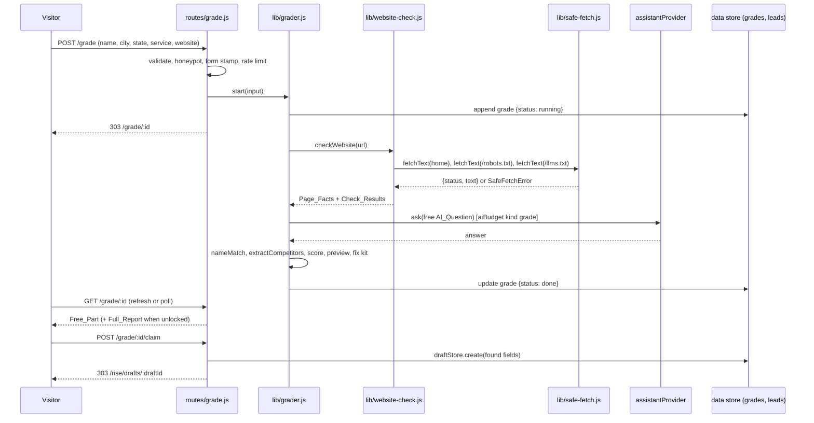

# Design Document: AI Visibility Grader

## Overview

The Grader is a public page, `/grade`, that checks one local business in about two minutes and ends with the fix on screen: the business's free First Answer Pages listing, already filled in from what the scan found. It is built on top of the finished `super-pages` spec and changes none of its behavior.

A Grade has three parts:

1. **Website checks**: fetch the home page, `/robots.txt` and `/llms.txt` safely, read them with built-ins, and score 12 Checks.
2. **AI answers**: ask the existing Assistant_Provider (Claude with web search in production, the mock in tests) "best <service> in <city>", find out whether the business is named, and pull out the competitors that were named instead.
3. **The fix**: a Free_Page_Preview that claims into the existing draft review flow, and a Fix_Kit of copy-and-paste changes for the business's own website.

### Design decisions at a glance

| Question | Decision |
|---|---|
| Where the work runs | In-process, after the redirect. `POST /grade` stores the Grade and starts `runGrade(id)` without awaiting it; the scan page polls. One Render instance, so no job queue. |
| No-JS scan screen | `<meta http-equiv="refresh" content="3">` while `running`. The optional script polls `status.json` once a second and swaps in the report. |
| HTTP client for business websites | `node:http` / `node:https` `request()` with a custom `lookup` function, not global `fetch`. The `lookup` hook checks every resolved address before the socket opens, so the connection can only go to a checked address (no DNS-rebinding gap). Redirects are followed by hand. |
| HTML reading | Hand-written. Elements and comments are removed by `indexOf` scanning (an unclosed tag cuts to the end), because lazy patterns go quadratic on unclosed tags. Attribute and text patterns run only on short, bounded pieces. No parser dependency. |
| AI provider | The existing `ctx.assistantProvider.ask({ prompt, category, businessName })`. No new provider in v1. |
| AI spending | `aiBudget.consume({ kind: 'grade' })`, a new kind with its own daily limit, inside the existing total cap. |
| Lead gate | `GRADER_LEAD_GATE=on` (default). `off` for contest judges and demos. Unlock is a signed cookie per Grade. |
| Secrets | New `GRADER_SECRET` (render.yaml `generateValue: true`) signs the form-start stamp and unlock cookies. If unset, a random per-process key is used and a warning is printed once; unlocks then reset on restart. |
| Storage | Two new collections, `grades` and `leads`, added to the data store allow-list. Same JSON-file writer and retention job as `drafts` and `quotes`. |
| Indexing | Every `/grade` page sends `X-Robots-Tag: noindex, nofollow`; sitemap, llms.txt, MCP and IndexNow never see Grades. |
| Dollar figures | None. Every number on the report is measured. |

### Findings from reading the existing code

- `server/lib/assistant.js`: providers expose `ask({ prompt, category, businessName })` and resolve to `{ answer, provider, model, webSearch }`; the Anthropic adapter uses the server-side `web_search` tool with `max_uses: 3`; the OpenAI adapter has no web search. The mock is deterministic.
- `server/lib/seance.js`: `normalizeForMatch` (lowercase, punctuation to spaces, collapse spaces) and `detectNamed(name, answer)` (substring). `runSeance` needs a saved listing, so the Grader calls the provider directly and reuses only `normalizeForMatch`.
- `server/lib/ai-budget.js`: `consume({ kind })` with kinds `photo` and `seance`; photo has its own share; the Seance keeps a quarter of the total.
- `server/lib/rate-limiter.js`: `RULES` table and `consume(key, rule)` returning `{ allowed, retryAfterSeconds }`.
- `server/data.js`: `COLLECTIONS = new Set(['drafts', 'quotes', 'seance', 'pending'])`; `pruneExpired({ quotes, drafts })`.
- `server/lib/drafts.js`: `createDraftStore({ store }).create({ fields, missingFields, provider })` returns `{ status: 201, draft }`. The review page is `/rise/drafts/:id`.
- `server/lib/listing-fields.js`: `normalizePhone`, `normalizeState`, `tidyCity`, `mapCategory`, `validateFields`.
- `server/lib/admin-auth.js`: signed admin cookie with `createHmac`; `requireAdmin` middleware.
- `data/categories.json` has no roofers or HVAC; the Grader's service is free text and maps to a category only when a draft is created (falling back to `other`).

## Architecture



### File layout

| File | Role |
|---|---|
| `server/lib/ip-guard.js` | `isPublicAddress(ip)`: the range list from Requirement 3.2. |
| `server/lib/safe-fetch.js` | `createSafeFetcher({ request, lookup, clock, timeoutMs, maxBytes, maxRedirects, userAgent })` → `fetchText(url)`. |
| `server/lib/page-facts.js` | `readPageFacts(html)` → Page_Facts. |
| `server/lib/robots.js` | `parseRobots(text)`, `mayFetchRoot(groups, agent)`. |
| `server/lib/grade-checks.js` | `CHECKS` table and `runWebsiteChecks(facts, robots, llms, input)`. |
| `server/lib/name-match.js` | `shortName(name)`, `isNamed(answer, { name, website })`, `extractCompetitors(answer, business)`. |
| `server/lib/grade-score.js` | `scoreGrade(results)`. |
| `server/lib/fix-kit.js` | `suggestedTitle`, `suggestedSummary`, `jsonLdBlock`, `llmsDraft`, `robotsLines`. |
| `server/lib/grader.js` | `createGrader(ctx)`: `start`, `run`, `recheck`, `unlock`, `claim`, `findReusableAi`. |
| `server/lib/grade-html.js` | Form, scan, report, about, admin pages. |
| `server/routes/grade.js` | Public routes. |
| `server/routes/admin.js` | Adds `/admin/grades` and `/admin/leads`. |
| `public/js/grade.js` | Optional: poll `status.json`, copy buttons. |
| `test/fixtures/grade/*.html` | Three saved home pages with personal details replaced. |

### Routes

| Method and path | Purpose | Limits |
|---|---|---|
| `GET /grade` | Form | none |
| `POST /grade` | Validate, start, 303 to report | `grade` 5/hour, `grade-day` 20/day per client |
| `GET /grade/about` | What the Grader reads and why | none |
| `GET /grade/:id` | Scan screen or report | none |
| `GET /grade/:id/status.json` | `{ status, steps, done }` for the script | none |
| `POST /grade/:id/unlock` | Lead_Form | `grade-unlock` 5/hour per client |
| `POST /grade/:id/claim` | Create or reuse the Draft | `rise` rule (existing) |
| `POST /grade/:id/recheck` | Website checks again | 1 per 2 minutes per Grade, 10/hour per client |
| `GET /admin/grades`, `GET /admin/leads`, `POST /admin/grades/:id/delete` | Admin | `requireAdmin` |

`/grade/about` is registered before `/grade/:id`. Grade_Ids are 22-character base64url strings; any other `:id` gets 404 without a store read.

## Components and Interfaces

### ip-guard.js

`isPublicAddress(ip: string): boolean`. Uses `net.isIP`. IPv4 is parsed to a 32-bit number; IPv6 is expanded to eight 16-bit groups (handling `::` and an embedded dotted IPv4 tail). Refused ranges:

- IPv4: `0.0.0.0/8`, `10.0.0.0/8`, `100.64.0.0/10`, `127.0.0.0/8`, `169.254.0.0/16`, `172.16.0.0/12`, `192.0.0.0/24`, `192.0.2.0/24`, `192.88.99.0/24`, `192.168.0.0/16`, `198.18.0.0/15`, `198.51.100.0/24`, `203.0.113.0/24`, `224.0.0.0/4`, `240.0.0.0/4` (includes `255.255.255.255`).
- IPv6: a native IPv6 address is public only inside `2000::/3`, minus `2001::/23`, `2001:db8::/32`, `2002::/16` and `3fff::/20`. `::ffff:0:0/96`, `::/96` and `64:ff9b::/96` are judged by their embedded IPv4. Everything else is refused, including site-local `fec0::/10`, unique-local, link-local, multicast, any string containing `%`, and any string the expander cannot parse.

Anything `net.isIP` rejects is not public.

### safe-fetch.js

```js
createSafeFetcher({
  request = { http: http.request, https: https.request },
  lookup = dns.lookup,
  timeoutMs = 10000, maxBytes = 2 * 1024 * 1024, maxRedirects = 5,
  userAgent,
}) => ({ fetchText(url, { accept }) })
```

`fetchText` resolves to `{ status, finalUrl, contentType, text, truncated }` or rejects with `SafeFetchError` whose `code` is one of `bad_url`, `blocked_address`, `timeout`, `too_large`, `too_many_redirects`, `connect_failed`.

1. Parse with `new URL()`. Refuse unless protocol is `http:` or `https:`, `username` and `password` are empty, and the port is empty, `80` or `443`.
2. Read the host from `url.hostname` (never the raw input: WHATWG URL already turns decimal, hex and octal IPv4 into dotted form) and strip `[` and `]`. If `net.isIP` is true for the result, refuse unless `isPublicAddress`.
3. Otherwise resolve the host in `fetchText` with `lookup(host, { all: true })` and refuse with `blocked_address` when the list is empty or any address is not public. Then call `request[protocol](url, { method: 'GET', headers, agent: false, lookup: pinnedLookup, signal })`. `pinnedLookup` never resolves again: it answers `cb(null, [{ address, family }, …])` with the checked list when `opts.all` is set (Node 22 does this by default), and `cb(null, address, family)` otherwise. The socket can only open to a checked address, and TLS still verifies the certificate against the host name.
4. Headers: `User-Agent` (Requirement 3.7), `Accept`, `Accept-Encoding: gzip, deflate, br`. Nothing else.
5. On status 301, 302, 303, 307 or 308 with a `Location`, resolve it against the current URL and repeat from step 1, up to 5 times.
6. Pipe the body through `zlib.createGunzip`, `createInflate` or `createBrotliDecompress` per `Content-Encoding`, count decompressed bytes, and destroy the stream past `maxBytes` (result `truncated: true`, error `too_large` for the home page).
7. One `setTimeout` per fetch covers connect, redirects and body; on expiry the request is destroyed with `timeout`.
8. Decode as UTF-8 (or the `charset` in `Content-Type` when Node supports it through `TextDecoder`, else UTF-8).

The transport and lookup are injectable; tests pass fakes and never open sockets.

### page-facts.js

`readPageFacts(html: string) => PageFacts`

1. Truncate to 2 MiB. Remove `<!-- ... -->` comments.
2. Collect `<script type="application/ld+json">…</script>` bodies (type match case-insensitive, attribute order free) before removing other scripts.
3. Count `<script` tags, then remove `script`, `style`, `noscript`, `template`, `svg` elements by `indexOf` scanning for the open and close tags (no lazy regular expressions).
4. `title`: first `<title>` text. Meta tags: scan every `<meta …>` tag, read its attributes with one attribute pattern (`name`, `property`, `content`, `charset`), and keep `description`, `og:title`, `og:image`, `viewport`.
5. `h1s`: text of each `<h1>…</h1>` with inner tags stripped.
6. Images: every `` tag; missing alt means no `alt` attribute or an empty or whitespace value.
7. `telLinks`: `<a` tags whose `href` starts with `tel:` (case-insensitive, after trimming).
8. `ctaLabels`: inner text of `<a>` and `<button>` elements and `value` of `<input type=submit|button>`, each trimmed and capped at 60 characters.
9. `text`: replace remaining tags with spaces, decode entities (named: `amp lt gt quot apos nbsp ndash mdash rsquo lsquo ldquo rdquo hellip copy reg`; numeric decimal and hex), collapse whitespace.
10. `jsonLd`: for each block, `JSON.parse` in a try; on success, collect `@type` values from the top object, from each item of a top-level array, and from `@graph`; find the first business-typed node (type list below) and read `name`, `telephone`, `address` (string or `PostalAddress`), `openingHours` / `openingHoursSpecification`, `url`. On failure, record `{ unreadable: true }`.
11. `scriptBuilt`: `text.length < 200 && scriptCount > 0`.

Business types: `LocalBusiness`, `Restaurant`, `FoodEstablishment`, `CafeOrCoffeeShop`, `BarOrPub`, `Bakery`, `HomeAndConstructionBusiness`, `RoofingContractor`, `HVACBusiness`, `Plumber`, `Electrician`, `GeneralContractor`, `HousePainter`, `Locksmith`, `MovingCompany`, `AutomotiveBusiness`, `AutoRepair`, `HealthAndBeautyBusiness`, `HairSalon`, `BeautySalon`, `DaySpa`, `LegalService`, `Attorney`, `ProfessionalService`, `FinancialService`, `InsuranceAgency`, `RealEstateAgent`, `Dentist`, `MedicalBusiness`, `Store`, `CleaningService` (non-standard but common), `Organization` only when it also carries `telephone` and `address`.

Patterns used by Checks (all case-insensitive):

- Hours: a day word (`mon|tue|wed|thu|fri|sat|sun` and full names) within 40 characters of a time (`\d{1,2}(:\d{2})?\s?(am|pm|a\.m\.|p\.m\.)`), or a time range (`<time> (-|–|to) <time>`), or `24/7`, `open 24 hours`.
- Street address: `\b\d{1,6}\s+(?:[A-Za-z0-9.'-]+\s){0,4}(St|Street|Ave|Avenue|Rd|Road|Blvd|Boulevard|Dr|Drive|Ln|Lane|Way|Ct|Court|Pkwy|Parkway|Pike|Hwy|Highway|Cir|Circle|Pl|Place|Ter|Terrace)\b`.
- Call to action (whole words): `call`, `book`, `schedule`, `quote`, `estimate`, `order`, `reserve`, `reservation`, `appointment`, `get started`.
- City and service in the title: the normalized title contains the normalized city, and at least one service word of 4 or more letters (or its singular, by dropping a trailing `s`).

### robots.js

`parseRobots(text) => Group[]` where `Group = { agents: string[], rules: { allow: boolean, path: string }[] }`. Lines split on `\r?\n`, `#` comments removed, `field: value` split at the first colon, field compared case-insensitively. A `User-agent` line after rules starts a new group; consecutive `User-agent` lines share a group.

`mayFetchRoot(groups, agent)`: pick the group whose agents include `agent` (case-insensitive exact token), else the group with `*`, else allow. Among that group's rules whose path is a prefix of `/` (`/` itself, `/*`, or empty `Disallow`, which allows), the longest path wins; on a tie `Allow` wins; an empty `Disallow:` value means allow all.

### name-match.js

- `shortName(name)`: normalize with `normalizeForMatch`, drop a leading `the`, drop trailing legal words (`llc`, `l l c`, `inc`, `incorporated`, `co`, `company`, `corp`, `corporation`, `ltd`, `pllc`, `pc`, `lp`), trimmed. Returned only when it has at least 2 words or 6 characters; else `null`.
- `registeredDomain(website)`: host without `www.`, cut to the last two labels (three when the second-to-last is a known two-letter public suffix such as `co.uk`, from a short fixed list).
- `isNamed(answer, { name, website })`: true when the normalized answer contains the normalized name, the short name, or the registered domain (matched on the raw lowercased answer, since normalizing would split the dot).
- `extractCompetitors(answer, business)`: read lines matching `^\s*(\d+[.)]|[-*•])\s+` and every `**…**` span; for each, strip markdown, take the text before the first separator (` - `, ` – `, ` — `, `:`, `(`, ` | `), trim, keep names of 2 to 60 characters that start with a letter or digit, drop ones `isNamed` matches to the business, de-duplicate on normalized form, keep the first 5.

### grade-checks.js

```js
CHECKS = [
  { id: 'ai-bots-allowed',    group: 'ai_readable',     points: 8 },
  { id: 'business-labeled',   group: 'ai_readable',     points: 8 },
  { id: 'info-sheet',         group: 'ai_readable',     points: 4 },
  { id: 'title-city-service', group: 'search_basics',   points: 7 },
  { id: 'one-headline',       group: 'search_basics',   points: 4 },
  { id: 'summary',            group: 'search_basics',   points: 4 },
  { id: 'image-descriptions', group: 'search_basics',   points: 3 },
  { id: 'share-picture',      group: 'search_basics',   points: 2 },
  { id: 'tap-to-call',        group: 'customer_basics', points: 5 },
  { id: 'hours-shown',        group: 'customer_basics', points: 4 },
  { id: 'address-shown',      group: 'customer_basics', points: 3 },
  { id: 'call-button',        group: 'customer_basics', points: 3 },
  { id: 'ai-named',           group: 'ai_answers',      points: 30 },
  { id: 'google-profile',     group: 'google_profile',  points: 15 },
]
```

Group totals: ai_answers 30, ai_readable 20, search_basics 20, customer_basics 15, google_profile 15 = 100. Each entry also has `label` (plain name), `passText`, `failText` (detail), and `fix` (at most 160 characters). Example fixes:

- `ai-bots-allowed`: "Your website tells some AI assistants to stay out. Add the lines in your fix kit to robots.txt so they can read it."
- `business-labeled`: "Add the business label block from your fix kit to your home page so AI can read your name and phone."
- `title-city-service`: "Change your page title to the one in your fix kit so it says what you do and where."
- `tap-to-call`: "Make your phone number a tap-to-call link so people on phones can call you in one tap."

Text-based Checks (`title-city-service` excepted, since the title is not page text) are `not_checked` when `scriptBuilt` is true.

### grade-score.js

`scoreGrade(results) => { score, earned, available, failed, counted, byGroup }`. `ai-named` contributes `earnedPoints` from Requirement 8.1 (it carries `earned` on its result); every other `pass` contributes its full points and `fail` contributes 0. `score = available >= 40 ? Math.round(100 * earned / available) : null`. `failed` counts `fail` results; `counted` counts `pass` plus `fail`.

### fix-kit.js

- `suggestedTitle({ name, service, city, state })`: try `name | Service in City, ST`; if over 60, try `name | Service in City`; then drop whole words from the end of the service; then `name | City`; finally the name cut at a word boundary to 60.
- `suggestedSummary(...)`: "<Name>: <service> in <City>, <ST>. Call <phone> today." with the phone part only when found, followed by "Serving <City> and nearby areas." when it fits, cut at a word boundary to 160.
- `jsonLdBlock(found)`: `{ "@context": "https://schema.org", "@type": "LocalBusiness", name, telephone?, url?, address?, openingHours?, areaServed: city }`, `JSON.stringify(…, null, 2)` with `<` replaced by `\u003c`, wrapped in `<script type="application/ld+json">`.
- `llmsDraft(found)`: Markdown: `# <Name>`, a one-line summary, then `- Service:`, `- Area:`, `- Phone:`, `- Website:`, `- Hours:` lines for found fields.
- `robotsLines(blockedAgents)`: one `User-agent: <agent>` plus `Allow: /` group per blocked agent.

### grader.js

`createGrader({ store, assistantProvider, aiBudget, safeFetcher, notifier, clock, newId, config })`:

- `start(input)`: normalize input, create the Grade (`running`, steps `[]`), look for a reusable AI result (Requirement 14.3), then `queueMicrotask(() => run(id))` and return the id. Running promises are kept in a `Map` so a second `run` for the same id is ignored.
- `run(id)`: website steps (with a 30 s overall budget through `AbortSignal.timeout`), then the free AI_Question (skipped when reused), then preview and fix kit, then `done`. Each step appends `{ name, state, ms }` to `steps` through `store.collection('grades').update`.
- `askAi(grade, prompt)`: `aiBudget.consume({ kind: 'grade' })` first; refused means `not_checked` ("AI check limit reached for today"). Then `assistantProvider.ask({ prompt, category: mapped category or '', businessName: input.name })` with a 120 s `Promise.race` timeout. Stores `{ prompt, provider, model, webSearch, answer (cut to 4,000 code points), named, competitors, ms, at }`.
- `unlock(id, lead)`: store the Lead, run the two extra questions in the background, recompute the Score.
- `claim(id)`: build fields from the found facts, call `draftStore.create`, store `draftId`.
- `recheck(id)`: re-run website steps only; keep `previousScore`.
- `isStale(grade, now)`: `running` and older than 4 minutes.

### Unlock cookie and form stamp

- Form stamp: hidden field `t = <ms>.<hmac(secret, 'form:' + ms)>`. Accepted when the HMAC matches, the age is at least 3 s and at most 2 hours.
- Unlock cookie: name `g_<id>`, value `hmac(secret, 'unlock:' + id)`, `HttpOnly`, `SameSite=Lax`, `Secure` in production, `Path=/grade/<id>`, `Max-Age` 90 days. Checked with `timingSafeEqual`.

### AI_Budget change

`consume({ kind })` gains `'grade'`. New state `grade` counted per Chicago day like `photo`. Rules: blocked when `total >= cap`, or when `kind === 'grade'` and `grade >= gradeCap`, or when `kind` is `photo` or `grade` and `photo + grade >= cap - ceil(cap / 4)`. `gradeCap = GRADE_AI_CALLS_PER_DAY` (default 60, at least 0). The persisted file gains a `grade` count; files without it load as 0.

### Notifier change

Today a notifier is `{ name, notify({ quote, listing }) }`. Each implementation gains `notifyLead({ business, score, reportUrl, lead })`. Only the Resend email to the admin includes the visitor's name, phone and email; the mock and console notifiers never print them:

- mock: records the call in memory;
- console: prints one line with the business name, score and link;
- none: does nothing;
- Resend: emails `ADMIN_EMAIL` only (never a business owner) with the subject "New grader lead: <business>" and the report link; and the visitor's name, phone and email, so the admin can follow up right away.

`notifyLead` never throws, matching `notify`.

### Retention change

`pruneExpired` gains `grades` and `leads` options; both drop records whose `createdAt` is more than 90 days old. Records with a missing or invalid `createdAt` are kept, matching the quotes rule.

## Implementation notes from the code review

These were checked against the code and on Node 22, and they are part of the design.

- **Assistant call.** The real interface is `ask({ prompt, signal, category, businessName, consumeExtra })`, and the result may include `sources`. Pass `signal: AbortSignal.timeout(120000)` and `consumeExtra: () => aiBudget.consume({ kind: 'grade' }).allowed === true`, so a continued call is counted. Like the Seance, do not consume budget for the mock. In production with the mock in use, record `ai-named` as `not_checked` ("AI check isn't connected") and show no demo answer.
- **Background work.** Every background promise (`run`, the extra questions, recheck) ends in a `.catch` that logs the Grade_Id only. Node 22 exits on an unhandled rejection.
- **Budget file.** Write `grade` to the budget file only when it is above 0, so existing files and tests stay byte-identical.
- **Retention.** `pruneExpired` gains `grades` and `leads` options that default to false, and returns their counts only when asked. The startup call becomes `pruneExpired({ grades: true, leads: true })`, and `grader.start()` calls `pruneExpired({ quotes: false, drafts: false, grades: true, leads: true })`. Pruning runs at startup and on new records; there is no timer.
- **Grade ids.** A new `newGradeId` dependency (default `randomBytes(16).toString('base64url')`); `ctx.newId` is not used for Grades. New `createApp` deps: `safeFetcher`, `newGradeId`.
- **Layout.** `layout()` gains an optional `head` string that defaults to empty and leaves existing output byte-identical. The scan page's refresh tag goes inside `<noscript>` in the head, so pages with JavaScript poll instead of reloading.
- **Recheck.** A recheck never sets `status: 'running'`; it uses a separate `recheckRunning` flag, so `isStale` cannot fail an old Grade. Rate rules: `grade-recheck` (10 per hour per client) and `grade-recheck-grade` (1 per 2 minutes per Grade). `grade` and `grade-day` are consumed together with `consumeAll`.
- **Claim.** The draft review page shows the owner's email, so a Draft is reused only when the same browser holds a signed `gc_<id>` cookie set at claim time; any other visitor gets a new Draft. Fields go through `validateFields(fields, categories)` as `/rise/manual` does; hours are `{ monday: '…' }` style or left out; `website` is not a listing field and is dropped; the Draft's provider is `'grader'`, added to the admin page's provider labels.
- **Name matching.** Match on normalized text padded with spaces, so "ace plumbing" does not match "space plumbing". `shortName` returns null when every remaining word is a service, city, state or generic word (for example "roofing"). The domain is matched in normalized form ("billragan com"). `isNamed` also returns the business's `position` in the extracted list when it has one.
- **Fix kit.** The summary has no minimum length. The title may hard-cut a single word longer than 60, and lengths count code points.
- **Smaller points.** Store `extraAiStartedAt` before the extra questions start, so repeated views cannot start them twice. Call `notifyLead` only when it exists, inside try/catch with a timeout. Serve `status.json` for running Grades from memory. Add grader leads (kept 90 days) to `/privacy`. Robots groups naming the same agent are merged. Text-based Checks are `one-headline`, `hours-shown`, `address-shown` and `call-button`. The wording ban test uses `/\bYP\b/`, since a plain substring check matches `<!DOCTYPE`.

## Data Models

```js
// grades.json item
{
  id: 'q8Zr0…22 chars',
  status: 'running' | 'done' | 'failed',
  input: { name, city, state, service, website: 'https://…/' | null },
  key: 'normalized name|city|state|service|registered domain or -',   // reuse lookup
  createdAt: ISO, finishedAt: ISO | null,
  steps: [{ name, state: 'done' | 'skipped' | 'failed', ms }],
  facts: { title, metaDescription, ogImage: boolean, h1s: [...], phone, hours, address, jsonLdTypes: [...] } | null,
  results: [{ id, result: 'pass' | 'fail' | 'not_checked', detail, earned? }],
  ai: [{ prompt, provider, model, webSearch, answer, named, competitors: [...], ms, at, reusedFrom? }],
  score: { score, earned, available, failed, counted }, previousScore: number | null,
  draftId: null | 'draft id', recheckedAt: ISO | null
}

// leads.json item
{ id, gradeId, business: 'name', name, email, phone, okToContact: boolean, score: number | null, createdAt: ISO }
```

Business facts kept on a Grade are only what the business published on its own website. Visitor details live only in `leads`.

## Configuration

| Variable | Default | Meaning |
|---|---|---|
| `GRADER_ENABLED` | `on` | `off` hides `/grade` (404) and the home-page link. |
| `GRADER_LEAD_GATE` | `on` | `off` shows the Full_Report to everyone. |
| `GRADE_AI_CALLS_PER_DAY` | `60` | Grader share of the daily AI cap. |
| `GRADER_SECRET` | none | Signs form stamps and unlock cookies. render.yaml: `generateValue: true`. |

## Correctness Properties

### Property 1: Public-address test matches the range table

*For any* IPv4 address, and *for any* IPv6 address including IPv4-mapped, IPv4-compatible and NAT64 forms, `isPublicAddress` returns false exactly when the address falls in a refused range, judged by an independent bit-mask oracle in the test.

**Validates: Requirements 3.2, 3.10**

### Property 2: Redirects never reach a refused address

*For any* chain of up to 7 redirects whose targets mix public and refused addresses (through a fake transport and fake lookup), `fetchText` never connects to a refused address (the fake transport calls `opts.lookup` the way Node does) and fails with `blocked_address` or `too_many_redirects` when the chain contains one or is too long.

**Validates: Requirements 3.1, 3.3, 3.4**

### Property 3: Size limit holds after decompression

*For any* body length and encoding among identity, gzip, deflate and br, `fetchText` returns at most `maxBytes` decompressed bytes, and reports `truncated` exactly when the decompressed body is longer.

**Validates: Requirements 3.5, 3.6**

### Property 4: Page reading never throws and stays fast

*For any* string up to 2 MiB (random text, random tag soup, and fixture pages with random insertions), `readPageFacts` returns a Page_Facts object without throwing, in under 200 ms.

**Validates: Requirements 4.1, 4.6**

### Property 5: Robots answers are stable under formatting

*For any* robots.txt built from random groups and rules, `mayFetchRoot` gives the same answer when newlines are `\r\n`, field names change case, and comments or blank lines are added.

**Validates: Requirements 5.1, 5.2, 5.5**

### Property 6: Score bounds and invariance

*For any* list of Check_Results, `scoreGrade(...).score` is null or an integer from 0 to 100, is 100 when every counted Check passes with full points, and does not change when `not_checked` results are added or removed.

**Validates: Requirements 6.5, 6.6, 8.2**

### Property 7: Name matching ignores case, punctuation and spacing

*For any* business name and answer text, `isNamed` returns the same result after changing letter case, swapping punctuation, and changing runs of spaces in either string; and it returns true when the answer contains the exact name.

**Validates: Requirements 7.3, 7.10**

### Property 8: Competitors exclude the business and repeat no one

*For any* answer built from a random numbered list that may include the business, `extractCompetitors` returns at most 5 names, none matched by `isNamed` to the business, with no two equal after normalization, in answer order.

**Validates: Requirement 7.4**

### Property 9: Fix kit stays within its limits

*For any* Grade_Input and found fields (including names with `<`, `</script>`, quotes and emoji), `suggestedTitle` is at most 60 characters and never ends mid-word, `suggestedSummary` is at most 160 characters, and `jsonLdBlock` parses as JSON after its script tags are removed and contains no raw `<`.

**Validates: Requirements 11.1, 11.2, 11.3, 11.8**

### Property 10: Reuse never copies a visitor's state

*For any* two Grades with the same key within 7 days, the second Grade copies only `ai` entries, and never `draftId`, unlock state, or Leads.

**Validates: Requirements 14.3, 14.4**

## Error Handling

| Condition | Response |
|---|---|
| Form fields invalid, honeypot filled, stamp too new or bad | 422, form again with problems named |
| Rate limit | 429 with `Retry-After` in whole seconds |
| Unknown or malformed Grade_Id | 404 page |
| Grade `running` past 4 minutes | Page "This check didn't finish" with a button to start again |
| Website unreachable, refused, too large, timed out | Affected Checks `not_checked` with a plain reason |
| AI budget refused, provider error, 120 s timeout | `ai-named` `not_checked`; report says the AI check can run again later |
| Claim when the Grade has no name or city | Cannot happen (both required); claim still creates a draft with `missingFields` |
| Lead form invalid | 422, form again |
| Notifier fails | Lead still stored; failure logged without personal fields |

## Testing Strategy

Property-based testing fits the pure pieces with large input spaces: the address guard, the safe fetcher (with a fake transport), page reading, robots reading, the score, name matching, competitor extraction and the fix kit. Rendering, routing and the grader flow use example tests.

- **Runner**: `node:test` and `fast-check`, files `test/grade-*.test.js`, run with `node --test`. Each property runs at least 100 iterations, tagged `// Feature: ai-visibility-grader, Property N: <title>`.
- **No network**: tests pass a fake `request` transport, a fake `lookup`, the mock Assistant_Provider, a mock Notifier and a fake clock. A guard test asserts the real `http.request` is never called during the suite.
- **Fixtures**: three saved home pages (restaurant with a slider of headlines, roofer whose JSON-LD fails to parse, large company with several JSON-LD blocks), personal details replaced, plus expected Page_Facts and Check_Results for each.
- **Flow tests**: `createApp({ dataDir, assistantProvider, … })` with `app.listen(0)`: form 422s, start and 303, scan page refresh tag, done report, lead gate on and off, unlock cookie, claim creates exactly one draft and redirects, recheck limits, admin pages behind login, noindex headers, sitemap and llms.txt without `/grade`.
- **Existing suite**: every test from earlier specs keeps passing.
