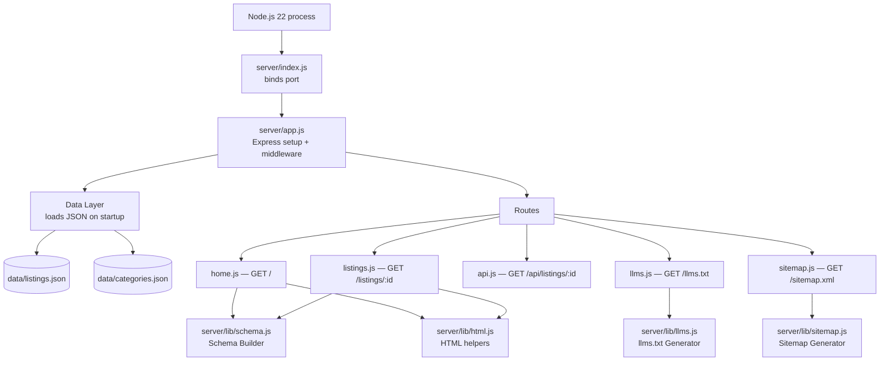

# Design Document

## Overview

First Answer Pages is a server-rendered local business directory built on Node.js 22 and Express. The system reads business listing data from JSON files on disk, caches them in memory at startup, and serves five route groups: a home page directory, individual listing pages, a JSON API, a plain-text AI feed (`/llms.txt`), and an XML sitemap.

The rendering model is fully server-side. All HTML is generated via JavaScript template literal helpers — no template engine dependency, no client-side framework, no bundler. The page aesthetic mirrors a classic printed phone book: paper-yellow background, bold black text, two-column listing grids, and bold category section dividers.

Three generator modules — Schema Builder, llms.txt Generator, and Sitemap Generator — are pure functions that accept listing data and return strings. Their isolation makes them directly unit- and property-testable without HTTP machinery.

---

## Architecture

### High-Level Flow



### File Layout

```
server/
├── app.js            # Express app: middleware, route registration, 404 handler
├── index.js          # Binds to PORT (default 3000), starts listening
├── data.js           # Data layer: loads + caches listings and categories
├── lib/
│   ├── schema.js     # Schema Builder: Listing → JSON-LD object
│   ├── llms.js       # llms.txt Generator: Listing[] → plain text string
│   ├── sitemap.js    # Sitemap Generator: Listing[] + baseUrl → XML string
│   └── html.js       # HTML template helpers: layout, listing card, etc.
└── routes/
    ├── home.js       # GET /
    ├── listings.js   # GET /listings/:id
    ├── api.js        # GET /api/listings/:id
    ├── llms.js       # GET /llms.txt
    └── sitemap.js    # GET /sitemap.xml
```

### Data Layer (`server/data.js`)

- On module import, reads `data/listings.json` and `data/categories.json` synchronously (startup cost only).
- Exports two arrays: `listings` and `categories`.
- Exposes helper functions: `findById(id)`, `filterListings({ category, city })`, `groupByCategory(listings)`.
- No write-back in v1. Data is read-only from the web layer.

### Express Setup (`server/app.js`)

- Registers `express.static('public')` to serve CSS and any static assets.
- Registers all route modules.
- Registers a catch-all 404 handler returning an HTML 404 page.
- No session, no auth, no body parser beyond Express built-ins.

---

## Components and Interfaces

### Data Layer — `server/data.js`

```js
/**
 * @returns {Listing[]} all listings loaded from data/listings.json
 */
export function getListings() { ... }

/**
 * @returns {Category[]} all categories from data/categories.json
 */
export function getCategories() { ... }

/**
 * @param {string} id
 * @returns {Listing|undefined}
 */
export function findById(id) { ... }

/**
 * @param {{ category?: string, city?: string }} filters
 * @returns {Listing[]}
 */
export function filterListings(filters) { ... }

/**
 * @param {Listing[]} listings
 * @returns {Map<string, Listing[]>} category slug → listings
 */
export function groupByCategory(listings) { ... }
```

### Schema Builder — `server/lib/schema.js`

```js
/**
 * Converts a Listing object to a schema.org LocalBusiness JSON-LD object.
 * Throws a descriptive Error if any required field is missing.
 *
 * @param {Listing} listing
 * @returns {Object} JSON-LD LocalBusiness object
 */
export function buildSchema(listing) { ... }
```

### llms.txt Generator — `server/lib/llms.js`

```js
/**
 * Generates the full /llms.txt content.
 *
 * @param {Listing[]} listings
 * @param {string} baseUrl  e.g. "https://firstanswerpages.com"
 * @returns {string}
 */
export function generateLlmsTxt(listings, baseUrl) { ... }
```

### Sitemap Generator — `server/lib/sitemap.js`

```js
/**
 * Generates a Sitemap Protocol 0.9 XML document.
 *
 * @param {Listing[]} listings
 * @param {string} baseUrl
 * @returns {string} XML string
 */
export function generateSitemap(listings, baseUrl) { ... }
```

### HTML Helpers — `server/lib/html.js`

```js
/**
 * Wraps page content in the full HTML shell (head, nav, footer).
 * @param {{ title: string, body: string }} options
 * @returns {string}
 */
export function layout({ title, body }) { ... }

/**
 * Renders a compact listing card for the home page directory.
 * @param {Listing} listing
 * @returns {string}
 */
export function listingCard(listing) { ... }

/**
 * Renders the full listing detail page body.
 * @param {Listing} listing
 * @param {string} jsonLd  serialized JSON-LD string for the <script> block
 * @returns {string}
 */
export function listingDetail(listing, jsonLd) { ... }
```

---

## Data Models

### Listing Object

```js
/**
 * @typedef {Object} Listing
 * @property {string}            id          - URL-safe slug, e.g. "nashville-plumbing-co"
 * @property {string}            name        - Business display name
 * @property {string}            category    - Slug matching a Category; e.g. "plumbers"
 * @property {string}            phone       - "(555) 555-XXXX"
 * @property {Object.<string,string>} hours  - Day name → time range or "Closed"
 * @property {string[]}          services    - At least one service description
 * @property {string}            serviceArea - City or region served
 * @property {string}            description - 1–3 plain sentences
 * @property {string}            city        - City of business location
 * @property {string}            state       - Two-letter abbreviation, e.g. "TN"
 * @property {string}            [address]   - Optional street address
 */
```

Listings are stored as a JSON array in `data/listings.json`. Example record:

```json
{
  "_comment": "SAMPLE DATA — fictional businesses for development and demonstration only",
  "id": "nashville-pipe-pros",
  "name": "Nashville Pipe Pros",
  "category": "plumbers",
  "phone": "(555) 555-0101",
  "hours": {
    "Monday": "8am–5pm",
    "Tuesday": "8am–5pm",
    "Wednesday": "8am–5pm",
    "Thursday": "8am–5pm",
    "Friday": "8am–5pm",
    "Saturday": "9am–1pm",
    "Sunday": "Closed"
  },
  "services": ["Drain cleaning", "Pipe repair", "Water heater installation"],
  "serviceArea": "Nashville and Davidson County",
  "description": "We fix pipes. Licensed and insured, serving Nashville since 2005.",
  "city": "Nashville",
  "state": "TN",
  "address": "412 Main St"
}
```

### Category Object

```js
/**
 * @typedef {Object} Category
 * @property {string} slug   - URL-safe identifier, e.g. "plumbers"
 * @property {string} label  - Display name, e.g. "Plumbers"
 */
```

Stored as a JSON array in `data/categories.json`:

```json
[
  { "slug": "plumbers",     "label": "Plumbers" },
  { "slug": "electricians", "label": "Electricians" },
  { "slug": "restaurants",  "label": "Restaurants" },
  { "slug": "auto-repair",  "label": "Auto Repair" },
  { "slug": "hair-salons",  "label": "Hair Salons" },
  { "slug": "lawyers",      "label": "Lawyers" }
]
```

### Lookup Strategy

- `findById(id)` uses `Array.prototype.find` over the in-memory listings array. O(n) is acceptable for v1 — the directory will have hundreds of listings, not millions.
- `filterListings({ category, city })` uses `Array.prototype.filter`. Case-insensitive city comparison via `.toLowerCase()`.
- `groupByCategory(listings)` reduces the array into a `Map<slug, Listing[]>`, preserving category order as defined in `categories.json`.

---

## Route Design

### GET /

- Reads query params `?category=` and `?city=` (both optional).
- Calls `filterListings({ category, city })` to get the working set.
- Calls `groupByCategory(filteredListings)` to organize for display.
- Renders HTML using `layout()` + category section template + `listingCard()` per listing.
- When no listings match filters, renders a "no results found" message inside the normal page shell.
- Returns 200 with `Content-Type: text/html`.

### GET /listings/:id

- Calls `findById(req.params.id)`.
- If not found: returns 404 with HTML "listing not found" page.
- If found: calls `buildSchema(listing)`, serializes to JSON, calls `listingDetail(listing, jsonLd)`, wraps in `layout()`.
- Returns 200 with `Content-Type: text/html`.

### GET /api/listings/:id

- Calls `findById(req.params.id)`.
- If not found: returns 404 with `Content-Type: application/json` and `{ "error": "Listing not found" }`.
- If found: returns 200 with `Content-Type: application/json` and the full listing object.

### GET /llms.txt

- Calls `generateLlmsTxt(getListings(), baseUrl)`.
- `baseUrl` derived from `process.env.BASE_URL` or `'http://localhost:3000'`.
- Returns 200 with `Content-Type: text/plain`.

### GET /sitemap.xml

- Calls `generateSitemap(getListings(), baseUrl)`.
- Returns 200 with `Content-Type: application/xml`.

---

## Rendering

### Philosophy

All HTML is produced by JavaScript functions returning strings. No external template engine is introduced. Template literals handle interpolation. A small `html.js` module holds reusable layout and component fragments.

### Page Aesthetic — Old Phone-Book Style

```css
/* Core palette */
--color-page-bg:   #FDF3C0;  /* paper yellow */
--color-text:      #1A1A1A;  /* near-black */
--color-divider:   #333333;
--color-link:      #0000EE;  /* classic blue hyperlink */

/* Layout */
body           { font-family: Georgia, serif; background: var(--color-page-bg); }
.directory     { columns: 2; column-gap: 2rem; }
.category-head { font-size: 1.4rem; font-weight: bold; border-bottom: 3px solid var(--color-divider); }
.listing-card  { break-inside: avoid; margin-bottom: 1rem; }
```

Key visual decisions:
- Two-column directory grid via CSS `columns` (degrades gracefully in narrow viewports with a `@media` breakpoint).
- Bold category headings with a thick bottom border act as section dividers.
- Listing cards are compact: name in bold, phone on the same line, city + category below, a "View details →" link.
- The full listing page uses a single-column layout with all fields displayed in a definition-list (`<dl>`) style.
- No JavaScript required. Filters are `<form method="GET">` submissions — full page reloads.

### JSON-LD Embedding

The `listingDetail` helper injects the schema into a `<script type="application/ld+json">` tag inside the `<head>` of the page shell. The JSON is produced by `buildSchema()` and serialized with `JSON.stringify(schema, null, 2)`.

---

## Schema Builder — Field Mapping

`buildSchema(listing)` performs this mapping:

| Listing field | JSON-LD property | Notes |
|---|---|---|
| `name` | `name` | Direct copy |
| `phone` | `telephone` | Direct copy |
| `description` | `description` | Direct copy |
| `address` | `address.streetAddress` | Inside a `PostalAddress` object |
| `city` | `address.addressLocality` | Inside `PostalAddress` |
| `state` | `address.addressRegion` | Inside `PostalAddress` |
| `services` | `hasOfferCatalog` | `OfferCatalog` with `itemListElement` array of `Offer` objects |

Required constants added by the builder:

```json
{
  "@context": "https://schema.org",
  "@type": "LocalBusiness",
  "address": {
    "@type": "PostalAddress"
  },
  "hasOfferCatalog": {
    "@type": "OfferCatalog"
  }
}
```

**Error handling**: Before building, the function checks that `name`, `phone`, `description`, `city`, `state`, and `services` are all present and non-empty. If any is missing, it throws `new Error('Schema_Builder: missing required field: <fieldName>')`.

---

## llms.txt Generator — Format

```
# First Answer Pages
# Free local business directory — Nashville, TN
# Total listings: {n}
# https://firstanswerpages.com

## {Category Label}

### {Business Name}
Phone: {phone}
Category: {category label}
City: {city}, {state}
Service Area: {serviceArea}
Page: {baseUrl}/listings/{id}

[...entries in alphabetical order by name within each category...]
```

Within each category block, entries are sorted alphabetically by `name` (case-insensitive).

---

## Sitemap Generator — Format

Conforms to [Sitemap Protocol 0.9](https://www.sitemaps.org/protocol.html):

```xml
<?xml version="1.0" encoding="UTF-8"?>
<urlset xmlns="http://www.sitemaps.org/schemas/sitemap/0.9">
  <url>
    <loc>{baseUrl}/</loc>
  </url>
  <url>
    <loc>{baseUrl}/listings/{id}</loc>
  </url>
  <!-- one <url> per listing -->
</urlset>
```

The home page `<url>` entry appears first. Listing entries follow in the order they appear in `listings.json`.

---

## Seed Data

`data/listings.json` is populated with 18 fictional Nashville businesses — 3 per category across all 6 categories. The top-level array has a leading `_comment` field.

| Category | Count | Example Name |
|---|---|---|
| Plumbers | 3 | Nashville Pipe Pros |
| Electricians | 3 | Volt Brothers Electric |
| Restaurants | 3 | The Griddle House |
| Auto Repair | 3 | Cumberland Auto Works |
| Hair Salons | 3 | Shear Nashville |
| Lawyers | 3 | Barrett & Hollow Law |

All phone numbers follow `(555) 555-XXXX` with unique four-digit suffixes. All `city` values are `"Nashville"`, all `state` values are `"TN"`. Names are clearly fictional.

---

## Correctness Properties

*A property is a characteristic or behavior that should hold true across all valid executions of a system — essentially, a formal statement about what the system should do. Properties serve as the bridge between human-readable specifications and machine-verifiable correctness guarantees.*

### Property 1: Schema Builder preserves required constants

*For any* valid Listing object, `buildSchema(listing)` SHALL produce an object where `@context` equals `"https://schema.org"` and `@type` equals `"LocalBusiness"`.

**Validates: Requirements 3.3, 8.1, 8.2**

---

### Property 2: Schema Builder field mapping is correct

*For any* valid Listing object, `buildSchema(listing)` SHALL produce an object where `name` equals `listing.name`, `telephone` equals `listing.phone`, and `description` equals `listing.description`.

**Validates: Requirements 3.2, 8.3, 8.4**

---

### Property 3: Schema Builder never throws for valid input

*For any* valid Listing object with all required fields present, `buildSchema(listing)` SHALL not throw an error.

**Validates: Requirements 3.4, 8.5**

---

### Property 4: Schema Builder throws for missing required fields

*For any* Listing object where one required field has been removed, `buildSchema(listing)` SHALL throw an Error.

**Validates: Requirements 3.5**

---

### Property 5: llms.txt contains every listing's name

*For any* non-empty array of valid Listing objects, `generateLlmsTxt(listings, baseUrl)` SHALL produce a string that contains the `name` of every listing in the input array.

**Validates: Requirements 5.2, 9.1**

---

### Property 6: llms.txt contains every listing's page URL

*For any* non-empty array of valid Listing objects and a base URL, `generateLlmsTxt(listings, baseUrl)` SHALL produce a string that contains `{baseUrl}/listings/{id}` for every listing in the input array.

**Validates: Requirements 5.3, 9.2**

---

### Property 7: llms.txt entry count equals listing count

*For any* non-empty array of valid Listing objects, the number of listing entries in the `generateLlmsTxt` output SHALL equal the number of listings passed in.

**Validates: Requirements 9.3**

---

### Property 8: llms.txt entries are alphabetically ordered within categories

*For any* non-empty array of valid Listing objects, the names within each category block of the `generateLlmsTxt` output SHALL appear in case-insensitive alphabetical order.

**Validates: Requirements 5.5**

---

### Property 9: Sitemap contains every listing's page URL

*For any* non-empty array of valid Listing objects and a base URL, `generateSitemap(listings, baseUrl)` SHALL produce an XML string that contains `{baseUrl}/listings/{id}` for every listing in the input array.

**Validates: Requirements 6.2, 10.1**

---

### Property 10: Sitemap has well-formed XML structure

*For any* non-empty array of valid Listing objects, `generateSitemap(listings, baseUrl)` SHALL produce a string containing `<urlset` and `xmlns="http://www.sitemaps.org/schemas/sitemap/0.9"`.

**Validates: Requirements 6.4, 10.2**

---

### Property 11: Sitemap URL count equals listing count plus one

*For any* non-empty array of valid Listing objects, the number of `<url>` elements in the `generateSitemap` output SHALL equal `listings.length + 1` (the extra entry being the home page).

**Validates: Requirements 6.3, 10.3**

---

### Property 12: Category filtering returns only matching listings

*For any* array of Listing objects and any category filter value, `filterListings({ category })` SHALL return only listings whose `category` field equals the filter value.

**Validates: Requirements 1.4**

---

### Property 13: City filtering is case-insensitive

*For any* array of Listing objects and any city filter string, `filterListings({ city })` SHALL return only listings whose `city` field matches the filter value case-insensitively, and SHALL include all listings that match regardless of casing difference.

**Validates: Requirements 1.5**

---

### Property 14: Combined filtering is a logical intersection

*For any* array of Listing objects and any combination of category and city filter values, `filterListings({ category, city })` SHALL return exactly the set of listings that satisfy both filters simultaneously.

**Validates: Requirements 1.6**

---

## Error Handling

| Scenario | Response |
|---|---|
| `GET /listings/:id` with unknown id | HTTP 404, HTML page: "Listing not found" |
| `GET /api/listings/:id` with unknown id | HTTP 404, JSON: `{ "error": "Listing not found" }` |
| `buildSchema` called with missing field | Throws `Error('Schema_Builder: missing required field: <name>')` |
| `data/listings.json` malformed at startup | Process exits with a descriptive error message |
| `data/categories.json` malformed at startup | Process exits with a descriptive error message |
| Any unmatched route | HTTP 404, HTML page: "Page not found" |
| Any unhandled server error | HTTP 500, HTML page: "Something went wrong" (generic, no stack trace in production) |

Startup failures are fatal — the process should not silently serve partial data. Route-level 404s are expected and handled gracefully with user-friendly pages.

---

## Testing Strategy

### Test Files

| File | Runner | Type | Covers |
|---|---|---|---|
| `test/schema.test.js` | node:test + fast-check | Property-based | Schema Builder (Properties 1–4) |
| `test/llms.test.js` | node:test + fast-check | Property-based | llms.txt Generator (Properties 5–8) |
| `test/sitemap.test.js` | node:test + fast-check | Property-based | Sitemap Generator (Properties 9–11) |
| `test/listings.test.js` | node:test + fast-check | Property-based + unit | Data helpers: filterListings (Properties 12–14), findById, groupByCategory |
| `test/api.test.js` | node:test | Integration | GET /api/listings/:id — 200, 404, Content-Type header |

Run all tests: `node --test`

### fast-check Arbitrary for a Valid Listing

```js
import fc from 'fast-check';

const arbId = fc.stringMatching(/^[a-z][a-z0-9-]{3,39}$/);
const arbPhone = fc.stringMatching(/^\(555\) 555-\d{4}$/);
const arbDay = fc.constantFrom('Monday','Tuesday','Wednesday','Thursday','Friday','Saturday','Sunday');
const arbHoursValue = fc.oneof(fc.constant('Closed'), fc.stringMatching(/^\d{1,2}(am|pm)–\d{1,2}(am|pm)$/));

const arbListing = fc.record({
  id:          arbId,
  name:        fc.string({ minLength: 2, maxLength: 80 }),
  category:    fc.constantFrom('plumbers','electricians','restaurants','auto-repair','hair-salons','lawyers'),
  phone:       arbPhone,
  hours:       fc.dictionary(arbDay, arbHoursValue, { minKeys: 1, maxKeys: 7 }),
  services:    fc.array(fc.string({ minLength: 2, maxLength: 60 }), { minLength: 1, maxLength: 10 }),
  serviceArea: fc.string({ minLength: 2, maxLength: 80 }),
  description: fc.string({ minLength: 10, maxLength: 300 }),
  city:        fc.string({ minLength: 2, maxLength: 60 }),
  state:       fc.stringMatching(/^[A-Z]{2}$/),
  address:     fc.option(fc.string({ minLength: 5, maxLength: 100 }), { nil: undefined }),
});
```

### Property Test Configuration

- Minimum **100 iterations** per property test (fast-check default is 100; do not reduce).
- Each `fc.assert` call includes a comment referencing the design property:
  `// Feature: listings-and-ai-readable-pages, Property 1: Schema Builder preserves required constants`
- Each correctness property from this document maps to exactly **one** `fc.assert` call in the test file.

### Unit Tests (listings.test.js and api.test.js)

- `findById` with a known id → returns correct listing.
- `findById` with unknown id → returns `undefined`.
- `groupByCategory` with mixed listings → categories appear in the order defined by `categories.json`.
- `filterListings` with no filters → returns all listings (identity).
- `filterListings` with a filter that matches nothing → returns empty array.
- API route: `GET /api/listings/nashville-pipe-pros` → 200, correct JSON body, `application/json` header.
- API route: `GET /api/listings/does-not-exist` → 404, `{ "error": "Listing not found" }`, `application/json` header.

### What Is Not Tested

- Visual layout and CSS rendering (cannot be automated here).
- JavaScript-disabled behavior (architectural constraint, verified by design — no `<script>` tags on rendered pages except the JSON-LD block).
- External AI assistant consumption (out of scope for automated tests).
