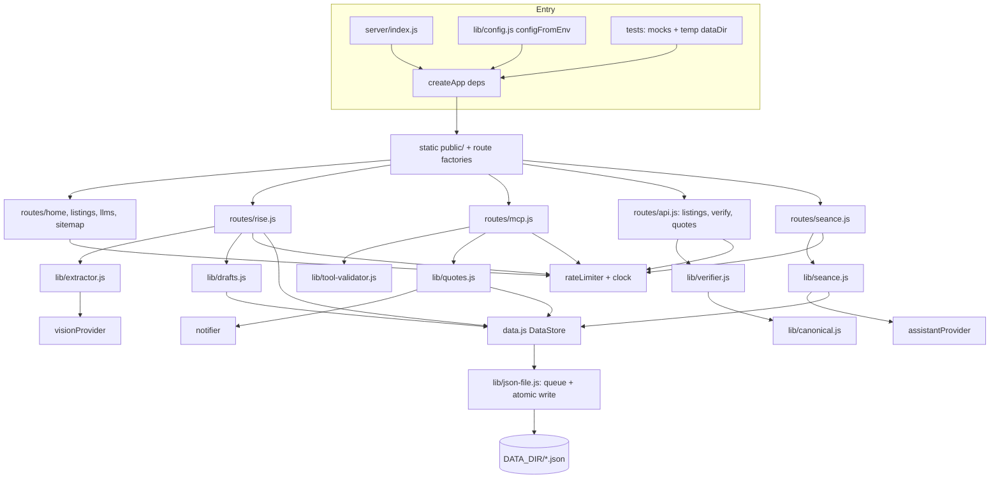
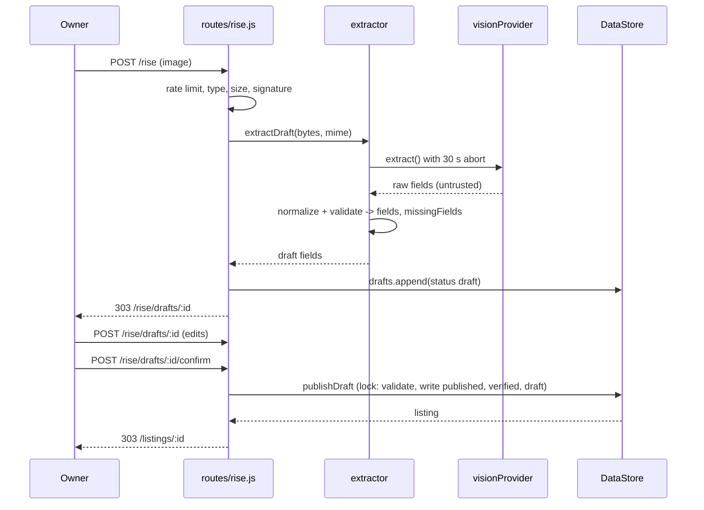

# Design Document: Super Pages

## Overview

Super Pages extends the finished `listings-and-ai-readable-pages` build with four features, built in this order: Rise from the Grave (photo to draft listing), Agent-ready (MCP server, quote requests, WebMCP), the Owner-verified stamp (SHA-256 of a canonical listing), and the Seance (does an AI assistant name this business, with history).

The existing app is a module-level singleton: `server/app.js` builds one Express `app`, `server/data.js` reads JSON once at import, and routes import `data.js` functions directly. That shape cannot support injected mocks, a temporary `DATA_DIR`, or a refreshable cache. The central design move is to turn it into a factory (`createApp(deps)`) over an instance-based data store, while keeping every existing import path and test working unchanged.

### Design decisions at a glance

| Question | Decision |
|---|---|
| A2A endpoint built in this spec? | **No.** The Agent_Card stays unpublished. `GET /.well-known/agent-card.json` returns 404. The card route and the A2A endpoint route are registered together by one function, `mountA2A`, which runs only when an `a2a` dependency is supplied. This spec supplies none. (Requirements 8.3, 8.4, 8.5) |
| Cache refresh on publish | `server/data.js` gains `createDataStore({dataDir})`. Publishing writes `published.json` and `verified.json`, then swaps the in-memory arrays inside the store. No file watching, no restart. |
| `DATA_DIR` | Resolved once per store: `createApp({dataDir})` argument, else `process.env.DATA_DIR`, else repo `data/`. |
| Testability | `createApp({dataDir, visionProvider, notifier, assistantProvider, clock, rateLimiter})`. Env-based selection lives only in `lib/config.js`. |
| Uploads without a multipart library | Raw image body, or `application/x-www-form-urlencoded` with a base64 text field. A file picker needs a small optional script (`public/js/rise.js`). |
| Writes | One promise queue per file path, read-modify-write inside the queue, temp file plus rename. |
| Hash | SHA-256 over the canonical JSON of `{listing, verifiedDate}`. Keys sorted by code point, not UTF-16 unit. |
| MCP transport | Hand-written JSON-RPC 2.0 over `POST /mcp`, JSON responses only (no SSE), no SDK. |

### Findings from reading the existing code

- `data.js` calls `process.exit(1)` on a load failure and exports `getListings`, `getCategories`, `findById`, `filterListings`, `groupByCategory`. `html.js` and `lib/llms.js` import `getCategories` directly. Existing tests import `app` (default export) and `findById`.
- `routes/*.js` each `export default router` and import `data.js` directly.
- `layout()` takes `{title, body, jsonLd}` and has no slot for scripts. `listingDetail(listing, jsonLd)` renders the detail body. `buildSchema(listing)` throws if `name`, `phone`, `description`, `city`, `state`, or `services` is missing.
- `test/api.test.js` asserts `/api/listings/:id` deep-equals the stored listing. Verification fields therefore must be added only for verified listings, so the seed listings (unverified) keep passing.
- Seed hours keys may be capitalised; `listingDetail` already matches case-insensitively. New drafts use lowercase day names (Requirement 3.4).

### Requirement gaps resolved in this design

1. **Description, city, and state.** Requirement 3.4 does not validate them, but `buildSchema` throws without them, so a published listing missing any of them would 500 on its own page. The validator in this design also requires `description` (non-empty), `city` (non-empty), and `state` (two uppercase letters). These are added to `missingFields` when absent, and block confirmation. Extraction asks the model for them when visible; otherwise the owner fills them in during review.
2. **Requirement 11.8 is too strong as written.** Adding a prefix and suffix can create a new match across the boundary (answer `x`, name `x y`, suffix `y`). The property is tested as: (a) `named: true` stays `true` after adding any prefix and suffix; (b) `named` is unchanged when the affixes use an alphabet disjoint from the name. See Property 22.
3. **Notifier has no owner address.** The Listing model has a phone number but no email. The only real Notifier built here is `console` (writes a line to stdout). The `Notifier` interface is what email or SMS adapters would implement later. See Requirement 6.5.
4. **Truly no-JS upload.** A browser cannot turn a file into base64 without JavaScript, and multipart is rejected by Requirement 1.3. The no-JS form therefore carries a base64 textarea (usable by scripts and `curl`), and `public/js/rise.js` adds a file picker as progressive enhancement. See "No-JS upload form".
5. **Discard after publish.** `POST /rise/drafts/:id/discard` deletes only drafts with status `draft`. A `publishing` or `published` draft returns 409, so a published listing never loses its audit link.
6. **WebMCP API location.** Chrome's current documentation registers tools on `document.modelContext`, while Requirement 7 says `navigator.modelContext`. The script reads `navigator.modelContext` first and falls back to `document.modelContext`. Source: [Chrome WebMCP imperative API](https://developer.chrome.com/docs/ai/webmcp/imperative-api) (content rephrased for compliance with licensing restrictions). The API is still in an origin trial, so the script must tolerate its absence.

### Build order and the Verifier dependency

The requested order is Rise, Agent-ready, Verified stamp, Seance. Two things cross that order:

- Requirement 5.6, Requirement 10.12, and the MCP `get_listing` result need a Verification_Hash. Rise confirmation also writes `verified.json` (Requirement 10.10).
- Every feature needs the injectable app, the store, and the safe writer.

So the plan is a foundation step, then the four features:

| Step | Contents |
|---|---|
| 0. Foundation | `createApp` refactor, `createDataStore`, `json-file.js`, `rate-limiter.js`, `config.js`, **`canonical.js` and `verifier.js` (pure hash functions plus the `verified` map in the store)**. No UI, no endpoint. Existing tests stay green. |
| 1. Rise | Upload, vision providers, extractor, validator, drafts, review, confirm/publish. Confirm sets the Verified_Date through the store. |
| 2. Agent-ready | `/mcp`, tool validator, quotes, notifier, WebMCP script, listing-page quote form. `get_listing` calls the real Verifier from step 0. |
| 3. Verified stamp | Stamp element, JSON-LD `identifier` and `dateModified`, `GET /api/verify/:id`, verification fields in `/api/listings/:id`. |
| 4. Seance | Prompts, detection, assistant providers, history, report, admin trigger. |

If step 0 is cut for time, the fallback is a stub `verifier.js` exporting `verificationFor(listing) -> null`; `get_listing` then returns `verification: null`. The real module replaces it in step 3 with no interface change. Step 0 is small (two pure functions and a map lookup), so building it early is the recommendation.

## Architecture



### Dependency injection

`createApp` takes one object. Every field is optional; missing fields come from `configFromEnv(process.env)`.

```js
createApp({
  dataDir,            // string. Wins over DATA_DIR env.
  visionProvider,     // { name, extract({ bytes, mimeType, signal }) -> Promise<object> }
  notifier,           // { name, notify({ quote, listing }) -> Promise<void> }
  assistantProvider,  // { name, ask({ prompt, signal }) -> Promise<string> }
  clock,              // { now() -> epoch ms }
  rateLimiter,        // { consume(key, { limit, windowMs }) -> { allowed, retryAfterSeconds } }
  // extras, all optional
  config,             // { adminToken, baseUrl, providerTimeoutMs }
  newId,              // () -> string, defaults to crypto.randomUUID
  a2a,                // undefined in this spec. See "A2A decision".
})
```

Rules:

- `app.js` exports `createApp` and keeps `export default createApp()` so `import app from '../server/app.js'` in existing tests still works. The default instance uses env config, the repo `data/` directory, and (under the test runner) mocks.
- Env-based provider selection happens only in `lib/config.js`. Rule: `VISION_API_KEY` unset gives the mock; `NODE_TEST_CONTEXT` set (Node's test runner sets it in child processes) gives the mock; same for assistant and notifier. New tests do not rely on this; they inject mocks explicitly.
- Route modules are factories: `export function createListingsRouter(ctx)`. `ctx` is the resolved dependency bag `{ store, visionProvider, notifier, assistantProvider, clock, rateLimiter, config, newId }`. No route imports a provider or reads `process.env`.
- Mocks live next to their real siblings (`vision.js` exports `createMockVisionProvider`, `assistant.js` exports `createMockAssistantProvider`, `notifier.js` exports `createMockNotifier`) so tests import them without extra fixtures.
- `clock` is used for timestamps, Verified_Date, rate-limit windows, and seance history. Nothing in `server/` calls `Date.now()` outside `clock`.

### A2A decision

An A2A endpoint is **not built** in this spec. Requirement 8 only permits an Agent_Card when a real endpoint answers behind it, and no requirement defines A2A tasks, skills, or message handling. Building one would be a fifth feature.

Mechanism: `server/app.js` contains

```js
if (ctx.a2a) mountA2A(app, ctx.a2a); // registers BOTH the card route and ctx.a2a.path together
```

`mountA2A` lives in `server/routes/a2a.js`, is about 15 lines, and is the only place the card route is registered. Because the card and the endpoint come from one call, they cannot be enabled separately (Requirement 8.4). With no `a2a` dependency, no route exists, and the catch-all 404 answers `GET /.well-known/agent-card.json`. A test asserts the 404 and asserts that no `app._router` layer matches the card path. The file `routes/a2a.js` is created only if the team wants the seam; omitting the file and the `if` is equally valid. Recommendation: include the 15-line seam and its test, since Requirement 8.5 asks the design to be explicit and the test locks the decision in.

### Data store, cache refresh, and DATA_DIR

`server/data.js` becomes:

```js
export function createDataStore({ dataDir, fs? }) -> DataStore   // synchronous construction
// legacy exports, unchanged signatures, delegate to a lazily created default store:
export function getListings(); getCategories(); findById(id); filterListings(f); groupByCategory(list)
```

The default store is created on first use from `DATA_DIR || <repo>/data`. If creation fails it writes to stderr and calls `process.exit(1)`, as today. `createDataStore` itself throws, so tests can assert on bad files.

Loading (synchronous, at construction):

| File | Role | Missing | Corrupt |
|---|---|---|---|
| `listings.json` | seed listings, read-only | `[]` | throw |
| `categories.json` | categories, read-only | `[]` | throw |
| `published.json` | listings published from drafts | `[]` | throw |
| `verified.json` | `{ [id]: "YYYY-MM-DD" }` | `{}` | throw |
| `drafts.json`, `quotes.json`, `seance.json` | read on demand, not cached | `[]` | request fails with 500, file untouched |

Entries with a `_comment` field are filtered out of `listings.json` as today. The published set is `listings.json` followed by `published.json`; on an `id` collision the seed entry wins and the later one is dropped with a stderr warning (cannot happen through the app because slug allocation checks both).

**Refresh.** The store holds `state = { published: Listing[], verified: Record<string,string> }`. A write method does its file I/O inside the per-file queue, and only after the rename succeeds does it replace `state.published` (or `state.verified`) with a new array or object. Readers always see a complete, immutable snapshot. There is no watcher and no restart. Edits made to `listings.json` or `categories.json` by hand still need a restart (current behaviour), or a call to `store.reload()`, which tests and ops can use.

Store methods that touch published data:

```js
store.getListings()            // seed + published snapshot (new frozen array)
store.getCategories()
store.findById(id)
store.searchListings({ category, city, query, limit })   // shared by home page and MCP
store.getVerifiedDate(id)      // string | undefined
store.publishDraft(...)        // see "Publish sequence"
store.updatePublished(id, patch)  // internal, used by tests and a future edit route; no HTTP route
store.reload()
store.collection(name)         // name in { drafts, quotes, seance }: { read, update, append }
```

`collection()` rejects any name outside the allow-list of `drafts`, `quotes`, `seance`. The only other writes (`published.json`, `verified.json`) go through `publishDraft` and `updatePublished`. No method accepts a caller-chosen filename, which enforces Requirement 14.1. `listings.json` and `categories.json` have no write path at all.

**Publish sequence** (confirm, Requirement 4.3, 4.5, 10.10). Runs inside `store.withLock('publish', fn)`, a queue keyed by a logical name, so two confirms cannot interleave. Inside the lock:

1. Read the draft. If `status` is `published`, return the existing listing (idempotent). If not `draft` or `publishing`, return 409.
2. Validate the fields. Any failure returns 422 with the failing fields and writes nothing.
3. Choose the listing id: `draft.reservedId` if present, else `makeSlug(name, city, takenIds)`. Write the draft with `status: 'publishing'` and `reservedId`. This pins the id so a retry after a crash does not mint a second id.
4. Append the listing to `published.json` unless an entry with that id exists already.
5. Write `verified.json[id] = today (clock)`.
6. Set the draft to `status: 'published'`, `listingId: id`.
7. Swap the in-memory snapshot.

A crash between steps leaves a draft in `publishing`; re-confirming completes the remaining steps without duplicating. A listing visible without a Verified_Date (crash between 4 and 5) renders as unverified until the retry, which is the safe direction.

### Write serialization and atomic writes

`server/lib/json-file.js` is the only module that writes files.

```js
readJsonFile(path, fallback, { fs }) -> Promise<value>      // missing file -> fallback; bad JSON -> throws StoreError
updateJsonFile(path, mutator, { fs }) -> Promise<result>    // queued read-modify-write
```

- **Queue.** A module-level `Map<absolutePath, Promise>`. `updateJsonFile` chains onto the tail for that path: `tail.then(run)`. The stored tail is `run.catch(() => {})` so one failed write does not block later ones, while the caller still receives the rejection. The map is module-level (not per store) so two stores pointed at one directory in the same process still serialize. Separate processes are not coordinated; the app is single-process.
- **Read-modify-write inside the queue.** The mutator receives the freshly read value, so two concurrent appends each see the other's result. A bad-JSON read aborts the update; the file is never overwritten with a guess.
- **Atomic write.** Write `<path>.<pid>.<random>.tmp` in the same directory, `fsync` it, then `rename` over the target. On `EPERM`, `EBUSY`, or `EACCES` (Windows with antivirus or an open handle), retry up to 3 times with 10, 25, 50 ms delays. On final failure delete the temp file and throw, leaving the previous content intact (Requirement 4.10).
- **Test seam.** An optional `fs` argument lets tests inject delays and failures to force interleavings and verify the previous content survives (Property 25 and the failure-injection example test).

### File layout

This matches the `structure` steering: all server code under `server/`, routes one file per group, tests under `test/`, browser script under `public/js/`, `data/` JSON only.

```
server/
├── app.js                 createApp(deps) + default export
├── index.js               unchanged (imports default app)
├── data.js                createDataStore + legacy accessors
├── lib/
│   ├── config.js          configFromEnv, isTestRun
│   ├── json-file.js       queue, atomic write
│   ├── rate-limiter.js    createRateLimiter, RULES constants
│   ├── canonical.js       canonicalize, canonicalBytes
│   ├── verifier.js        verificationFor, hashListing, checkHash
│   ├── listing-fields.js  normalizePhone, normalizeFields, validateFields, makeSlug, DAYS
│   ├── vision.js          mock + openai-compatible + anthropic adapters, createVisionProvider
│   ├── extractor.js       extractDraft
│   ├── upload.js          detectImageType, decodeBase64Image, body-limit constants
│   ├── drafts.js          Draft_Store
│   ├── tool-validator.js  validateAgainstSchema, validateQuoteArgs
│   ├── mcp.js             tool definitions, JSON-RPC dispatch
│   ├── quotes.js          Quote_Store, submitQuote
│   ├── notifier.js        mock + console
│   ├── assistant.js       mock + openai-compatible + anthropic adapters
│   ├── seance.js          buildPrompt, normalizeForMatch, detectNamed, Seance_Store, runSeance
│   ├── rise-html.js       upload form, review form, result pages
│   ├── seance-html.js     report page
│   ├── html.js            + verifiedStamp, quoteForm, optional scripts slot (additive)
│   ├── schema.js          + optional verification argument (additive)
│   ├── llms.js            + optional categories argument (additive)
│   └── sitemap.js         unchanged
└── routes/
    ├── home.js            factory, uses store.searchListings
    ├── listings.js        factory, + POST /listings/:id/quote (no-JS form)
    ├── api.js             factory: GET /api/listings/:id, GET /api/verify/:id, POST /api/quotes
    ├── llms.js, sitemap.js  factories
    ├── rise.js            GET/POST /rise, /rise/drafts/:id[/confirm|/discard]
    ├── mcp.js             POST /mcp, 405 for other methods
    ├── seance.js          GET /seance/:id, GET /api/seance/:id, POST /seance/run
    └── a2a.js             mountA2A (not wired in this spec)
public/js/
├── webmcp.js              WebMCP_Script (ES module)
└── rise.js                optional file-picker enhancement
test/                      see Testing Strategy
```

Additive changes to existing modules keep existing tests valid: `layout({ title, body, jsonLd, scripts })` gains an optional `scripts` array; `listingDetail(listing, jsonLd, opts)` gains optional `opts`; `buildSchema(listing, verification)` gains an optional second argument; `generateLlmsTxt(listings, baseUrl, categories)` and the `html.js` helpers default `categories` to the default store when omitted. Before refactoring each, the existing tests in `test/html.test.js`, `test/schema.test.js`, `test/llms.test.js`, and `test/listings.test.js` should be read to confirm they do not pin the exact old output.

### Rate limiting

`createRateLimiter({ clock })` keeps a sliding-window log per key (array of timestamps). `consume(key, { limit, windowMs })` drops timestamps older than `now - windowMs`; if fewer than `limit` remain it records the call and returns `{ allowed: true }`; otherwise it returns `{ allowed: false, retryAfterSeconds: ceil((oldest + windowMs - now) / 1000) }`, clamped to `[1, ceil(windowMs / 1000)]`. Empty keys are deleted during pruning, and a global key cap (for example 10,000) evicts the least recently used key so a flood of spoofed addresses cannot grow memory without bound.

Rules live in one constant table so tests and docs agree:

| Key | Limit | Window | Requirement |
|---|---|---|---|
| `rise:<ip>` | 10 | 10 min | 1.6 |
| `mcp:<ip>` | 120 | 60 s | 5.15 |
| `quote:<ip>` | 5 | 1 h | 6.9 |
| `quote:<ip>:<listingId>` | 3 | 1 h | 6.9 |
| `seance:<ip>` | 10 | 1 h | 12.7 |
| `seance-listing:<listingId>` | 1 | 10 min | 12.7 |

The client key is `req.ip`. When the app runs behind a proxy, `req.ip` is the proxy address unless Express `trust proxy` is set. The design adds one optional env var, `TRUST_PROXY` (passed to `app.set('trust proxy', ...)`), documented in the README next to the Requirement 14.5 list. Without it every client shares one bucket behind a proxy.

When both quote rules apply, the check is atomic: peek both, then record both only if both allow, so a refused call does not consume the other budget.

### Canonical JSON and hash input

`canonicalize(value)` in `lib/canonical.js`:

- `null`, booleans: `JSON.stringify` output.
- Numbers: must be finite; `JSON.stringify(n)` (so `-0` becomes `0`, `1e21` stays in JSON form). `NaN` or `Infinity` throws `TypeError`.
- Strings: `JSON.stringify(s)`. Node 22 escapes lone surrogates as `\udXXX`, so output is always valid JSON.
- Arrays: `[` + elements joined by `,` + `]`, order preserved. `undefined` elements become `null` as in JSON.
- Objects: take own enumerable string keys, **omit keys whose value is `undefined`**, sort keys by **code point** (not the default `Array.prototype.sort`, which compares UTF-16 code units and orders surrogate pairs wrongly against BMP characters above U+D800), then emit `{"key":value,...}` with no whitespace.
- Functions, symbols, `bigint`, `Date`, `Map`: not JSON data; throw `TypeError`. Listings come from `JSON.parse`, so none appear.

Hash input in `lib/verifier.js`:

```js
const { verifiedDate, verificationHash, ...rest } = listing;           // Requirement 9.3
const input = canonicalize({ listing: rest, verifiedDate });           // Requirement 9.2
hash = createHash('sha256').update(input, 'utf8').digest('hex');        // lowercase hex
```

`canonicalize` returns a string and `update(..., 'utf8')` encodes it, so the bytes hashed are the UTF-8 of the canonical text. The hash is computed on every call from the current snapshot; no cache (Requirement 9.5), since a listing is a few hundred bytes.

`verificationFor(store, listing)` returns `null` when the store has no Verified_Date for the listing id, else `{ verifiedDate, hash }`. Unverified listings have no hash (Requirement 9.4 treats no entry as unverified).

Sensitivity caveat for the property: "adding a field" only changes the hash if the value is not `undefined`, and fields named `verifiedDate` or `verificationHash` are stripped by design. The generator avoids both.

### Upload handling

Order of work in `POST /rise`:

1. Rate limit `rise:<ip>` (counts every attempt, including rejected ones).
2. Read the base media type from `Content-Type`. If it is not `image/jpeg`, `image/png`, `image/webp`, or `application/x-www-form-urlencoded`, respond 415 naming the accepted image types **before reading the body**.
3. Image types: `express.raw({ type: <that type>, limit: 5242880 })`. Express's body parser rejects early on a larger `Content-Length` and aborts a chunked stream as soon as the count passes the limit, so the oversized body is not buffered (Requirement 1.2). An `entity.too.large` error maps to 413.
4. Form type: `express.urlencoded({ extended: false, limit: 8388608, parameterLimit: 10 })`. The limit is 8 MiB, not 5 MiB, because base64 inflates by 4/3 and percent-encoding of `+`, `/`, `=` adds more. A 5 MiB image encodes to about 7.0 million characters, around 7.4 million after typical encoding. An encoded body over 8 MiB is refused with 413; the decoded size is then checked against 5,242,880 bytes and also refused with 413.
5. Empty or missing body or field: 400 "no image was received". Invalid base64: 400 "image data could not be decoded". Base64 validity is checked with a strict regex after stripping whitespace and any `data:...;base64,` prefix, so `Buffer.from` leniency does not hide garbage.
6. `detectImageType(bytes)` compares the leading bytes to the three signatures (JPEG `FF D8 FF`, PNG 8-byte, WebP `RIFF` at 0-3 and `WEBP` at 8-11). For raw uploads the detected type must equal the declared type, else 415 "file content does not match the declared type". For form uploads the detected type becomes the declared type, and no match gives the same 415.
7. The bytes go to the extractor as a `Buffer` held in the request scope only. Nothing is written to disk and no byte is logged (Requirement 1.7). The buffer reference is dropped when the handler returns.

### No-JS upload form

`GET /rise` returns plain HTML:

```html
<form method="POST" action="/rise" enctype="application/x-www-form-urlencoded">
  <label>Image as base64 text
    <textarea name="imageBase64" rows="8" required></textarea></label>
  <button type="submit">Read my ad</button>
</form>
<noscript>...explains the paste-base64 route and the curl example...</noscript>
```

With JavaScript enabled, `public/js/rise.js` (module, about 40 lines) inserts a file input above the textarea. On change it checks size and type client-side, then either fills the textarea with the base64 of the file or, on submit, `fetch`es the raw bytes to `POST /rise` with the file's `Content-Type` and follows the redirect. Without JavaScript the form still submits and the server still works, which is the requirement. The page states plainly that picking a file needs JavaScript and shows a `curl --data-binary @ad.jpg -H "Content-Type: image/jpeg" .../rise` example. A successful upload responds `303 See Other` to `/rise/drafts/<id>`.

### Rise review and publication flow



Draft ids are `crypto.randomUUID()` values, so a draft URL is an unguessable capability link. Draft pages send `Cache-Control: no-store`, `X-Robots-Tag: noindex`, and `Referrer-Policy: no-referrer`. Drafts never enter the store snapshot, so every public route (`/`, `/listings/:id`, `/api/...`, `/llms.txt`, `/sitemap.xml`, `/mcp`) excludes them by construction (Requirement 4.6), not by filtering.

`POST /rise/drafts/:id` accepts a urlencoded form (limit 64 KiB), normalizes and revalidates the fields, saves them with the new `missingFields`, and redirects back to the form. `confirm` on a draft with failures returns 422 and re-renders the form with the failing fields highlighted.

### Vision and assistant providers

Both follow the same shape: `createXProvider(env)` returns the mock unless the provider name is known, the API key is set, and the run is not a test run.

- `VISION_PROVIDER=openai` (OpenAI-compatible chat completions with an image data URL; `VISION_BASE_URL` selects the host) or `anthropic` (Messages API). Each is one `fetch` call with `AbortSignal.timeout(30000)`, the model from `VISION_MODEL`, and the key from `VISION_API_KEY` in a header only. No default model id is hard-coded; a real provider without `VISION_MODEL` logs a warning and falls back to the mock.
- The extraction prompt asks for strict JSON with the keys `name`, `phone`, `category`, `services`, `hours`, `serviceArea`, `description`, `city`, `state`, `address`, and says to omit anything not visible. The reply is parsed with `JSON.parse` inside a try; a parse failure is an extraction failure (502).
- `SEANCE_PROVIDER` (`openai` or `anthropic`), `SEANCE_API_KEY`, `SEANCE_MODEL` work the same way for the assistant.
- The mock vision provider hashes the image bytes with SHA-256 and uses the first bytes of the digest to index a small fixture table of fictional businesses, with some fixtures deliberately missing a field so the review screen can be demonstrated. The mock assistant provider hashes the prompt and returns a canned answer that names a fixture business or not, chosen from the digest. Both are pure functions of their input (Requirement 2.5, 12.5).
- Keys come only from the environment, are placed only in the outbound request header, and are never logged, returned, or stored. Error logs print the HTTP status and provider name, not the request or response body.

### MCP endpoint

`routes/mcp.js` mounts `POST /mcp` with this chain: rate limit (`mcp:<ip>`), `express.raw({ type: () => true, limit: 65536 })`, handler. Parsing the body by hand lets the server return `-32700` for bad JSON, which `express.json` would turn into a generic error. Other methods on `/mcp` get `405` with `Allow: POST`.

Handler rules:

- Body is not valid JSON: HTTP 400, error `-32700`.
- Body is a JSON array (batch) or not an object with `jsonrpc: "2.0"` and a string `method`: HTTP 400, error `-32600`. Batches are not supported; the 2025-06-18 protocol revision removed them.
- A message without an `id` is a notification: respond `202` with an empty body, run nothing except `notifications/initialized` (no-op).
- `initialize`: reply with `protocolVersion` (the client's if supported, else the latest supported), `capabilities: { tools: { listChanged: false } }`, and `serverInfo: { name: 'first-answer-pages', version }`.
- `ping`: empty result.
- `tools/list`: exactly the three tools, each with `name`, `description`, `inputSchema`.
- `tools/call`: look up the tool (unknown gives `-32602` naming it), run `validateAgainstSchema(tool.inputSchema, args)` (failure gives `-32602` naming the argument), then the semantic checks for `request_quote`, then the tool logic.
- Unknown method: `-32601`.
- Any other JSON-RPC error responds HTTP 200 with the error object. A thrown exception inside tool logic is caught and returned as `-32603` with a generic message, never an HTTP 500.
- Success result shape: `{ content: [{ type: 'text', text: JSON.stringify(payload) }], structuredContent: payload }`, plus `isError: true` for tool-level failures (listing not found, quote rate limit).

`search_listings` calls `store.searchListings({ category, city, query, limit: 25 })`. Matching: `category` exact slug, `city` case-insensitive equality, `query` case-insensitive substring of `name`, `description`, or any service. An empty-string argument counts as "not supplied" (no trimming). Results are the listing summary fields (`id`, `name`, `category`, `phone`, `city`, `state`, `serviceArea`, `services`, `description`, `url`), in store order. `get_listing` returns the full listing plus `verification: { verified, verifiedDate, hash }`.

The server is unauthenticated and uses no cookies, so no CSRF or origin allow-list is added in v1.

### Tool validator

`lib/tool-validator.js` implements the small JSON Schema subset the three tools use, by hand: `type` (`object`, `string`), `properties`, `required`, `additionalProperties: false`, `minLength`, `maxLength`. It returns `{ ok: true, value }` or `{ ok: false, argument, message }`. It is total: it accepts any JavaScript value (including arrays, `null`, nested objects, huge strings) and never throws. `__proto__` is handled as an ordinary key because arguments come from `JSON.parse` and are read with `Object.hasOwn`.

`validateQuoteArgs(args, store)` runs the structural check, then sanitizes (strip control characters, trim), then the semantic rules:

- `id`: non-empty string that matches a published listing.
- `name`: after sanitizing, 1 to 100 characters.
- `contact`: a simple email (`^[^\s@]+@[^\s@]+\.[^\s@]+$`, at most 254 characters), or a phone: only digits and `space ( ) - . +`, with 10 digits, or 11 digits starting with 1.
- `details`: after sanitizing, 1 to 2000 characters.

The same function serves MCP, the WebMCP endpoint, and the HTML form, so validation, storage, and rate limits are identical (Requirements 7.8, 6.2). Sanitizing runs before validating, so the stored value is exactly the validated value and Property 18 is well defined. `name` loses all control characters; `details` keeps `\n` and `\t` and normalizes `\r\n` to `\n`.

### Quotes and notification

`submitQuote(ctx, args, clientIp)`:

1. `validateQuoteArgs`; failure returns `{ status: 'invalid', argument, message }`, stores nothing, consumes no rate budget.
2. Rate limit: `quote:<ip>` and `quote:<ip>:<listingId>`; failure returns `{ status: 'rate_limited', retryAfterSeconds }`.
3. Append `{ id, listingId, name, contact, details, createdAt, notified: false }` to `quotes.json` through the queue.
4. Call `notifier.notify({ quote, listing })` inside try/catch with the provider timeout.
5. On success, update that quote to `notified: true` (queued update by id). On failure, log the error name only and leave `notified: false`. Either way return `{ status: 'ok', quoteId }`.

Surfaces: MCP `request_quote` (invalid gives `-32602`; rate limited gives a tool result with `isError: true` and the retry time), `POST /api/quotes` (JSON, 16 KiB limit; 201 with `{ quoteId }`, 422 `{ error, argument }`, 429 plus `Retry-After`), and `POST /listings/:id/quote` (urlencoded form; 303 to `/listings/:id?quote=sent`, or an HTML error page with 422 or 429). The `id` in the form path overrides any body `id`.

The `console` notifier writes one JSON line (quote id and listing id only, no contact details) to stdout. The mock notifier pushes to an in-memory `sent` array and has a `failNext` flag tests use to exercise the failure path.

### WebMCP_Script

`public/js/webmcp.js` is an ES module with no top-level side effects except a guarded auto-start:

```js
export function registerWebMcp({ navigator, document, window, fetch, console }) { ... }
if (typeof document !== 'undefined' && typeof window !== 'undefined') registerWebMcp({ navigator, document, window, fetch, console });
```

Node 22 defines a global `navigator`, so the guard keys on `document` and `window`, not on `navigator`. The listing context comes from `data-listing-id` and `data-listing-name` attributes on the page's quote form element.

Behaviour:

- Resolve the context: `navigator?.modelContext ?? document?.modelContext`. If neither exists, return silently (no throw, no `console.error`).
- Register `get_listing` (annotation `readOnlyHint: true`) returning the listing JSON from `GET /api/listings/<id>`, and `request_quote` (annotation `readOnlyHint: false`, input schema matching the MCP tool) in separate `try/catch` blocks so one failure does not stop the other or break the page.
- `request_quote.execute(input)` calls `window.confirm(...)` with the business name and the message to be sent. If declined, it returns text saying the user declined and calls `fetch` zero times. If confirmed, it `POST`s JSON to `/api/quotes`, with the listing `id` forced to the current listing, and returns the result text.
- "Requires user confirmation" (Requirement 7.5) is implemented by the confirm step itself plus a `requiresConfirmation: true` marker in the tool's metadata. The WebMCP draft has no standard annotation for it, so this is advisory to agents and enforced by code.
- Tool output is data from our own server; the script treats the fetch response as JSON and does not insert it into the DOM.

The listing page always renders the plain HTML quote form (Requirement 7.9) and a `<script type="module" src="/js/webmcp.js">` through `layout({ scripts })`.

### Verified stamp, JSON-LD, and verify endpoint

- `listingDetail(listing, jsonLd, { verification })` renders a `<aside class="stamp">` with `Verified <date>` and the hash in a `<code data-hash="...">`; unverified listings show "Not yet verified by the owner" instead. CSS is added to `public/css/style.css` in the existing hand-made style (a bordered, slightly rotated rubber-stamp look in black and dark red on the paper-yellow page).
- `buildSchema(listing, verification)` adds `identifier` (the hash as a plain string) and `dateModified` (the Verified_Date) only when `verification` is non-null. `identifier` is a schema.org `Text` here for simplicity and so tests can compare it directly to the hash. The existing required-field checks are unchanged.
- `GET /api/verify/:id?hash=...` returns 200 `{ id, verified, verifiedDate, hash, match }`. For a verified listing `hash` is the current hash and `match` is `true`, `false`, or `null` (no `hash` parameter); comparison is case-insensitive after trimming. For a published but unverified listing, `verified: false`, `verifiedDate: null`, `hash: null`, and `match` is `null` without a parameter or `false` with one. Unknown id gives 404 `{ error: 'Listing not found' }`. A non-string `hash` (repeated parameter) is treated as a non-match.
- `GET /api/listings/:id` returns the stored listing and, only for verified listings, adds `verifiedDate` and `verificationHash`. The hash never includes these two added fields because `verifier.js` strips them (Requirement 9.3).
- `get_listing` returns the same data under `verification`.
- Verified_Date is the UTC calendar date from `clock.now()`. A listing confirmed late evening Central time can show the next day's date; UTC keeps the value deterministic in tests and independent of server locale.

### Seance

- `buildPrompt(listing, categories)` returns `best <category label> in <city>` using the label exactly as stored (for example `best Plumbers in Nashville`).
- `normalizeForMatch(s)`: iterate by code point, lowercase each code point individually (not the whole string, to avoid context-dependent results such as final sigma), replace each Unicode punctuation code point (`\p{P}`) with a space, map each whitespace run to one space, trim. No Unicode normalization form is applied, because composition across a boundary would break the substring and affix properties. A listing name that normalizes to the empty string never matches (`named: false`).
- `detectNamed(name, answer)` is `normalizeForMatch(answer).includes(normalizeForMatch(name))` with the empty-name guard.
- `runSeance(ctx, listingId)`: check the token and rate limits in the route, build the prompt, call `assistantProvider.ask` with a 30 s abort, truncate the answer to 4,000 characters (by code point), detect, and append `{ id, listingId, prompt, provider, timestamp, answer, named }` to `seance.json` through the queue. Provider failure or timeout stores nothing and the route returns 502 `{ error: 'run failed' }`. Rate limits are consumed before the provider call so failed calls still count toward the cost cap.
- `POST /seance/run` takes JSON `{ id }`. Auth: no `SEANCE_ADMIN_TOKEN` configured gives 403; missing or wrong bearer token gives 401. The comparison hashes both values with SHA-256 and uses `crypto.timingSafeEqual`.
- The seance store is append-only. It exposes `append(run)` and `list(listingId)`; there is no update or delete method, which is how Requirement 13.1 is enforced. Because the per-file queue serializes read-modify-write, concurrent appends are not lost.
- Report (`GET /seance/:id`, `GET /api/seance/:id`): runs ordered oldest to newest (file order, which equals append order). Groups by `(provider, prompt)`; a group with two or more runs shows first as "before", last as "after", and whether `named` changed. Each run is tagged "before verification" or "after verification" by comparing its UTC date to the Verified_Date (same date counts as after). No runs: states that none are recorded. Assistant answers are escaped via `escapeHtml`.

## Components and Interfaces

Summary of the module contracts that the tasks and tests rely on.

| Module | Exports | Pure? |
|---|---|---|
| `lib/canonical.js` | `canonicalize(value) -> string` | yes |
| `lib/verifier.js` | `hashListing(listing, verifiedDate) -> hex`, `verificationFor(store, listing) -> {verifiedDate, hash} \| null`, `checkHash(current, supplied) -> boolean \| null` | yes (except store read) |
| `lib/listing-fields.js` | `normalizePhone(s) -> string \| ''`, `normalizeFields(raw, categories) -> fields`, `validateFields(fields, categories) -> { fields, missingFields }`, `makeSlug(name, city, taken) -> string`, `mapCategory(s, categories) -> slug \| ''` | yes |
| `lib/extractor.js` | `extractDraft({ provider, bytes, mimeType, categories, timeoutMs }) -> Promise<{ fields, missingFields }>` | no (calls provider) |
| `lib/upload.js` | `detectImageType(bytes) -> mime \| null`, `decodeBase64Image(text) -> Buffer \| null`, `MAX_IMAGE_BYTES`, `MAX_FORM_BYTES` | yes |
| `lib/tool-validator.js` | `validateAgainstSchema(schema, value)`, `validateQuoteArgs(args, store)` | yes |
| `lib/seance.js` | `buildPrompt`, `normalizeForMatch`, `detectNamed`, `createSeanceStore(store)`, `runSeance` | first three yes |
| `lib/rate-limiter.js` | `createRateLimiter({ clock })`, `RULES` | no (stateful) |
| `lib/json-file.js` | `readJsonFile`, `updateJsonFile` | no (I/O) |

## Data Models

All files hold JSON. Missing file means empty (`[]`, or `{}` for `verified.json`).

**Listing** (unchanged from the prior spec, in `listings.json` and `published.json`):

```json
{ "id": "string", "name": "string", "category": "slug", "phone": "(NNN) NNN-NNNN",
  "hours": { "monday": "8am-5pm" }, "services": ["string"], "serviceArea": "string",
  "description": "string", "city": "string", "state": "TN", "address": "string (optional)" }
```

**Draft** (`drafts.json` array element):

```json
{ "id": "uuid", "status": "draft | publishing | published",
  "createdAt": "ISO 8601", "updatedAt": "ISO 8601",
  "fields": { "name": "", "phone": "", "category": "", "services": [], "hours": {},
              "serviceArea": "", "description": "", "city": "", "state": "", "address": "" },
  "missingFields": ["phone", "state"],
  "reservedId": "slug (set when publishing starts)", "listingId": "slug (set when published)" }
```

Empty values are `""`, `[]`, `{}`. `address` is optional and never listed in `missingFields`. `hours` may be `{}` without blocking publication; if present, keys are lowercase day names and values are strings of at most 500 characters.

**Verified map** (`verified.json`): `{ "nashville-pipe-pros": "2026-03-14" }`.

**Quote_Request** (`quotes.json` array element):

```json
{ "id": "uuid", "listingId": "slug", "name": "string", "contact": "string",
  "details": "string", "createdAt": "ISO 8601", "notified": false }
```

**Seance_Run** (`seance.json` array element, append-only):

```json
{ "id": "uuid", "listingId": "slug", "prompt": "best Plumbers in Nashville",
  "provider": "mock", "timestamp": "ISO 8601", "answer": "string up to 4000 chars", "named": true }
```

**Environment variables** (documented in README, Requirement 14.5): `VISION_PROVIDER`, `VISION_API_KEY`, `VISION_MODEL`, `VISION_BASE_URL`, `NOTIFIER` (`console`; unset or test run gives the mock), `SEANCE_PROVIDER`, `SEANCE_API_KEY`, `SEANCE_MODEL`, `SEANCE_ADMIN_TOKEN`, `DATA_DIR`, plus the existing `PORT` and `BASE_URL`, and the optional `TRUST_PROXY`.

## Correctness Properties

*A property is a characteristic or behavior that should hold true across all valid executions of a system-essentially, a formal statement about what the system should do. Properties serve as the bridge between human-readable specifications and machine-verifiable correctness guarantees.*

Reflection on the prework removed these redundancies: 3.4, 3.5, 3.7, and 3.8 are all facets of the extraction validation invariant (Property 9); 5.8, 5.9, and 5.16 collapse into the validator oracle property (Property 15); 5.4, 5.5, 5.17, and 5.18 collapse into the search property (Property 17); 6.2, 6.3, and 6.11 collapse into the quote iff-store property (Property 18); 11.3 and 11.7 are one property (Property 21); 13.1 and 13.9 are one property (Property 23); 14.4 and 14.8 are one property (Property 25); 10.5, 10.6, and 10.9 are covered by the stamp round trip (Property 6).

### Property 1: Canonical form is independent of key order

*For any* JSON-compatible Listing, and *for any* reordering of the keys of that Listing and of every nested object, `canonicalize` produces the identical string. The output contains no whitespace outside string values, and keys appear in code-point order, including keys with characters above U+FFFF.

**Validates: Requirements 9.1, 9.6**

### Property 2: Canonical form round trip

*For any* JSON-compatible Listing, `canonicalize(JSON.parse(canonicalize(listing)))` equals `canonicalize(listing)`.

**Validates: Requirements 9.1, 9.9**

### Property 3: Verification hash is deterministic and well formed

*For any* Listing and Verified_Date, computing the Verification_Hash twice gives the same value, the value matches `^[0-9a-f]{64}$`, and it equals the SHA-256 of the UTF-8 bytes of `canonicalize({ listing, verifiedDate })` computed independently in the test.

**Validates: Requirements 9.2, 9.7**

### Property 4: Verification hash is sensitive to every change

*For any* Listing and Verified_Date, changing one field value to a different JSON value, adding a field with a defined value (other than `verifiedDate` or `verificationHash`), removing a field, or changing the Verified_Date yields a different hash.

**Validates: Requirements 9.5, 9.8**

### Property 5: Derived fields do not enter the hash

*For any* Listing and Verified_Date, adding or changing the `verifiedDate` or `verificationHash` keys on the Listing does not change the Verification_Hash.

**Validates: Requirements 9.3**

### Property 6: Stamp hash verifies until the listing changes

*For any* valid Listing published into a store and verified on some date, the hash shown in the stamp on its Listing_Page produces `match: true` at `GET /api/verify/:id?hash=<hash>`, and also when the supplied hash is upper-cased or padded with whitespace; after any edit to the Listing through the store, the same hash produces `match: false` and the response `hash` differs.

**Validates: Requirements 10.5, 10.6, 10.9, 10.11**

### Property 7: Phone normalization

*For any* string, `normalizePhone` returns either the empty string or a string matching `^\(\d{3}\) \d{3}-\d{4}$`. *For any* 10-digit string, or 11-digit string starting with `1`, embedded among arbitrary non-digit separators, the result contains exactly the 10 significant digits in order. *For any* string whose digit count is neither 10 nor 11-with-leading-1, the result is empty. Applying `normalizePhone` to its own non-empty output returns it unchanged.

**Validates: Requirements 3.2**

### Property 8: Category mapping yields a known slug or nothing

*For any* string and any category list, `mapCategory` returns a slug from the list or the empty string; *for any* category in the list, its slug and its label (in any letter case) map to that slug.

**Validates: Requirements 3.3**

### Property 9: Extraction output always satisfies the Listing model

*For any* JSON value returned by a Vision_Provider (including non-objects, extra keys, wrong types, `__proto__` keys, very long strings, and oversized arrays), `normalizeFields` followed by `validateFields` yields fields containing only Listing model keys, every string at most 500 characters, `services` at most 20 entries, and for every field not named in `missingFields` the field satisfies its rule (non-empty `name`; `(NNN) NNN-NNNN` phone; category slug in the list; at least one service; non-empty `serviceArea`, `description`, and `city`; two-letter uppercase `state`; `hours` keys limited to lowercase day names). Every field that fails its rule is empty and named in `missingFields`.

**Validates: Requirements 3.4, 3.5, 3.7, 3.8, 3.9**

### Property 10: Extraction normalization is idempotent

*For any* Vision_Provider output, normalizing and validating the already-normalized fields yields the same fields and the same `missingFields`.

**Validates: Requirements 3.10**

### Property 11: Listing slugs are URL-safe and unique

*For any* business name, city, and set of taken ids, `makeSlug` returns a non-empty string matching `^[a-z0-9]+(-[a-z0-9]+)*$` that is not in the taken set; and applying it repeatedly while adding each result to the taken set never returns a duplicate.

**Validates: Requirements 4.3**

### Property 12: Image signature detection and base64 decoding

*For any* byte array, `detectImageType` returns a type if and only if the leading bytes match exactly one of the JPEG, PNG, or WebP signatures (checked against an independent oracle), and *for any* byte array, `decodeBase64Image(base64(bytes))` returns the same bytes, with or without surrounding whitespace and a `data:` prefix. *For any* string containing a character outside the base64 alphabet (after removing whitespace), `decodeBase64Image` returns null.

**Validates: Requirements 1.5, 1.9, 1.10**

### Property 13: Rate limiter honours limit, window, and Retry-After

*For any* limit, window, and non-decreasing sequence of call times (from a fake clock), the number of allowed calls inside any window of that length never exceeds the limit; every refused call reports a `retryAfterSeconds` that is an integer between 1 and the window length in seconds; and a call made after waiting exactly `retryAfterSeconds` is allowed. Calls under different keys never affect each other.

**Validates: Requirements 1.6, 5.15, 6.9, 12.7**

### Property 14: Mock providers are deterministic

*For any* byte array, the Mock_Vision_Provider returns deeply equal output on two calls; *for any* prompt string, the Mock_Assistant_Provider returns the same text on two calls.

**Validates: Requirements 2.5, 12.5**

### Property 15: Tool validator accepts exactly what the schema allows

*For any* JSON value used as the `arguments` of any of the three tools, `validateAgainstSchema` returns ok if and only if an independent oracle says the value is an object with only the allowed keys, all required keys present, and every value a string within its length bounds. The validator never throws, and when it returns not-ok it names an argument or the arguments object.

**Validates: Requirements 5.8, 5.9, 5.16**

### Property 16: The MCP endpoint never answers 500

*For any* request body (arbitrary bytes, arbitrary JSON values, JSON-RPC envelopes with arbitrary method names, ids, params, and tool arguments), `POST /mcp` responds with a status below 500; invalid JSON yields `-32700`, an unknown method yields `-32601`, and invalid or unknown-tool `tools/call` params yield `-32602`, in each case without running tool logic.

**Validates: Requirements 5.8, 5.9, 5.10, 5.11, 5.12, 5.16**

### Property 17: Search returns exactly the matching listings, capped at 25

*For any* set of published Listings and any combination of `category`, `city`, and `query` arguments (including empty and absent ones), every returned Listing satisfies every supplied filter, the count is at most 25, and the result equals the first 25 of an independent naive filter over the same set in store order (so an empty match returns an empty list, not an error).

**Validates: Requirements 5.4, 5.5, 5.17, 5.18**

### Property 18: A quote is stored if and only if validation accepts

*For any* argument object (valid, partially valid, or arbitrary JSON), calling `request_quote` with a rate limiter that allows the call increases the stored Quote_Request count by exactly one if and only if `validateQuoteArgs` accepts the arguments, and by zero otherwise; refused arguments return `-32602` and never reach the Notifier.

**Validates: Requirements 6.2, 6.3, 6.11**

### Property 19: Stored quote text is sanitized

*For any* `name` and `details` strings that pass validation, the stored `name` contains no control characters and the stored `details` contains no control characters other than `\n` and `\t`, and each stored value is the sanitized, trimmed form of the input.

**Validates: Requirements 6.10**

### Property 20: Quote round trip

*For any* accepted Quote_Request, reading `quotes.json` after the write returns a record deeply equal to the one returned by the store, with a unique `id`, the Listing `id`, `name`, `contact`, `details`, a creation timestamp, and a boolean `notified`.

**Validates: Requirements 6.4, 6.12**

### Property 21: A name contained in the answer is detected

*For any* Listing name that has a non-empty normalized form, and *for any* prefix and suffix strings, the answer `prefix + name + suffix` yields `named: true`; the same holds when the name's letters are re-cased, its punctuation is changed, or its whitespace runs are lengthened.

**Validates: Requirements 11.3, 11.7**

### Property 22: Name detection is stable under added context

*For any* name and answer where the answer is named, adding any prefix and suffix keeps `named` true; and *for any* name drawn from one alphabet and any answer, prefix, and suffix drawn from a disjoint alphabet, `named` is false for the answer and unchanged after adding the prefix and suffix.

**Validates: Requirements 11.4, 11.8**

### Property 23: Seance history is append-only and ordered

*For any* sequence of Seance_Runs appended (including concurrent appends), the stored history length equals the number of appends, every earlier record is unchanged after each later append, and the order of stored runs equals the order of the append calls.

**Validates: Requirements 13.1, 13.9**

### Property 24: Seance round trip

*For any* Seance_Run, reading `seance.json` after the write returns a record deeply equal to the run that was appended, including answers truncated to 4,000 characters.

**Validates: Requirements 13.10, 11.5**

### Property 25: Concurrent writes lose nothing

*For any* set of records written concurrently to one JSON file, with random delays injected between the read and the rename, the final file parses as an array containing every record exactly once, and the file is valid JSON after every individual write.

**Validates: Requirements 14.4, 14.8**

### Property 26: Rendered values are escaped

*For any* Draft or Listing field values and any assistant answer text (including `<`, `>`, `&`, quotes, and `</script>`), the HTML for the review page, Listing_Page, quote result page, and seance report contains the `escapeHtml` form of each value and no unescaped occurrence of the markup characters from it; the JSON-LD block never contains a literal `</script`.

**Validates: Requirements 4.12, 6.10, 13.8**

## Error Handling

| Condition | Response |
|---|---|
| Unsupported upload `Content-Type` | 415, message lists `image/jpeg`, `image/png`, `image/webp` |
| Upload over 5,242,880 bytes (raw), decoded form image over that size, or encoded form over 8 MiB | 413, body not retained |
| Empty body or empty base64 field | 400 "no image was received" |
| Bad base64 | 400 "image data could not be decoded" |
| Signature does not match declared type | 415 "file content does not match the declared type" |
| Rate limit hit | 429 with `Retry-After` in whole seconds (MCP over-limit and seance limits the same way; quote tool inside MCP returns `isError: true` with the wait time) |
| Vision call fails, times out at 30 s, or returns unparseable output | 502 "extraction failed"; no Draft stored; provider body and key never logged |
| Draft id unknown | 404 HTML page |
| Edit or discard of a draft that is `publishing` or `published` | 409 |
| Confirm with failing fields | 422, form re-rendered with the failing field names; nothing published |
| Confirm interrupted after the draft was marked `publishing` | Re-confirm finishes the remaining steps with the reserved id; no duplicate |
| Malformed JSON at `/mcp` | HTTP 400, `-32700` |
| Not a JSON-RPC 2.0 request object, or a batch | HTTP 400, `-32600` |
| Unknown MCP method | `-32601` |
| Invalid args or unknown tool | `-32602` naming the argument or tool |
| MCP body over 65,536 bytes | 413 |
| `GET` or `DELETE` on `/mcp` | 405 with `Allow: POST` |
| Exception inside tool logic | JSON-RPC `-32603` "internal error", HTTP 200, stack to stderr only |
| Notifier throws or times out | Quote kept, `notified: false`, client still told success |
| Assistant provider fails or times out | 502 `{ error: 'run failed' }`, no Seance_Run stored |
| `POST /seance/run` without configured token | 403 |
| `POST /seance/run` with missing or wrong token | 401 |
| Unknown listing id on `/api/verify`, `/seance`, `/api/seance`, `/listings` | 404 (JSON for API routes) |
| Data file missing | treated as empty |
| Data file contains invalid JSON | Startup (listings, categories, published, verified): fail fast with a clear stderr message. Runtime (drafts, quotes, seance): the request gets the generic 500 page; the file is not overwritten. |
| Write failure (disk full, rename denied after retries) | Temp file removed, previous content intact, generic 500, queue continues |
| Any uncaught route error | Existing generic 500 handler, no stack trace in the response |

Logging: stderr lines carry error names, provider names, status codes, and ids. They never carry API keys, image bytes, quote contact details, or full provider responses.

## Testing Strategy

### Approach

Property-based testing applies to this feature: it has pure functions with large input spaces (canonicalization, hashing, phone and field normalization, slugs, signature detection, name detection, the validator, the rate limiter) and storage code with invariants (round trips, append order, concurrency). It does not apply to rendered HTML layout, CSS, provider wiring, or the WebMCP script's browser interaction; those use example-based tests.

- **Runner and library**: `node:test` and `fast-check`, files in `test/` named `*.test.js`, run with `node --test`. No new dependencies.
- **Iterations**: every property runs at least 100 iterations (`fc.assert(..., { numRuns: 100 })`; raise to 200 for Properties 1 to 4 and 9, which are cheap).
- **One test per property**, each tagged in a comment: `// Feature: super-pages, Property N: <title>`.
- **Isolation**: each test file creates a temporary directory with `fs.mkdtemp(os.tmpdir())`, seeds it with copies of `listings.json` and `categories.json` (or small fixtures), and passes it as `createApp({ dataDir })`. The directory is removed in an `after` hook. No test touches the repo `data/` directory.
- **Mocks**: tests inject `createMockVisionProvider()`, `createMockNotifier()`, `createMockAssistantProvider()`, a fake clock (`{ now: () => t }` with a mutable `t`), and a rate limiter built on that clock (or a large-limit limiter when rate limits are not under test). No test calls the network; tests of the real adapters stub `globalThis.fetch` and assert the request shape and zero calls when no key is set.
- **HTTP**: integration tests use `app.listen(0)` and the built-in `fetch`, the same pattern as `test/api.test.js`. Properties that need HTTP (6, 16) start the server once per test file and build a fresh store per iteration where isolation matters.

### Suggested test files

| File | Covers |
|---|---|
| `test/canonical.test.js` | Properties 1, 2; known-vector examples |
| `test/verifier.test.js` | Properties 3, 4, 5; hash vector computed independently with `node:crypto` |
| `test/verify.test.js` | Property 6; verify endpoint examples; stamp and JSON-LD examples; `/api/listings/:id` additions |
| `test/listing-fields.test.js` | Properties 7, 8, 9, 10, 11 |
| `test/upload.test.js` | Property 12; size, type, signature, empty, base64 examples |
| `test/rise.test.js` | Integration: upload, review, edit, confirm, listing appears in `/`, `/listings/:id`, `/llms.txt`, `/sitemap.xml`; drafts excluded; 422; 409; 404; provider failure 502; `listings.json` bytes unchanged |
| `test/rate-limiter.test.js` | Property 13; route-level 429 examples |
| `test/providers.test.js` | Property 14; `configFromEnv` selection; stubbed-fetch adapter checks; key never leaked |
| `test/tool-validator.test.js` | Property 15 |
| `test/mcp.test.js` | Properties 16, 17; `initialize`, `tools/list`, `tools/call` flow; 405; 413; unknown tool or method |
| `test/quotes.test.js` | Properties 18, 19, 20; notifier success and failure; quote rate limits; no-JS form post |
| `test/seance.test.js` | Properties 21, 22, 23, 24; report ordering, before/after, before/after verification, empty state, auth 401 and 403 |
| `test/json-file.test.js` | Property 25; failure-injection example for atomic write; corrupt file is not overwritten |
| `test/render.test.js` | Property 26 over the pure render functions |
| `test/webmcp.test.js` | WebMCP_Script with stubbed globals (below) |
| `test/app.test.js` | A2A card 404 and seam, `GET /data/listings.json` 404, README lists every env var, no forbidden trademark terms in new files, only allow-listed files appear in the temp `DATA_DIR` |

Existing test files stay as they are; they keep importing `app` from `server/app.js` and `findById` from `server/data.js`.

### Generator notes

- Listing generators reuse the shapes in `test/schema.test.js` and add arbitrary nested JSON for canonical tests (`fc.jsonValue()` plus strings containing astral characters and lone surrogates).
- Property 4 builds each mutation explicitly (replace one leaf with a different value, add `extra_<n>`, delete a key) and filters out mutations that produce an equal JSON value.
- Properties 21 and 22 generate names from letters and spaces for the positive case and use two disjoint alphabets (names from `a-f`, affixes and answers from digits) for the disjoint case. The monotonic half of Property 22 uses unrestricted strings.
- Property 25 passes an injected `fs` whose `readFile` and `rename` await a random short delay so the unserialized version of the code would fail the property.
- Property 16 mixes three body generators: random bytes, random JSON, and a JSON-RPC envelope with random `method` (weighted toward real method names) and random `params`.

### Testing the WebMCP_Script (stubbed navigator)

`public/js/webmcp.js` exports `registerWebMcp(env)`, so tests import it directly and pass stubs; no browser or DOM library is needed. A stub `document` offers `querySelector` returning an element with `dataset.listingId` and `dataset.listingName`.

| Case | Setup | Assertions |
|---|---|---|
| `modelContext` absent | `navigator = {}`, `document` without `modelContext`, console spy | returns without throwing; no `console.error` or `console.warn`; `fetch` not called |
| `document.modelContext` fallback | `navigator = {}`, `document.modelContext = { registerTool }` | both tools registered |
| Present | `navigator.modelContext = { registerTool: spy }` | `registerTool` called with `get_listing` and `request_quote`; each has `name`, `description`, `inputSchema`, `execute`; `request_quote` has `readOnlyHint: false` and the confirmation marker; `get_listing` has `readOnlyHint: true` |
| Registration throws on the first tool | `registerTool` throws for `get_listing` | no exception escapes; the second tool is still attempted; no uncaught error |
| User declines | `window.confirm = () => false` | `execute` result text says the user declined; `fetch` call count is 0 |
| User confirms | `window.confirm = () => true`, `fetch` stub returns 201 `{ quoteId }` | exactly one `fetch` to `/api/quotes` with method `POST`, JSON body whose `id` is the page's listing id; result text contains the quote id |
| Server rejects | `fetch` stub returns 422 | result reports the error; no throw |
| Import in Node | `import('../public/js/webmcp.js')` | no side effects, because `document` and `window` are undefined (Node 22 does define `navigator`, so the auto-start guard uses `document`) |

Two more checks run against the real server: the listing page HTML contains the `<script type="module" src="/js/webmcp.js">` tag and a plain `<form method="POST" action="/listings/<id>/quote">`; and `POST /api/quotes` applies the same validation, storage, notification, and limits as MCP (Requirement 7.8), using the same fixtures as `test/quotes.test.js`.

### Not property-tested, and why

- Page markup, stamp CSS, and form layout: UI rendering, covered by example assertions on key elements.
- Real provider adapters: external services; tested with stubbed `fetch` for request shape only.
- A2A: not built; covered by the 404 example and the seam test.
- File picker enhancement `public/js/rise.js`: optional browser behaviour; manual check, with the server path covered by `test/upload.test.js`.
